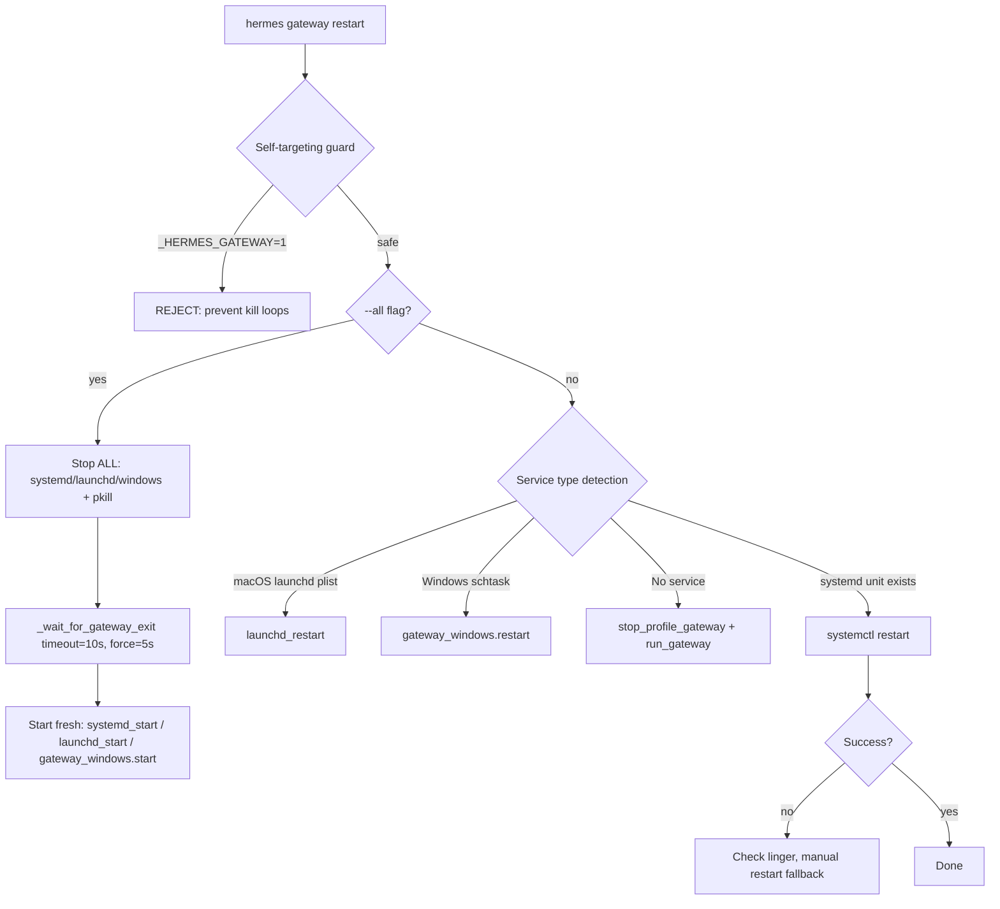

# Hermes CLI — Complete Command Reference + Gateway Restart Logic

## Gateway Restart Backend Logic

The gateway restart is in [gateway.py:L6651-6807](file:///c:/Users/soni8/Desktop/everything/University 2.0/Project(s)/5_Locus/hermes-agent/hermes_cli/gateway.py#L6651-L6807).

### Architecture

### Key patterns ported:

| Pattern | Description |
|---|---|
| **Self-targeting guard** | `if os.getenv("_HERMES_GATEWAY") == "1": REJECT` — prevents restart loops when the gateway's own agent runs restart |
| **Service detection cascade** | `systemd → launchd → windows schtask → manual PID` |
| **`_wait_for_gateway_exit()`** | Polls for process exit with `timeout=10s`, force-kills after `5s` |
| **`stop_profile_gateway()`** | Reads PID file, sends SIGTERM, cleans up PID file |
| **`kill_gateway_processes()`** | `psutil` or `pkill` to find all hermes gateway processes |
| **`--all` flag** | Stops ALL profiles' gateways before restarting current one |

### Files involved:

- [gateway.py](file:///c:/Users/soni8/Desktop/everything/University 2.0/Project(s)/5_Locus/hermes-agent/hermes_cli/gateway.py) — Main gateway logic (6916 lines)
- [gateway_windows.py](file:///c:/Users/soni8/Desktop/everything/University 2.0/Project(s)/5_Locus/hermes-agent/hermes_cli/gateway_windows.py) — Windows-specific service management
- [service_manager.py](file:///c:/Users/soni8/Desktop/everything/University 2.0/Project(s)/5_Locus/hermes-agent/hermes_cli/service_manager.py) — s6/systemd/launchd service abstraction

---

## Complete Hermes CLI Command Catalog

### 1. Core — Chat & Agent

| Command | Description |
|---|---|
| `hermes` | Start interactive chat (default) |
| `hermes chat` | Explicit interactive chat |
| `hermes chat -q "prompt"` | Single query mode (non-interactive) |
| `hermes chat --image path` | Attach image to query |
| `hermes chat -m model` | Override model for this session |
| `hermes chat --provider name` | Override inference provider |
| `hermes chat -t toolsets` | Enable specific toolsets |
| `hermes chat -s skill` | Preload a skill |
| `hermes chat --checkpoints` | Enable filesystem checkpoints |
| `hermes chat --max-turns N` | Limit tool-calling iterations |
| `hermes chat --source tag` | Tag session source for filtering |
| `hermes -z "prompt"` | One-shot mode: stdout only, no UI |
| `hermes -c` | Resume most recent session |
| `hermes -c "name"` | Resume session by name |
| `hermes --resume ID` | Resume session by ID |
| `hermes --worktree` / `-w` | Run in isolated git worktree |
| `hermes --yolo` | Bypass all approval prompts |
| `hermes --tui` | Launch modern TUI |
| `hermes --cli` | Force classic REPL |
| `hermes --ignore-rules` | Skip AGENTS.md, SOUL.md, memory injection |
| `hermes --ignore-user-config` | Ignore config.yaml |

---

### 2. Setup & Configuration

| Command | Description |
|---|---|
| `hermes setup` | Full interactive setup wizard |
| `hermes config` / `hermes config show` | View current configuration |
| `hermes config edit` | Open config.yaml in $EDITOR |
| `hermes config set key value` | Set a config value |
| `hermes config path` | Print config file path |
| `hermes config env-path` | Print .env file path |
| `hermes config check` | Check for missing/outdated config |
| `hermes config migrate` | Update config with new options |

---

### 3. Gateway — Messaging Platform Management

| Command | Description |
|---|---|
| `hermes gateway` / `hermes gateway run` | Run gateway in foreground |
| `hermes gateway run -v` | Verbose mode (INFO) |
| `hermes gateway run -vv` | Debug mode |
| `hermes gateway run --replace` | Replace existing instance |
| `hermes gateway run --no-supervise` | Skip s6 redirection in container |
| `hermes gateway setup` | Configure messaging platforms |
| `hermes gateway start` | Start installed background service |
| `hermes gateway start --all` | Kill all stale processes first |
| `hermes gateway start --system` | Target system-level service |
| `hermes gateway stop` | Stop gateway service |
| `hermes gateway stop --all` | Stop ALL gateway processes |
| `hermes gateway restart` | Restart gateway service |
| `hermes gateway restart --all` | Restart all profiles |
| `hermes gateway status` | Show gateway status |
| `hermes gateway status --deep` | Deep status check |
| `hermes gateway status -l` | Full untruncated output |
| `hermes gateway install` | Install as systemd/launchd/schtask |
| `hermes gateway install --system` | System-level service |
| `hermes gateway install --force` | Force reinstall |
| `hermes gateway uninstall` | Remove gateway service |
| `hermes gateway list` | List all profiles' gateway status |
| `hermes gateway migrate-legacy` | Remove legacy unit files |

---

### 4. Model & Provider Management

| Command | Description |
|---|---|
| `hermes model` | Interactive model selection wizard |
| `hermes model list` | List available models |
| `hermes fallback list` | Show fallback provider chain |
| `hermes fallback add` | Add a fallback provider |
| `hermes fallback remove` | Remove a fallback provider |

---

### 5. Authentication & Credentials

| Command | Description |
|---|---|
| `hermes login` | Authenticate with provider |
| `hermes logout` | Clear stored authentication |
| `hermes auth add provider` | Add a pooled credential |
| `hermes auth list` | List pooled credentials |
| `hermes auth remove p t` | Remove credential by index/id/label |
| `hermes auth reset provider` | Clear exhaustion status |
| `hermes pairing approve platform code` | Approve DM pairing request |
| `hermes pairing list` | List pending pairing requests |

---

### 6. Session Management

| Command | Description |
|---|---|
| `hermes sessions list` | List past sessions |
| `hermes sessions browse` | Interactive session picker with search |
| `hermes sessions rename ID TITLE` | Rename/title a session |
| `hermes sessions delete ID` | Delete a session |

---

### 7. Cron — Scheduled Tasks

| Command | Description |
|---|---|
| `hermes cron list` | List scheduled jobs |
| `hermes cron create SCHEDULE "prompt"` | Create a scheduled job |
| `hermes cron create --script path` | Run script on schedule |
| `hermes cron create --no-agent` | Script-only (skip LLM) |
| `hermes cron create --deliver telegram` | Set delivery target |
| `hermes cron create --workdir /path` | Set working directory |
| `hermes cron edit ID --schedule "1h"` | Edit a job |
| `hermes cron pause ID` | Pause a job |
| `hermes cron resume ID` | Resume a paused job |
| `hermes cron run ID` | Trigger job immediately |
| `hermes cron remove ID` | Delete a job |
| `hermes cron status` | Check if scheduler is running |
| `hermes cron tick` | Run due jobs once (debug) |

---

### 8. Skills Management

| Command | Description |
|---|---|
| `hermes skills browse` | Browse all available skills |
| `hermes skills search query` | Search skill registries |
| `hermes skills install identifier` | Install a skill |
| `hermes skills inspect identifier` | Preview without installing |
| `hermes skills list` | List installed skills |
| `hermes skills check` | Check for updates |
| `hermes skills update` | Update installed skills |
| `hermes skills audit` | Re-scan for security |
| `hermes skills uninstall name` | Remove a skill |
| `hermes skills reset name` | Reset bundled skill tracking |
| `hermes skills config` | Interactive enable/disable |
| `hermes skills publish path` | Publish to registry |
| `hermes skills snapshot export out.json` | Export skill config |
| `hermes skills snapshot import in.json` | Import skill config |
| `hermes skills tap list` | List skill sources |
| `hermes skills tap add repo` | Add GitHub repo as source |
| `hermes skills tap remove name` | Remove a tap |
| `hermes skills opt-out` | Stop bundled skill seeding |
| `hermes skills opt-in` | Re-enable bundled skills |
| `hermes skills repair-official name` | Restore official skills |

---

### 9. Plugins Management

| Command | Description |
|---|---|
| `hermes plugins install identifier` | Install from Git URL/repo |
| `hermes plugins update name` | Pull latest changes |
| `hermes plugins remove name` | Remove a plugin |
| `hermes plugins list` | List installed plugins |
| `hermes plugins enable name` | Enable a disabled plugin |
| `hermes plugins disable name` | Disable without removing |

---

### 10. MCP — Model Context Protocol

| Command | Description |
|---|---|
| `hermes mcp` / `hermes mcp picker` | Interactive catalog picker |
| `hermes mcp serve` | Run Hermes as MCP server |
| `hermes mcp add name --url URL` | Add HTTP/SSE MCP server |
| `hermes mcp add name --command cmd --args ...` | Add stdio MCP server |
| `hermes mcp remove name` | Remove MCP server |
| `hermes mcp list` | List configured servers |
| `hermes mcp test name` | Test server connection |
| `hermes mcp configure name` | Toggle tool selection |
| `hermes mcp login name` | Re-authenticate OAuth MCP |
| `hermes mcp catalog` | List Nous-approved MCPs |
| `hermes mcp install name` | Install catalog MCP |

---

### 11. Tools Configuration

| Command | Description |
|---|---|
| `hermes tools` | Interactive tool configuration UI |
| `hermes tools --summary` | Print enabled tools summary |
| `hermes tools list` | Show all tools status |
| `hermes tools enable name` | Enable toolsets/MCP tools |
| `hermes tools disable name` | Disable toolsets/MCP tools |
| `hermes tools post-setup KEY` | Run provider install hook |

---

### 12. Profile Management

| Command | Description |
|---|---|
| `hermes profile list` | List all profiles |
| `hermes profile use name` | Set sticky default profile |
| `hermes profile create name` | Create new profile |
| `hermes profile create name --clone` | Clone from active profile |
| `hermes profile delete name` | Delete a profile |
| `hermes profile rename old new` | Rename a profile |
| `hermes profile show name` | Show profile details |
| `hermes profile describe name --auto` | Auto-generate description |
| `hermes profile alias name` | Create wrapper script |
| `hermes profile export name` | Export to archive |
| `hermes profile import archive` | Import from archive |
| `hermes profile install source` | Install distribution from git |
| `hermes profile update name` | Re-pull distribution updates |
| `hermes profile info name` | Show distribution manifest |
| `hermes -p name ...` | Run any command as profile |

---

### 13. Memory Management

| Command | Description |
|---|---|
| `hermes memory` / `hermes memory setup` | Interactive provider picker |
| `hermes memory setup honcho` | Configure specific provider |
| `hermes memory status` | Show current memory config |
| `hermes memory off` | Disable external provider |
| `hermes memory reset` | Erase all built-in memory |
| `hermes honcho setup` | Configure Honcho integration |
| `hermes honcho status` | Show Honcho connection |
| `hermes honcho sessions` | List directory→session mappings |
| `hermes honcho map name` | Map directory to session |
| `hermes honcho peer` | Show/set peer names |
| `hermes honcho mode` | Show/set memory mode |
| `hermes honcho tokens` | Show/set token budgets |
| `hermes honcho identity` | Show/seed AI identity |
| `hermes honcho migrate` | Migration guide |

---

### 14. Platform-Specific Setup

| Command | Description |
|---|---|
| `hermes whatsapp` | WhatsApp setup wizard (mode, bridge, QR) |
| `hermes slack` | Slack workspace configuration |

---

### 15. Dashboard (Web UI)

| Command | Description |
|---|---|
| `hermes dashboard` | Start web UI (port 9119) |
| `hermes dashboard --port 8080` | Custom port |
| `hermes dashboard --host 0.0.0.0 --insecure` | Expose on LAN |
| `hermes dashboard --no-open` | Don't open browser |
| `hermes dashboard --stop` | Stop all dashboards |
| `hermes dashboard --status` | List running dashboards |
| `hermes dashboard register` | Register OAuth client |

---

### 16. Proxy — Local OpenAI-Compatible

| Command | Description |
|---|---|
| `hermes proxy start` | Run proxy (forwards to OAuth provider) |
| `hermes proxy start --provider xai` | Specify upstream |
| `hermes proxy start --port 8645` | Custom port |
| `hermes proxy status` | Show ready upstreams |
| `hermes proxy providers` | List available providers |

---

### 17. Diagnostics & Debugging

| Command | Description |
|---|---|
| `hermes doctor` | Check configuration and dependencies |
| `hermes status` | Show status of all components |
| `hermes debug share` | Upload debug report for support |
| `hermes logs` | View agent.log (last 50 lines) |
| `hermes logs -f` | Follow agent.log in real time |
| `hermes logs errors` | View errors.log |
| `hermes logs --since 1h` | Lines from last hour |
| `hermes dump` | Dump configuration state |
| `hermes prompt-size` | Analyze prompt token usage |

---

### 18. Security

| Command | Description |
|---|---|
| `hermes security audit` | Security audit of config |
| `hermes security advisories` | Check for known vulnerabilities |

---

### 19. Lifecycle & System

| Command | Description |
|---|---|
| `hermes version` / `hermes --version` | Show version |
| `hermes update` | Update to latest version |
| `hermes uninstall` | Uninstall Hermes Agent |
| `hermes backup` | Backup configuration/state |
| `hermes import` | Import external agent config |
| `hermes hooks` | Manage shell hooks |
| `hermes webhook` | Manage webhook integrations |
| `hermes insights` | Usage insights and analytics |

---

### 20. Advanced / Integration

| Command | Description |
|---|---|
| `hermes acp` | Run as ACP server (editor integration) |
| `hermes claw` | Claw migration commands |
| `hermes claw migrate` | Migrate from another agent |
| `hermes gui` | Desktop GUI management |

---

## Summary Statistics

| Category | Commands |
|---|---|
| Core Chat | ~20 flags |
| Setup & Config | 7 subcommands |
| Gateway | 12 subcommands |
| Model & Auth | 9 commands |
| Sessions | 4 subcommands |
| Cron | 9 subcommands |
| Skills | 18 subcommands |
| Plugins | 6 subcommands |
| MCP | 11 subcommands |
| Tools | 5 subcommands |
| Profiles | 14 subcommands |
| Memory/Honcho | 14 commands |
| Dashboard | 5 flags/subs |
| Proxy | 4 subcommands |
| Diagnostics | 8 commands |
| Lifecycle | 8 commands |
| **Total** | **~150+ commands** |
