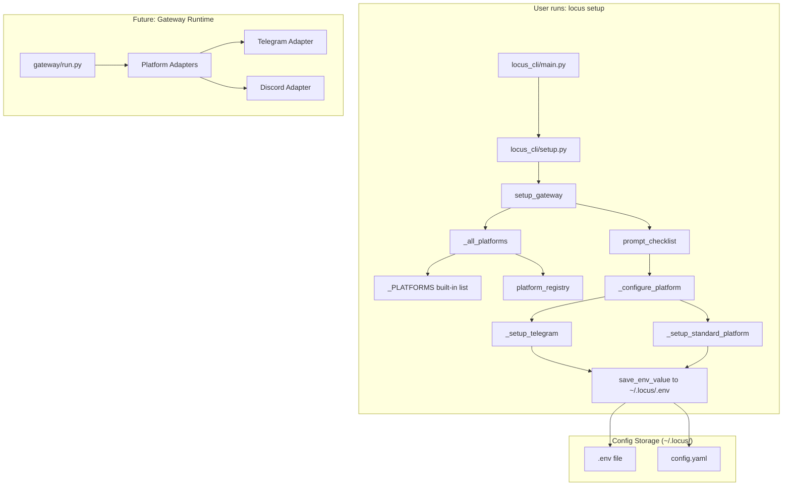

# Locus Gateway & Setup Service — Port from Hermes Agent

Build the messaging gateway and interactive setup flow for Locus by adapting the `hermes-agent` architecture. When a user runs `locus setup`, they pick a messaging platform (Telegram, Discord, etc.), configure it, and then continue interacting with Locus from that platform.

## User Review Required

> [!IMPORTANT]
> **Scope Decision: Telegram-first or All Platforms?**
> Hermes supports 15+ platforms. For Locus, the master doc says Telegram is the primary interface. Should we:
> - **Option A:** Port only Telegram support now (matches master doc — "Telegram is the ambient interface")
> - **Option B:** Port the full platform registry so all platforms are available from day one
>
> The plan below assumes **Option A** (Telegram-first) with the registry architecture in place so adding platforms later is trivial. If you want all platforms now, say so.

> [!IMPORTANT]
> **Config Storage Location**
> Hermes uses `~/.hermes/` for config/env files. Locus should use `~/.locus/`. Confirm this is correct.

> [!WARNING]
> **This is Locus's first code.** The `locus-os` repo currently has zero source code — only docs in `Ideas and System/`. This plan creates the entire initial Python project structure.

## Open Questions

> [!IMPORTANT]
> **Python Package Name:** Should the CLI module be `locus_cli` (matching Hermes's `hermes_cli`)? Or just `locus`?

> [!IMPORTANT]
> **CLI Entry Point:** Should the command be `locus setup` (like `hermes setup`)? Or `locus-setup` / `locus init`?

## Proposed Changes

### What We're Stealing from Hermes (and What We're NOT)

**TAKING:**
| Component | From Hermes | Why |
|---|---|---|
| Platform Registry pattern | `gateway/platform_registry.py` | Decoupled platform registration — plug-in architecture |
| Platform config schema | `gateway/config.py` (`PlatformConfig`, `GatewayConfig`) | Config data model |
| Interactive setup wizard | `hermes_cli/setup.py` (prompt helpers, `setup_gateway()`) | The TUI flow |
| Platform definitions | `hermes_cli/gateway.py` (`_PLATFORMS`, `_all_platforms`, `_configure_platform`) | Platform metadata + setup instructions |
| Config/env persistence | `hermes_cli/config.py` (load/save config, `.env` read/write) | Config file management |
| Color/output helpers | `hermes_cli/colors.py`, `hermes_cli/cli_output.py` | Terminal formatting |
| Curses TUI elements | `hermes_cli/curses_ui.py` | Arrow-key menus, checklists |

**NOT TAKING (yet):**
| Component | Why Not |
|---|---|
| Gateway runtime (`gateway/run.py`) | Locus uses FastAPI on a VM, not a local gateway daemon |
| Service manager (systemd/launchd/schtasks) | Locus runs server-side, not as a local service |
| Agent/LLM pipeline | Locus has its own architecture (Master Conductor, Query Router, etc.) |
| All 15+ platform adapters | Telegram-first; others added later |
| Plugin discovery system | Over-engineered for v1 |

---

### Component 1: Project Skeleton

#### [NEW] [pyproject.toml](file:///c:/Users/soni8/Desktop/everything/University 2.0/Project(s)/5_Locus/locus-os/pyproject.toml)
- Package metadata for `locus-os`
- Entry point: `locus = "locus_cli.main:main"`
- Dependencies: `pyyaml`, `python-dotenv`

#### [NEW] [locus_cli/__init__.py](file:///c:/Users/soni8/Desktop/everything/University 2.0/Project(s)/5_Locus/locus-os/locus_cli/__init__.py)
- Package init

#### [NEW] [locus_cli/main.py](file:///c:/Users/soni8/Desktop/everything/University 2.0/Project(s)/5_Locus/locus-os/locus_cli/main.py)
- CLI entry point with `argparse`
- Subcommands: `setup`, `config`, `version`
- `locus setup` → runs the full wizard
- `locus setup gateway` → runs only the gateway/platform section

---

### Component 2: Config & Environment Management

Adapted from Hermes's `hermes_cli/config.py`. Stripped to essentials.

#### [NEW] [locus_cli/config.py](file:///c:/Users/soni8/Desktop/everything/University 2.0/Project(s)/5_Locus/locus-os/locus_cli/config.py)
- `get_locus_home()` → `~/.locus/` (or `LOCUS_HOME` env override)
- `ensure_locus_home()` → create dir if missing
- `get_config_path()` → `~/.locus/config.yaml`
- `get_env_path()` → `~/.locus/.env`
- `load_config()` / `save_config()` — YAML read/write
- `get_env_value(key)` / `save_env_value(key, value)` / `remove_env_value(key)` — `.env` file management
- Default config skeleton with `gateway.platforms` section

---

### Component 3: Terminal UI Helpers

Adapted from Hermes's `hermes_cli/colors.py`, `hermes_cli/cli_output.py`, `hermes_cli/curses_ui.py`.

#### [NEW] [locus_cli/colors.py](file:///c:/Users/soni8/Desktop/everything/University 2.0/Project(s)/5_Locus/locus-os/locus_cli/colors.py)
- ANSI color codes enum
- `color(text, *styles)` helper
- Auto-detect terminal color support

#### [NEW] [locus_cli/cli_output.py](file:///c:/Users/soni8/Desktop/everything/University 2.0/Project(s)/5_Locus/locus-os/locus_cli/cli_output.py)
- `print_header()`, `print_info()`, `print_success()`, `print_warning()`, `print_error()`
- Consistent formatting across all CLI output

#### [NEW] [locus_cli/prompts.py](file:///c:/Users/soni8/Desktop/everything/University 2.0/Project(s)/5_Locus/locus-os/locus_cli/prompts.py)
- `prompt(question, default, password)` — basic input
- `prompt_choice(question, choices, default)` — arrow-key single-select (curses)
- `prompt_yes_no(question, default)` — Y/N
- `prompt_checklist(title, items, pre_selected)` — multi-select (curses)
- Curses fallback to numbered input when terminal doesn't support it

#### [NEW] [locus_cli/curses_ui.py](file:///c:/Users/soni8/Desktop/everything/University 2.0/Project(s)/5_Locus/locus-os/locus_cli/curses_ui.py)
- `curses_radiolist()` — arrow-key radio selection
- `curses_checklist()` — arrow-key checkbox selection
- Adapted from Hermes's curses_ui.py (cross-platform: works on Windows via `windows-curses`)

---

### Component 4: Platform Registry & Gateway Config

The core architecture — decoupled platform registration.

#### [NEW] [gateway/__init__.py](file:///c:/Users/soni8/Desktop/everything/University 2.0/Project(s)/5_Locus/locus-os/gateway/__init__.py)

#### [NEW] [gateway/platform_registry.py](file:///c:/Users/soni8/Desktop/everything/University 2.0/Project(s)/5_Locus/locus-os/gateway/platform_registry.py)
- `PlatformEntry` dataclass: `name`, `label`, `emoji`, `adapter_factory`, `check_fn`, `setup_fn`, `required_env`, `install_hint`, `is_connected`
- `PlatformRegistry` class: `register()`, `get()`, `all_entries()`, `plugin_entries()`
- Singleton `platform_registry` instance
- Adapted from Hermes's `gateway/platform_registry.py`

#### [NEW] [gateway/config.py](file:///c:/Users/soni8/Desktop/everything/University 2.0/Project(s)/5_Locus/locus-os/gateway/config.py)
- `Platform` enum: `TELEGRAM` (expandable)
- `PlatformConfig` dataclass: `enabled`, `allowed_users`, `home_channel`
- `GatewayConfig` dataclass: `platforms` dict
- `load_gateway_config()` / `save_gateway_config()`

---

### Component 5: Setup Wizard — The Main Flow

The interactive CLI setup that runs on `locus setup`.

#### [NEW] [locus_cli/setup.py](file:///c:/Users/soni8/Desktop/everything/University 2.0/Project(s)/5_Locus/locus-os/locus_cli/setup.py)
- `run_setup()` — full wizard orchestrator
  1. Print Locus branded banner
  2. `ensure_locus_home()` — create `~/.locus/` if needed
  3. **Platform selection** — "Where will you interact with Locus?" → checklist of platforms
  4. **Platform configuration** — for each selected platform, run its setup flow (env vars, tokens, etc.)
  5. Print setup summary showing configured platforms and next steps

#### [NEW] [locus_cli/setup_gateway.py](file:///c:/Users/soni8/Desktop/everything/University 2.0/Project(s)/5_Locus/locus-os/locus_cli/setup_gateway.py)
- `_PLATFORMS` list — platform metadata dicts (adapted from Hermes gateway.py L3966-4300)
  - Each platform has: `key`, `label`, `emoji`, `token_var`, `setup_instructions`, `vars`
  - **v1 includes:** Telegram (full), Discord (placeholder), Slack (placeholder), WhatsApp (placeholder), Email (placeholder)
- `_all_platforms()` → merges built-in + registry
- `_platform_status(platform)` → "configured" / "not configured" / "partially configured"
- `_configure_platform(platform)` → dispatch to platform-specific setup
- `_setup_telegram()` → interactive Telegram bot token + user ID setup
- `_setup_standard_platform(platform)` → generic env-var prompt loop for any platform with `vars`
- `setup_gateway(config)` → the checklist-driven platform config wizard

---

### Component 6: Telegram Platform Setup (Full Implementation)

#### Telegram setup flow (inside `setup_gateway.py`):
```
  ─── 📱 Telegram Setup ───

  1. Open Telegram and message @BotFather
  2. Send /newbot and follow the prompts
  3. Copy the bot token

  Bot token: ********
  ✓ Saved

  Allowed user IDs (comma-separated): 123456789
  ✓ Saved

  Home channel ID: 123456789
  ✓ Saved

  ✓ Telegram configured!
  Continue setup from Telegram by messaging your bot.
```

---

## Architecture Diagram



---

## File Tree (Final State)

```
locus-os/
├── pyproject.toml
├── locus_cli/
│   ├── __init__.py
│   ├── main.py              # CLI entry point
│   ├── config.py             # Config/env management
│   ├── colors.py             # ANSI color helpers
│   ├── cli_output.py         # Print helpers
│   ├── prompts.py            # Interactive prompts
│   ├── curses_ui.py          # Arrow-key menus
│   ├── setup.py              # Full setup wizard
│   └── setup_gateway.py      # Platform setup logic
├── gateway/
│   ├── __init__.py
│   ├── platform_registry.py  # Plugin-style platform registration
│   └── config.py             # Gateway config schema
└── Ideas and System/
    └── ... (existing docs)
```

## Verification Plan

### Manual Verification
1. Run `pip install -e .` in the locus-os directory
2. Run `locus setup` — verify the full wizard flow:
   - Banner displays
   - Platform checklist appears with arrow-key navigation
   - Selecting Telegram shows setup instructions
   - Bot token prompt works (masked input)
   - Values saved to `~/.locus/.env`
   - Summary shows "Telegram: configured"
3. Run `locus setup gateway` — verify it jumps straight to platform selection
4. Run `locus config` — verify it shows current config
5. Verify `~/.locus/config.yaml` and `~/.locus/.env` are created correctly
