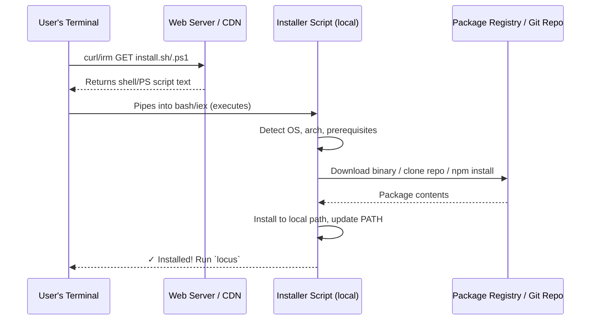
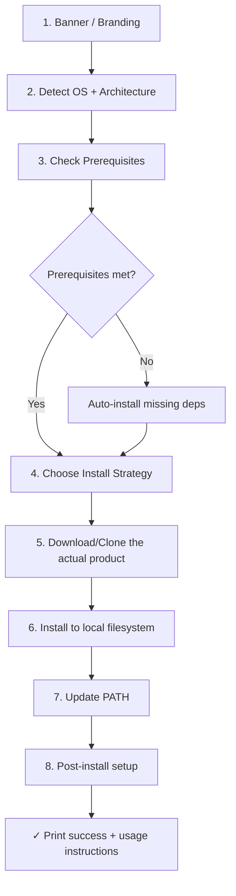
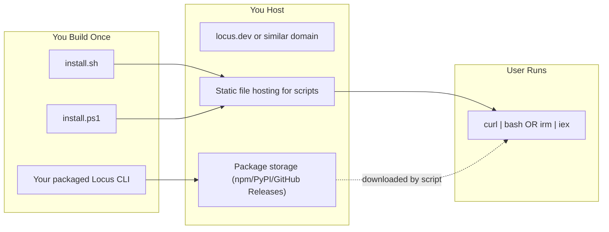

# How `curl | bash` Installers Work — And How to Build One for Locus

## The Big Picture

These one-liner installers follow a deceptively simple pattern that hides significant engineering:

```
User's terminal → HTTP GET to a URL → Server returns a shell script → Shell executes it
```



There is **no magic backend**. Let me break down exactly what's happening.

---

## Layer 1: The Web Server (The "Backend")

> [!IMPORTANT]
> The "backend" is just a **static file server** returning a script. There is no API, no database, no auth.

### What serves the script?

| Agent | URL | What's actually serving it |
|-------|-----|---------------------------|
| **Pi** | `https://pi.dev/install.ps1` | A CDN/static hosting (likely Cloudflare Pages, Vercel, or S3+CloudFront). The `.ps1` file is just a static asset. |
| **Hermes** | `https://hermes-agent.nousresearch.com/install.sh` | Same idea — a static file hosted on their domain. Could be GitHub Pages, Netlify, a simple nginx, or even a raw GitHub blob behind a domain. |

### How the one-liner works mechanically:

**PowerShell (Pi):**
```powershell
powershell -c "irm https://pi.dev/install.ps1 | iex"
```
- `irm` = `Invoke-RestMethod` — does an HTTP GET, returns the response body as a string
- `|` pipes that string to `iex` = `Invoke-Expression` — executes the string as PowerShell code
- Equivalent to: "download this text file, then run it as code"

**Bash (Hermes):**
```bash
curl -fsSL https://hermes-agent.nousresearch.com/install.sh | bash
```
- `curl -fsSL` = download silently, follow redirects, fail on HTTP errors
- `| bash` = pipe the downloaded text into a bash interpreter
- Same concept: "download this text file, then run it as code"

---

## Layer 2: What the Script Actually Does

Both installers follow the **same fundamental algorithm**. Here's the universal pattern:



### Detailed comparison:

| Step | Pi Agent (npm-based) | Hermes Agent (git+venv-based) |
|------|---------------------|-------------------------------|
| **Branding** | Animated tetris-like logo in terminal (300+ lines of ANSI art!) | Simple ASCII banner box |
| **OS Detection** | Checks `Win32NT`, redirects Unix to `install.sh` | `uname -s` → linux/macos/android/windows |
| **Prerequisites** | Node.js ≥22.19 + npm | Python 3.11 + Git + Node.js (for browser tools) |
| **Auto-install deps** | Downloads Node.js `.zip` from nodejs.org, extracts to `%LOCALAPPDATA%\pi-node` | Uses `uv` to install Python, `apt/brew/pkg` for git |
| **Package source** | **npm registry** (`@earendil-works/pi-coding-agent`) | **Git clone** from GitHub (`NousResearch/hermes-agent.git`) |
| **Install method** | `npm install -g` (global npm package) | `git clone` + `uv venv` + `pip install` |
| **Where it lands** | npm global prefix (`%APPDATA%\npm`) | `~/.hermes/hermes-agent` (or `/usr/local/lib/hermes-agent` for root) |
| **PATH update** | Modifies Windows Registry `HKCU:\Environment\Path` + broadcasts `WM_SETTINGCHANGE` | Symlinks `hermes` into `~/.local/bin` |
| **Post-install** | None (Pi is self-contained after npm install) | Interactive setup wizard for API keys, optional Playwright browser install |

---

## Layer 3: The Two Main Architecture Patterns

### Pattern A: **npm Package** (Pi's approach)

```
Your code → npm publish → npm registry → user runs `npm install -g`
```

- Your CLI tool is a Node.js package published to npmjs.com
- The installer script is essentially a fancy wrapper around `npm install -g your-package`
- Most of the script is handling edge cases: Node not installed, npm prefix not writable, PATH issues

**Pros:** Simple distribution, automatic updates via `npm update -g`, no git needed on user machine
**Cons:** Requires Node.js, limited to JS/TS ecosystem, npm registry dependency

### Pattern B: **Git Clone + Virtual Environment** (Hermes's approach)

```
Your code → GitHub repo → user's machine clones it → creates isolated env → installs deps
```

- The actual product lives in a GitHub repo
- Installer clones the repo, creates a Python venv (or similar), installs dependencies
- A symlink/wrapper script is created in a PATH directory

**Pros:** Works with any language, full source on user machine, easy to hack/modify
**Cons:** Requires git, larger install, more complex update mechanism

### Pattern C: **Pre-built Binary** (Rust/Go CLI tools — most modern approach)

```
Your code → CI/CD builds binaries → GitHub Releases / CDN → installer downloads correct binary
```

- Build platform-specific binaries in CI (e.g., GitHub Actions)
- Installer detects OS+arch, downloads the right binary, places it on PATH
- Used by: `rustup`, `deno`, `bun`, etc.

**Pros:** Zero runtime dependencies, fastest install, smallest footprint
**Cons:** Requires cross-compilation setup, harder for Python/JS projects

---

## How to Build This for Locus

### What You Need



### Step-by-step to make `curl -fsSL https://locus.dev/install.sh | bash` work:

#### 1. **Get a domain** (or use a GitHub raw URL)
   - Best: `locus.dev` or `getlocus.dev`
   - Free alternative: `https://raw.githubusercontent.com/youruser/locus-os/main/install.sh`
   - GitHub Pages: `https://youruser.github.io/locus-os/install.sh`

#### 2. **Package your Locus CLI**
   Based on your project, you'll likely want one of:

   | If Locus is... | Package as... | Install via... |
   |-----------------|---------------|----------------|
   | Python-based | PyPI package | `pip install locus-os` (script wraps this) |
   | Node.js-based | npm package | `npm install -g locus-os` (like Pi) |
   | Rust/Go binary | GitHub Release binary | Direct download (like Deno/Bun) |
   | Multi-language | Git clone | Clone + setup (like Hermes) |

#### 3. **Write the installer scripts**
   
   The minimal skeleton for `install.sh`:
   ```bash
   #!/bin/bash
   set -e
   
   # === Branding ===
   echo "🧠 Locus OS Installer"
   
   # === Detect OS + Arch ===
   OS=$(uname -s | tr '[:upper:]' '[:lower:]')
   ARCH=$(uname -m)
   
   # === Check/Install Prerequisites ===
   # (python, node, git — whatever Locus needs)
   
   # === Download/Install Locus ===
   # Option A: pip install locus-os
   # Option B: npm install -g locus-os  
   # Option C: Download binary from GitHub Releases
   # Option D: git clone + venv setup
   
   # === Update PATH ===
   # Add install location to PATH in ~/.bashrc, ~/.zshrc, etc.
   
   # === Post-install ===
   echo "✓ Locus installed! Run: locus"
   ```

#### 4. **Host the script**
   
   Simplest options:
   - **GitHub Pages**: Free, automatic HTTPS, just push to a `gh-pages` branch
   - **Vercel/Netlify**: Free tier, custom domain support, auto-deploy from Git
   - **Cloudflare Pages**: Free, global CDN, excellent performance
   - **Raw GitHub**: `https://raw.githubusercontent.com/...` (no custom domain but works)

#### 5. **Set up the domain DNS**
   Point your domain to wherever you host the script.

---

## The Minimal Viable Installer

> [!TIP]
> You don't need 2800 lines like Hermes or 1100 lines like Pi. Start with ~100 lines and grow.

Here's what a **real, production-ready minimal installer** looks like:

```bash
#!/bin/bash
set -euo pipefail

LOCUS_VERSION="${LOCUS_VERSION:-latest}"
INSTALL_DIR="${LOCUS_HOME:-$HOME/.locus}"

# Colors
RED='\033[0;31m'; GREEN='\033[0;32m'; CYAN='\033[0;36m'; NC='\033[0m'; BOLD='\033[1m'

info()    { echo -e "${CYAN}→${NC} $1"; }
success() { echo -e "${GREEN}✓${NC} $1"; }
error()   { echo -e "${RED}✗${NC} $1" >&2; exit 1; }

# Banner
echo -e "\n${BOLD}🧠 Locus OS Installer${NC}\n"

# Detect platform
OS=$(uname -s | tr '[:upper:]' '[:lower:]')
ARCH=$(uname -m)
case "$ARCH" in
    x86_64)        ARCH="amd64" ;;
    aarch64|arm64) ARCH="arm64" ;;
    *)             error "Unsupported architecture: $ARCH" ;;
esac
success "Detected: $OS/$ARCH"

# Check prerequisites
command -v git  >/dev/null 2>&1 || error "Git is required. Install it first."
command -v python3 >/dev/null 2>&1 || error "Python 3 is required. Install it first."
success "Prerequisites OK"

# Clone or update
if [ -d "$INSTALL_DIR/.git" ]; then
    info "Updating existing installation..."
    git -C "$INSTALL_DIR" pull --ff-only
else
    info "Cloning Locus OS..."
    git clone https://github.com/youruser/locus-os.git "$INSTALL_DIR"
fi
success "Source ready at $INSTALL_DIR"

# Create venv + install
info "Setting up Python environment..."
python3 -m venv "$INSTALL_DIR/.venv"
"$INSTALL_DIR/.venv/bin/pip" install -e "$INSTALL_DIR" --quiet
success "Dependencies installed"

# Create command link
LINK_DIR="$HOME/.local/bin"
mkdir -p "$LINK_DIR"
ln -sf "$INSTALL_DIR/.venv/bin/locus" "$LINK_DIR/locus"

# Ensure PATH
if [[ ":$PATH:" != *":$LINK_DIR:"* ]]; then
    for rc in ~/.bashrc ~/.zshrc; do
        [ -f "$rc" ] && echo "export PATH=\"$LINK_DIR:\$PATH\"" >> "$rc"
    done
    info "Added $LINK_DIR to PATH (restart your shell)"
fi

echo -e "\n${GREEN}${BOLD}✓ Locus OS installed!${NC}"
echo -e "  Run: ${BOLD}locus${NC}\n"
```

---

## Summary: What's Really Going On

| Layer | What it is | Complexity |
|-------|-----------|------------|
| **The URL** | A static file server returning text | Trivial — any web host works |
| **The script** | A shell script that automates `git clone` + `pip install` (or `npm install -g`) | Medium — OS detection, error handling, PATH management |
| **The package** | Your actual CLI tool, packaged for distribution | Depends on your tech stack |
| **The domain** | Nice-to-have vanity URL | Optional — GitHub raw URLs work too |

> [!IMPORTANT]  
> **The "backend" is literally just a web server returning a text file.** There's no API, no authentication, no server-side logic. The entire intelligence is in the script itself, which runs on the user's machine.

### For Locus, the decision tree is:

1. **What language is Locus written in?** → determines packaging strategy
2. **Where will you host the source?** → GitHub (most likely)
3. **Where will you host the install script?** → GitHub Pages (free) or a custom domain
4. **How fancy should the installer be?** → Start minimal (~100 lines), add polish later
