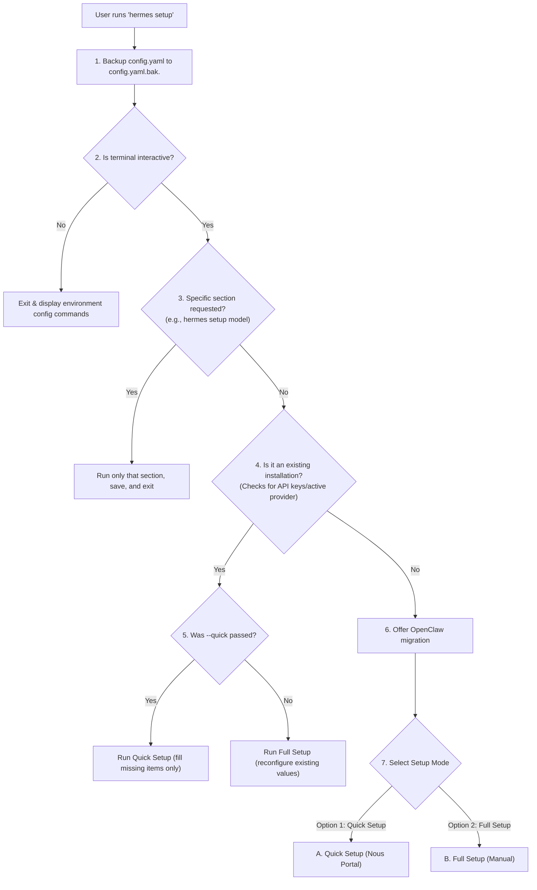
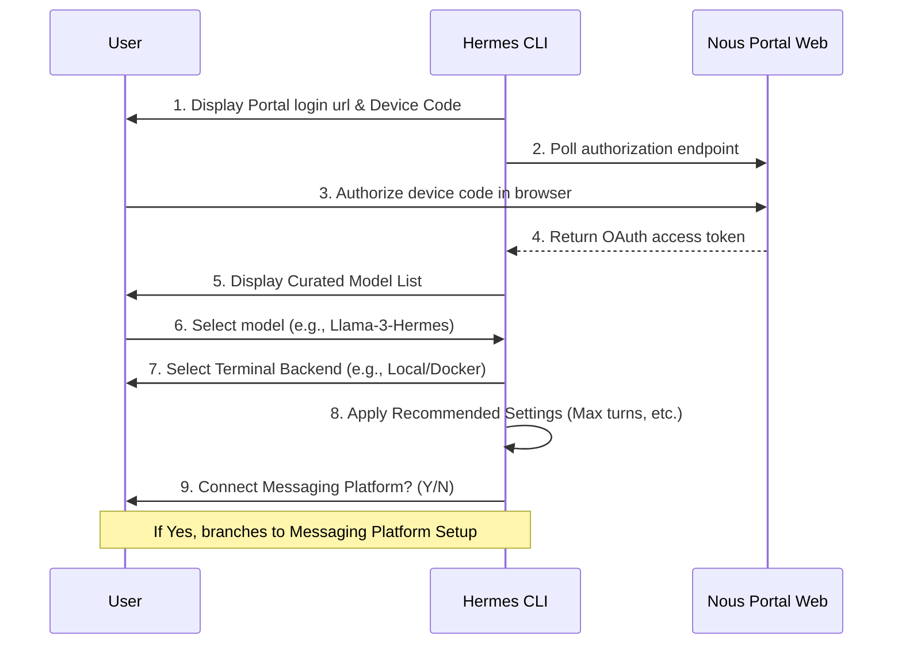
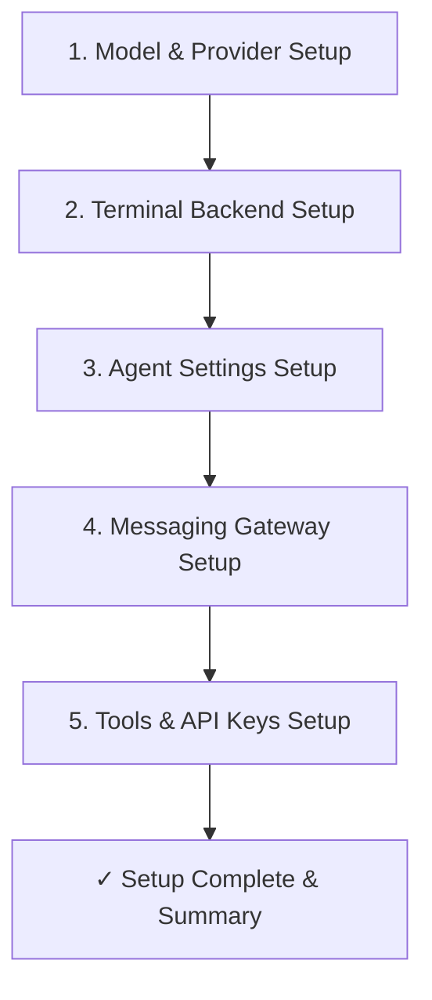

# Hermes Setup Codebase Deep-Dive & Walkthrough Guide

This document presents a detailed, atomic breakdown of the setup process in the `hermes-agent` codebase (`hermes_cli/setup.py`). It explains what happens under the hood when a user types `hermes setup`, covering the automatic (Quick) and manual (Full) setup flows, configuration file interactions, and background service installations.

---

## 🗺️ Architectural Flow Chart

The following diagram illustrates the entry point and branching paths of the setup wizard:

---

## ⚙️ Configuration Files & State

Hermes maintains its state in a dedicated home directory (defaults to `~/.hermes/`):

*   **`~/.hermes/config.yaml`**: The main configuration file containing model preferences, terminal backend options, enabled toolsets, and agent behaviors.
*   **`~/.hermes/.env`**: The secrets file containing API keys, OAuth tokens, and system settings.
*   **`~/.hermes/config.yaml.bak.*`**: Automated timestamped backups created immediately upon running setup.

---

## 🧩 Setup Flow Deep-Dive

### 1. Initialization and Safety Checks
Before presenting any options to the user, the orchestrator:
1.  **Backs Up State**: Copies the current `config.yaml` to `config.yaml.bak.YYYYMMDD_HHMMSS`.
2.  **Verifies Interaction Mode**: Checks `sys.stdin.isatty()`. If no interactive TTY is found (e.g., in Docker, headless SSH, or CI/CD), the script prints standard CLI commands (`hermes config set <key> <value>`) and aborts.
3.  **Probes Migration**: Offers to import data from `OpenClaw` (if found in the environment).

---

### A. Quick Setup (Nous Portal / Automatic Mode)
This is the recommended path for first-time users. It skips complex API key configurations by using the **Nous Portal** as a unified endpoint for model hosting and auxiliary services.

#### Step-by-Step Flow:
1.  **Nous Portal Authentication (`_model_flow_nous`)**:
    *   Initiates Google/GitHub OAuth login via loopback or device-code flow.
    *   Instructs the user to open `https://portal.nousresearch.com` and paste the displayed device code.
    *   Polls the authorization server until the token is returned, then writes credentials to the local auth store.
2.  **Portal Model Selection**:
    *   Determines if the account is on the **Free** or **Paid** tier.
    *   Pulls curated, agent-ready model recommendations matching the tier (e.g., Llama/Qwen variants optimized for tool calling).
    *   Prompts the user to pick their default chat model.
3.  **Terminal Backend Selection**:
    *   Asks the user where command execution tools should run.
    *   *Choices:* **Local** (directly on machine), **Docker** (isolated sandbox), **Modal** (serverless cloud), **SSH** (remote server), or **Daytona** (dev workspace).
4.  **Automatic Defaults**:
    *   Silently sets up key agent parameters to prevent token inflation:
        *   `agent.max_turns` = `150` (Maximum iterations per session)
        *   `display.tool_progress` = `all` (Show short summaries of tool calls)
        *   `compression.enabled` = `True` / `threshold` = `0.50` (Summarize context when 50% full)
        *   `session_reset.mode` = `none` (Do not automatically clear chat history)
5.  **Platform Handoff**:
    *   Asks: *"Connect a messaging platform? (Telegram, Discord, etc.)"*
    *   If yes, loops into the Messaging Gateway configuration. If no, completes setup.

---

### B. Full Setup (Manual Mode)
This mode requires the user to manually configure their own models, API endpoints, keys, and advanced tool parameters.

#### Step-by-Step Flow:

#### 1. Model & Provider Configuration
Delegates to the shared `select_provider_and_model()` routing logic. The user selects from:
*   **OpenRouter**: Prompts for `OPENROUTER_API_KEY`.
*   **OpenAI**: Prompts for `OPENAI_API_KEY` and optional `OPENAI_ORGANIZATION`.
*   **Anthropic**: Offers OAuth browser setup or manual `ANTHROPIC_API_KEY` pasting.
*   **Google Gemini**: Prompts for `GEMINI_API_KEY`/`GOOGLE_API_KEY`.
*   **DeepSeek**: Prompts for `DEEPSEEK_API_KEY`.
*   **xAI Grok**: Prompts for xAI OAuth browser login or a manual `XAI_API_KEY`.
*   **Custom**: Allows configuring any OpenAI-compatible API base URL (e.g., Local Llama.cpp, Ollama, vLLM) and optional API keys. Prompts to auto-append `/v1` if local and missing.

#### 2. Terminal Execution Backend
The user picks where the agent is allowed to execute terminal commands:
*   **Local**: Runs directly on the system. Default working directory (`cwd`) is set to the home directory.
*   **Docker**: Verifies if the `docker` binary exists. Sets default image to `nikolaik/python-nodejs:python3.11-nodejs20`.
*   **Modal**: Prompts whether to bill to the Nous subscription (managed) or use a direct Modal account (`MODAL_TOKEN_ID` and `MODAL_TOKEN_SECRET`). Installs the `modal` Python package.
*   **Daytona**: Prompts for `DAYTONA_API_KEY` and default workspace image. Installs the `daytona` Python package.
*   **SSH**: Prompts for SSH host/IP, user, port, and private key path. Tests the connection with a dry-run shell call (`ssh ... echo ok`).
*   **Singularity (Linux only)**: Checks for the `apptainer`/`singularity` binary. Sets the container image path.

#### 3. Agent Behavior Settings
*   **Max Iterations**: Controls the tool-calling loop limit (e.g., 90 vs 150+).
*   **Tool Progress**: Configures the UI verbosity level (`off`, `new`, `all`, `verbose`).
*   **Context Compression**: Configures the trigger threshold (0.50 to 0.95) for summarizing past messages.
*   **Session Reset Policy**: Determines when long-running conversation history gets wiped and archived:
    *   `both`: Reset on N minutes of inactivity OR at a fixed hour.
    *   `idle`: Reset only after inactivity (prompts for idle minutes).
    *   `daily`: Reset at a fixed hour (prompts for local hour 0-23).
    *   `none`: Do not auto-reset (history is managed purely by compression).

#### 4. Messaging Platforms (Gateway)
Presents a checklist of messaging platforms to activate:

| Platform | Verification / Setup Flow | Required Secret Keys | Security Settings |
| :--- | :--- | :--- | :--- |
| **Telegram** | QR code auto-onboarding or manual token entry | `TELEGRAM_BOT_TOKEN`, `TELEGRAM_HOME_CHANNEL` | Prompts user to allow detected owner ID or provide an allowlist. Falls back to DM pairing or open access. |
| **Slack** | Guided socket mode app setup | `SLACK_BOT_TOKEN`, `SLACK_APP_TOKEN`, `SLACK_ALLOWED_USERS` | Restricts command invocation to specified workspace members. |
| **Matrix** | element access token / user credentials | `MATRIX_HOMESERVER`, `MATRIX_ACCESS_TOKEN` / `MATRIX_PASSWORD` | Optional E2EE support (requires `mautrix` library). |
| **Mattermost** | Mattermost Bot Account token | `MATTERMOST_URL`, `MATTERMOST_TOKEN` | Optional threaded reply mode configuration. |
| **WhatsApp** | Cloud API registration guide | `WHATSAPP_ENABLED` (paired via WhatsApp QR scan flow) | - |
| **Signal** | signal-cli daemon URL | `SIGNAL_HTTP_URL`, `SIGNAL_ACCOUNT` | - |
| **Email** | Dedicated IMAP/SMTP connection | `EMAIL_ADDRESS`, `EMAIL_PASSWORD`, `EMAIL_IMAP_HOST`, `EMAIL_SMTP_HOST` | Restricts access to allowed sender addresses. |
| **SMS (Twilio)** | Account credentials & phone number | `TWILIO_ACCOUNT_SID`, `TWILIO_AUTH_TOKEN`, `TWILIO_PHONE_NUMBER` | - |
| **DingTalk** | Application key credentials | `DINGTALK_CLIENT_ID`, `DINGTALK_CLIENT_SECRET` | - |
| **Feishu/Lark** | Workspace App credentials | `FEISHU_APP_ID`, `FEISHU_APP_SECRET` | - |
| **WeCom** | Enterprise WeChat bot config | `WECOM_BOT_ID`, `WECOM_SECRET` | - |

> [!TIP]
> **Gateway Background Service Setup**:
> If any messaging platforms are configured, the wizard attempts to register the gateway as a background service:
> *   **Linux**: Configures a user or system scope `systemd` service (`hermes-gateway.service`).
> *   **macOS**: Configures a `launchd` plist (`com.nousresearch.hermes-gateway.plist`).
> *   **Windows**: Configures a native **Windows Scheduled Task** executing `locus gateway run` (or `hermes gateway run`) on boot/logon.

#### 5. Tools & API Keys
Presents a checklist of tool categories (Web, Browser, TTS, Image Gen, smart home, Spotify, etc.) and runs custom installers or credential setup for newly activated tools:
*   **Text-to-Speech (TTS)**:
    *   *Edge TTS*: Free, no keys.
    *   *Nous Subscription*: Free OpenAI TTS billing.
    *   *ElevenLabs*: Prompts for `ELEVENLABS_API_KEY`.
    *   *OpenAI TTS*: Prompts for `VOICE_TOOLS_OPENAI_KEY`.
    *   *xAI TTS*: Uses `xAI OAuth` or `XAI_API_KEY`.
    *   *KittenTTS* / *NeuTTS* / *Piper*: Local CPU TTS models. Automatically downloads ONNX/PyTorch models (~25MB to ~300MB) and checks system phonemizers (`espeak-ng`).
*   **Web Search**: Offers DuckDuckGo (free, built-in) vs premium providers (Nous Subscription, Exa, Tavily, Firecrawl, or SearxNG). Prompts for corresponding keys (e.g. `TAVILY_API_KEY`, `EXA_API_KEY`).
*   **Browser Automation**: Offers Local Browser (Chromium via Playwright/agent-browser), managed cloud Browser Use (Nous Subscription), Browserbase, or local anti-detection Firefox (Camofox).
*   **Computer Use (macOS only)**: Downloads and installs `cua-driver` for background keyboard/mouse interaction.
*   **Smart Home**: Prompts for `HASS_TOKEN` and `HASS_URL`.
*   **Spotify**: Launches an interactive PKCE OAuth browser authentication loop.

---

### C. Quick Setup (Missing Items Only Mode)
Triggered on existing installs via `hermes setup --quick`. This flow is non-destructive and highly focused:
1.  Scans `config.yaml` and `.env` against standard required schemas.
2.  If **Required Settings** are missing (e.g., main model provider key), it prompts for those variables immediately.
3.  If **Optional Tools or Platforms** are missing, it displays a multi-select checklist (e.g., *"Which tools/platforms would you like to configure?"*) and only runs setup for the newly ticked options, preserving all existing settings.

---

## 🛠️ Summary comparison: Automatic vs Manual Setup

| Aspect | Quick Setup (Automatic) | Full Setup (Manual) |
| :--- | :--- | :--- |
| **Primary Target** | Beginners, rapid testing | Advanced developers, custom deployments |
| **API Keys Required** | None (uses unified Nous subscription) | Many (individual provider tokens: OpenAI, ElevenLabs, Tavily, etc.) |
| **Main Provider** | `nous` | User-defined (OpenRouter, Anthropic, Custom, etc.) |
| **Defaults Applied** | Sensible presets loaded silently | Configurable iteratively (turn limits, logging levels, resets) |
| **Tool Routing** | Unified Tool Gateway | Direct provider API routing |
| **System Service Offer** | Yes (if messaging platform connected) | Yes (if messaging platform connected) |
