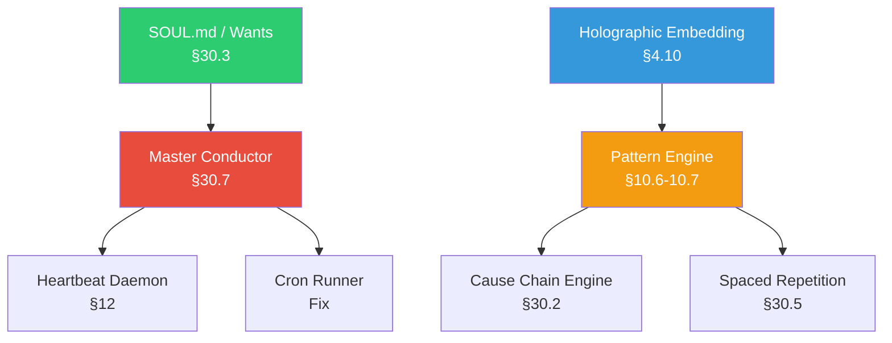

# Phase 2: Missing Subsystems — Implementation Plan

> [!NOTE]
> Phase 1 made the core loop functional (agent engine, 8 tools, state persistence, security, learning, Context Forge). Phase 2 brings the **proactive intelligence** online — the subsystems that make Locus think ahead instead of just reacting.

---

## Dependency Graph



---

## Component 1: Master Conductor (§30.7)

> The 11-step ingress-to-egress pipeline that orchestrates every request lifecycle. Currently, `agent.py`'s `run_turn()` does steps 7-9 inline. This refactors it into a proper pipeline with parallel retrieval, rate limiting, and post-turn state sync.

**Priority**: 🔴 HIGH — everything flows through this  
**Effort**: ~2 days  

#### [NEW] [`core/conductor.py`](file:///c:/Users/soni8/Desktop/everything/University%202.0/Project(s)/5_Locus/locus-os/core/conductor.py)

The Master Conductor class implementing the 11-step pipeline:

| Step | What | Currently | Phase 2 |
|------|------|-----------|---------|
| 1. Ingress | Normalize raw message | Telegram handler does this | Extract into `normalize_event()` |
| 2. Rate limit | Token bucket + concurrency | **Missing** | Add `RateLimiter` class (10 req/min, 2 concurrent streams) |
| 3. Intent classify | Fast-path routing | **Missing** | Add `classify_intent()` using keyword + LLM fallback |
| 4. State ingestion | Fetch DCS/mode | ✅ Done in Phase 1 (Context Forge Layer 1) | Wire through conductor |
| 5. Parallel retrieval | Async queries to Neo4j, vault, memory | Currently sequential | `asyncio.gather()` dispatch |
| 6. Context Forge | 6-layer assembly | ✅ Done in Phase 1 | Wire through conductor |
| 7. Security | Injection + redaction | ✅ Done in Phase 1 | Wire through conductor |
| 8. Model resolution | Route to provider | ✅ `resolve_provider()` exists | Add intent-based routing |
| 9. Tool execution | Loop | ✅ Done in Phase 1 | Wire through conductor |
| 10. Post-turn sync | Extract entities, log events, update DCS | **Partially missing** — no entity extraction | Add `post_turn_sync()` |
| 11. Egress | Format + deliver | Telegram handler does this | Extract into `format_egress()` |

**New steps to implement**: 2 (rate limiter), 3 (intent classifier), 5 (parallel retrieval), 10 (post-turn sync).

#### [MODIFY] [`core/agent.py`](file:///c:/Users/soni8/Desktop/everything/University%202.0/Project(s)/5_Locus/locus-os/core/agent.py)

- Add `run_turn_via_conductor()` method that delegates to `conductor.py` pipeline
- Keep existing `run_turn()` as a fallback for direct CLI usage

#### [MODIFY] [`gateway/agent.py`](file:///c:/Users/soni8/Desktop/everything/University%202.0/Project(s)/5_Locus/locus-os/gateway/agent.py)

- Wire `handle_agent_message` to use the conductor pipeline

---

## Component 2: Heartbeat Daemon Activation

> The heartbeat infrastructure already exists ([`core/heartbeat/__init__.py`](file:///c:/Users/soni8/Desktop/everything/University%202.0/Project(s)/5_Locus/locus-os/core/heartbeat/__init__.py)) with proper start/stop, tick loop, inference, and notification delivery. But its `_gather_*` methods are stubs and it's never started from the gateway.

**Priority**: 🔴 HIGH — this is how Locus thinks proactively  
**Effort**: ~0.5 days  

#### [MODIFY] [`core/heartbeat/__init__.py`](file:///c:/Users/soni8/Desktop/everything/University%202.0/Project(s)/5_Locus/locus-os/core/heartbeat/__init__.py)

1. **`_gather_reminders()`** — query `MemoryStore.list_cron_jobs()` for upcoming scheduled tasks
2. **`_gather_meetings()`** — check for calendar integrations in config; if none, return empty
3. **`_gather_events()`** — use Brave Search API (same as `locus_research`) to fetch today's relevant news

#### [MODIFY] [`core/heartbeat/subconscious.py`](file:///c:/Users/soni8/Desktop/everything/University%202.0/Project(s)/5_Locus/locus-os/core/heartbeat/subconscious.py)

1. **`_scan_memory_for_followups()`** — query holographic store for recent unresolved questions
2. **`_check_learning_patterns()`** — read `tool_usage.json` for usage trends
3. **`_scan_task_sources()`** — read pending tasks from `_load_tasks()`

#### [MODIFY] [`gateway/bot.py`](file:///c:/Users/soni8/Desktop/everything/University%202.0/Project(s)/5_Locus/locus-os/gateway/bot.py)

- Start `HeartbeatDaemon` during gateway startup (after agent init)

#### [MODIFY] [`core/heartbeat/notification.py`](file:///c:/Users/soni8/Desktop/everything/University%202.0/Project(s)/5_Locus/locus-os/core/heartbeat/notification.py)

- Implement `deliver_notification()` to send via Telegram bot API

---

## Component 3: Cron Runner Fixes

> [`core/cron_runner.py`](file:///c:/Users/soni8/Desktop/everything/University%202.0/Project(s)/5_Locus/locus-os/core/cron_runner.py) exists and has correct cron parsing, but has asyncio issues and fragile error handling.

**Priority**: 🟡 MEDIUM  
**Effort**: ~0.5 days  

#### [MODIFY] [`core/cron_runner.py`](file:///c:/Users/soni8/Desktop/everything/University%202.0/Project(s)/5_Locus/locus-os/core/cron_runner.py)

1. Fix `get_or_init_agent()` import to work in async context (use `run_in_executor` properly)
2. Add error isolation per job (one job failure shouldn't crash the runner)
3. Add `max_execution_time` timeout per job (5 min default)
4. Log execution results to `MemoryStore` for audit trail

---

## Component 4: Holographic Embedding Upgrade (§4.10)

> The holographic store ([`core/holographic/`](file:///c:/Users/soni8/Desktop/everything/University%202.0/Project(s)/5_Locus/locus-os/core/holographic/)) has HRR vector math but no actual embedding generation — searches fall back to keyword-only.

**Priority**: 🟡 MEDIUM — needed before Pattern Engine  
**Effort**: ~1 day  

#### [MODIFY] [`core/holographic/retrieval.py`](file:///c:/Users/soni8/Desktop/everything/University%202.0/Project(s)/5_Locus/locus-os/core/holographic/retrieval.py)

1. Add TF-IDF vectorizer as lightweight embedding backend (no GPU needed)
2. Add optional `sentence-transformers` integration for richer embeddings when available
3. Implement `search()` with cosine similarity ranking instead of substring matching

#### [MODIFY] [`core/holographic/store.py`](file:///c:/Users/soni8/Desktop/everything/University%202.0/Project(s)/5_Locus/locus-os/core/holographic/store.py)

1. Add vector index to SQLite store (via `sqlite-vec` extension or in-memory numpy)
2. Auto-embed on `store_memory()` calls

---

## Component 5: Multi-Horizon Pattern Engine (§10.6-10.7)

> **New subsystem**. Analyzes behavioral events across 5 time horizons (6h → all-time) to detect patterns like "always defers Craft tasks on Thursdays" or "DCS drops after late sleep."

**Priority**: 🟡 MEDIUM — feeds Cause Chain, Spaced Rep, and Inner Loop  
**Effort**: ~1.5 days  

#### [NEW] [`core/patterns/__init__.py`](file:///c:/Users/soni8/Desktop/everything/University%202.0/Project(s)/5_Locus/locus-os/core/patterns/__init__.py)

```python
class PatternEngine:
    HORIZONS = {
        "H1": timedelta(hours=6),   # "right now"
        "H2": timedelta(hours=24),  # "today"
        "H3": timedelta(days=7),    # "this week"
        "H4": timedelta(days=30),   # "this month"
        "H5": None,                 # "all-time"
    }
    
    def detect_patterns() -> list[Pattern]
    def promote_pattern(pattern, from_horizon, to_horizon)
    def get_active_patterns(horizon) -> list[Pattern]
```

#### [NEW] [`core/patterns/hebbian.py`](file:///c:/Users/soni8/Desktop/everything/University%202.0/Project(s)/5_Locus/locus-os/core/patterns/hebbian.py)

- Hebbian edge weight updates: +0.1 on access, ×1.3 on positive feedback, ×0.7 on negative
- STDP reinforcement: ×1.5 if user responds within 2 min, ×1.2 within 10 min
- Weekly decay: ×0.95 on all edges

#### [NEW] [`core/patterns/store.py`](file:///c:/Users/soni8/Desktop/everything/University%202.0/Project(s)/5_Locus/locus-os/core/patterns/store.py)

- SQLite-backed pattern storage in `~/.locus/patterns.db`
- Schema: `patterns(id, horizon, type, description, confidence, count, created_at, last_seen_at)`
- Schema: `behavioral_events(id, type, faction, timestamp, metadata_json)`

---

## Component 6: Cause Chain Engine (§30.2)

> **New subsystem**. When the State Engine detects a significant DCS shift (>2.0 drop), this pulls a 48-hour event window, correlates anomalies, and uses an LLM to infer the root cause chain.

**Priority**: 🟢 LOW-MEDIUM  
**Effort**: ~1 day  

#### [NEW] [`core/cause_chain.py`](file:///c:/Users/soni8/Desktop/everything/University%202.0/Project(s)/5_Locus/locus-os/core/cause_chain.py)

Implements the 9-step pipeline:
1. Trigger on DCS drop >2.0 points
2. Pull 48h behavioral event window from pattern store
3. Align events chronologically
4. Correlate anomalies (late sleep → skipped meal → deferral)
5. LLM synthesis with evidence-citing prompt
6. Verify each chain link has empirical backing
7. Score confidence (0.0–1.0)
8. Write `inferred_cause_chain` to `LocusState`
9. If confidence >0.85 + high severity: emit alert to Inner Loop

**Dependencies**: Pattern Engine (Component 5), LocusState (Phase 1 ✅)

---

## Component 7: SOUL.md / Wants Engine (§30.3)

> The personality and curiosity layer. Reads `SOUL.md` from the vault for identity, and maintains a list of "Wants" — things Locus is curious about or needs to learn.

**Priority**: 🟢 LOW  
**Effort**: ~0.5 days  

#### [NEW] [`core/soul.py`](file:///c:/Users/soni8/Desktop/everything/University%202.0/Project(s)/5_Locus/locus-os/core/soul.py)

1. `load_soul()` — read `SOUL.md` from vault path or `~/.locus/SOUL.md`
2. `get_active_wants()` — read from `~/.locus/wants.json`
3. `generate_want(gap_description)` — create a new Want from a detected knowledge gap
4. `rank_wants()` — sort by urgency × relevance to active goals
5. `nudge_want(state)` — if DCS > 6.0, format 1 Want as a natural question

#### [MODIFY] Context Forge Layer 1 injection

- Include SOUL.md identity (capped at 80 tokens) in Layer 1 alongside DCS/mode

---

## Component 8: Spaced Repetition Engine (§30.5)

> Scans Neo4j/memory for concepts the user hasn't engaged with recently, especially those still connected to active projects. Surfaces them as gentle nudges.

**Priority**: 🟢 LOW  
**Effort**: ~0.5 days  

#### [NEW] [`core/spaced_rep.py`](file:///c:/Users/soni8/Desktop/everything/University%202.0/Project(s)/5_Locus/locus-os/core/spaced_rep.py)

1. `scan_decaying_concepts()` — query memory store for documents not accessed in X days
2. `filter_active_connections()` — keep only concepts connected to active goals
3. `format_observation()` — "You haven't engaged with [X] in Y days, but it connects to Z"
4. `queue_to_inner_loop()` — add observation to heartbeat context
5. `handle_feedback()` — reinforce (×1.3) on engagement, decay (×0.95) on ignore

---

## Execution Order

Components are ordered by dependency chain:

| Phase | Component | Depends On | Effort |
|-------|-----------|------------|--------|
| 2A | **Holographic Embedding** (4) | — | 1 day |
| 2A | **Cron Runner Fixes** (3) | — | 0.5 day |
| 2A | **Heartbeat Activation** (2) | — | 0.5 day |
| 2B | **Master Conductor** (1) | Heartbeat, Cron | 2 days |
| 2B | **Pattern Engine** (5) | Holographic | 1.5 days |
| 2C | **SOUL.md / Wants** (7) | — | 0.5 day |
| 2C | **Cause Chain Engine** (6) | Pattern Engine | 1 day |
| 2C | **Spaced Repetition** (8) | Pattern Engine | 0.5 day |

**Total estimated effort**: ~7.5 days

---

## Open Questions

> [!IMPORTANT]
> **Scope**: Do you want all 8 components, or should I start with just 2A (the quick wins that enable everything else)?

> [!IMPORTANT]
> **SOUL.md**: Do you already have a `SOUL.md` file in your Obsidian vault? If not, should I generate a starter template?

> [!IMPORTANT]
> **Pattern storage**: The spec references PostgreSQL and Redis for behavioral events. Should I implement these against SQLite (simpler, already available) or add actual PostgreSQL/Redis support?

> [!WARNING]
> **Content Engine (§30.4)** and **QLoRA Pipeline (§30.6)** are omitted from Phase 2 — they're large standalone projects with lower immediate impact. They can be Phase 3 items.

---

## Verification Plan

### Automated Tests
```bash
cd c:\Users\soni8\Desktop\everything\University 2.0\Project(s)\5_Locus\locus-os
python -m pytest core/test_core.py core/test_memory_backends.py -v
```

### Manual Verification
1. Start gateway → verify heartbeat ticks fire at configured interval
2. Send message → verify conductor pipeline logs all 11 steps
3. Create a cron job → verify it executes on schedule
4. Do 3 check-ins over 2 days → verify Pattern Engine detects DCS trend
5. Drop DCS by >2 points → verify Cause Chain Engine triggers
6. Wait for spaced rep scan → verify decay nudges appear
