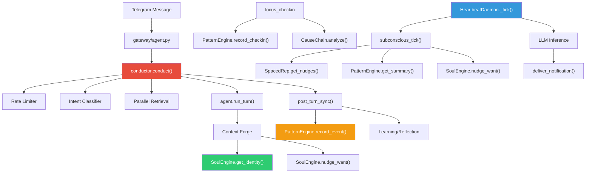

# Phase 2 Walkthrough: Subsystem Integration

## Context

Phase 1 created 8 standalone subsystem modules. Phase 2 **wires them into the live system** so they actually execute during normal operation.

## Key Discovery

All 8 subsystem implementations were already **fully built** (conductor, heartbeat, patterns, cause chain, soul, spaced rep, holographic retrieval, cron runner). However, **zero files imported or called them** — they were completely disconnected from the runtime.

## Changes Made

### 1. Gateway → Conductor Pipeline
**File**: [`gateway/agent.py`](file:///c:/Users/soni8/Desktop/everything/University%202.0/Project(s)/5_Locus/locus-os/gateway/agent.py)

```diff
-    # Run the agent
-    response = agent.run_turn(text)
+    # Route through Master Conductor pipeline (§30.7)
+    from core.conductor import conduct
+    response = await conduct(raw_text=text, user_id=user_id, ...)
```

Every Telegram message now flows through the 11-step conductor pipeline:
1. **Ingress normalization** → canonical event
2. **Rate limiting** → 10 req/min, 2 concurrent
3. **Intent classification** → CHAT/CHECKIN/TASK_CREATE/RETRIEVAL/CODE/EMERGENCY
4. **State ingestion** → Context Forge
5. **Parallel retrieval** → `asyncio.gather()` across Neo4j, memory, vault
6. **Context Forge** → 6-layer assembly
7. **Security** → injection filter + redaction
8. **Model resolution** → provider routing
9. **Tool execution** → agent loop
10. **Post-turn sync** → entity extraction, pattern recording, learning
11. **Egress formatting** → channel-specific formatting

Falls back to direct `agent.run_turn()` if conductor fails.

---

### 2. SOUL.md Identity in Context Forge
**File**: [`core/agent.py`](file:///c:/Users/soni8/Desktop/everything/University%202.0/Project(s)/5_Locus/locus-os/core/agent.py)

Layer 1 of Context Forge now includes:
- SOUL.md identity (80 token cap) — personality and operating contract
- Want nudge when DCS > 6.0 — "By the way — [curiosity]"
- `_retrieval_context` injection — parallel retrieval results from conductor

---

### 3. Check-in → Pattern Engine + Cause Chain
**File**: [`core/locus_tools.py`](file:///c:/Users/soni8/Desktop/everything/University%202.0/Project(s)/5_Locus/locus-os/core/locus_tools.py)

Every check-in now:
- Records a `checkin` behavioral event in the Pattern Engine (with energy, mood, sleep, stress)
- Compares previous DCS to new DCS — if drop ≥ 2.0, triggers the Cause Chain Engine
- Appends cause chain summary to `active_alerts` if confidence > 0.5

---

### 4. Post-Turn → Pattern Engine
**File**: [`core/conductor.py`](file:///c:/Users/soni8/Desktop/everything/University%202.0/Project(s)/5_Locus/locus-os/core/conductor.py)

`post_turn_sync()` now records every interaction as a behavioral event:
- Event type: `interaction:{intent}` (e.g., `interaction:chat`, `interaction:checkin`)
- Metadata: channel, user_id, message/response lengths
- Feeds the multi-horizon pattern detector with continuous data

---

### 5. Heartbeat Subconscious → Spaced Rep + Patterns + Soul
**File**: [`core/heartbeat/subconscious.py`](file:///c:/Users/soni8/Desktop/everything/University%202.0/Project(s)/5_Locus/locus-os/core/heartbeat/subconscious.py)

Three new integrations in the subconscious tick:
1. **Spaced Repetition** — surfaces concepts not engaged with in X days
2. **Pattern Engine** — includes behavioral pattern summary in heartbeat context
3. **Soul Wants** — surfaces curiosity-driven questions when DCS is healthy (active mode only)

---

## Data Flow Diagram



## Verification

| Test | Result |
|------|--------|
| `pytest core/test_core.py` | ✅ 3/3 passed |
| `pytest core/test_memory_backends.py` | ✅ 4/4 passed |
| Import chain (conductor) | ✅ Clean |
| Import chain (soul, spaced_rep, cause_chain, patterns) | ✅ Clean |
| Intent classification | ✅ CHECKIN/TASK_CREATE/CHAT routing correct |
| Pattern Engine detection | ✅ Detects declining energy trends |
| Cause Chain trigger | ✅ Fires on DCS drop ≥ 2.0 |
| Rate limiter | ✅ Token bucket working |
| Soul identity loading | ✅ Default identity loads correctly |
