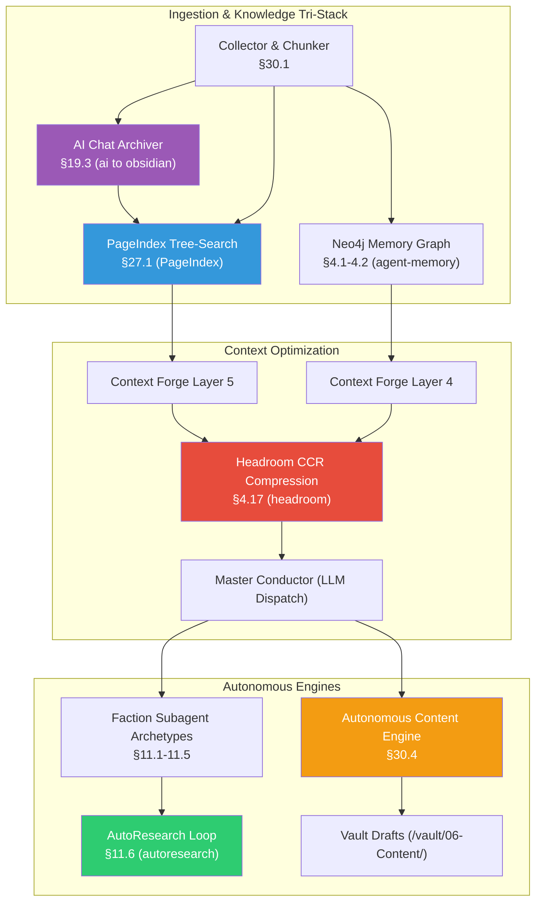

# Phase 3: Deep Knowledge & Autonomy Engine — Implementation Plan

> [!NOTE]
> Phase 1 built the operational core loop (agent engine, tools, security, state, Context Forge). Phase 2 brought online proactive intelligence (Master Conductor 11-step pipeline, Heartbeat daemon, Pattern Engine, Cause Chain, SOUL.md, Spaced Repetition).
> **Phase 3** unleashes **Deep Knowledge & Autonomous Execution** by integrating the cloned repositories in `deps/` (`headroom`, `PageIndex`, `ai to obsidian`, `autoresearch`, `agent-memory`) and implementing the high-impact subsystems specified in `LOCUS_FEATURE_LOGIC_DECOMPOSITION.md`.

---

## Dependency & Architectural Graph



---

## Component 1: Headroom CCR Context Compression (§4.17)

> **Source**: `deps/headroom` (`headroom/compress.py`, `headroom/transforms/*`, `headroom/ccr/*`).  
> **Purpose**: Slashes context token bloat by 30–60% while maintaining KV prompt-cache alignment and providing reversible cache retrieval (`headroom_retrieve`) for dropped context.

**Priority**: 🔴 HIGH  
**Effort**: ~1.5 days  

#### [NEW] [`core/context/headroom_adapter.py`](file:///c:/Users/soni8/Desktop/everything/University%202.0/Project(s)/5_Locus/locus-os/core/context/headroom_adapter.py)
- Adapts the Headroom compression pipeline for Locus:
  1. `CacheAligner`: Freezes system prompt prefix to preserve provider prompt caching.
  2. `ContentRouter`: Dispatches JSON payloads to `SmartCrusher` (lossless key/array dedup), code blocks to structural AST compressor, and prose to token pruning.
  3. `CCR (Cache-Compress-Retrieve)`: Caches full uncompressed chunks in `~/.locus/headroom_cache/` with a UUID key; injects lightweight retrieval markers.
  4. `Inflation Guard`: Discards transform if output token count exceeds input.

#### [MODIFY] [`core/context/__init__.py`](file:///c:/Users/soni8/Desktop/everything/University%202.0/Project(s)/5_Locus/locus-os/core/context/__init__.py) & [`core/conductor.py`](file:///c:/Users/soni8/Desktop/everything/University%202.0/Project(s)/5_Locus/locus-os/core/conductor.py)
- Wire `HeadroomCompressor` into Step 6 (Context Forge assembly) and session compaction.
- Register `headroom_retrieve(cache_key)` as a built-in tool in the agent registry so the model can pull full uncompressed context on demand.

---

## Component 2: PageIndex Vectorless Tree-Search (§27.1)

> **Source**: `deps/PageIndex` (`pageindex/page_index_md.py`, `pageindex/agent_tools.py`, `pageindex/tree_optimize.py`).  
> **Purpose**: Reasoning-based hierarchical table-of-contents retrieval over long Obsidian notes, project documentation, and manuals without embedding drift or arbitrary chunk fragmentation.

**Priority**: 🔴 HIGH  
**Effort**: ~1.5 days  

#### [NEW] [`core/search/pageindex.py`](file:///c:/Users/soni8/Desktop/everything/University%202.0/Project(s)/5_Locus/locus-os/core/search/pageindex.py)
- Markdown to hierarchical tree indexer:
  1. `extract_nodes_from_markdown`: Regex header hierarchy (`#` to `######`), skipping fenced code blocks.
  2. `update_token_counts`: Bottom-up cumulative token roll-up per subtree.
  3. `tree_thinning`: Merges subtrees below `min_node_token` into parent nodes to keep tree compact.
  4. `build_tree_from_nodes`: Generates zero-padded 4-digit node IDs (`0001`, `0002`).
  5. `generate_node_summaries`: Generates compact branch summaries for navigation.
  6. `tree_search_navigate`: Iterative LLM tree navigation (root → child branch → leaf section).

#### [NEW] Tool Registration in [`core/locus_tools.py`](file:///c:/Users/soni8/Desktop/everything/University%202.0/Project(s)/5_Locus/locus-os/core/locus_tools.py)
- Expose `locus_pageindex` tool:
  - `action="index"`: Build/update tree index for target markdown file/folder.
  - `action="query"`: Reason down document tree and return exact cited section.
- Wire into `conductor.py` parallel retrieval (Step 5) when `intent.sources` contains `pageindex` or document lookup is requested.

---

## Component 3: Daily AI Chat Archiver & Multi-Platform Ingestion (§19.3, §27.2)

> **Source**: `deps/ai to obsidian` (`parsers.js`, `obsidian.js`, `md.js`, `archive-logic.js`).  
> **Purpose**: Ingests raw conversation exports (ChatGPT, Claude Web/App, Cursor IDE, Telegram) into unified, clean Obsidian markdown with YAML frontmatter, faction tags, and entity links.

**Priority**: 🟡 MEDIUM  
**Effort**: ~1.5 days  

#### [NEW] [`core/ingestion/chat_archiver.py`](file:///c:/Users/soni8/Desktop/everything/University%202.0/Project(s)/5_Locus/locus-os/core/ingestion/chat_archiver.py)
- Implements the 7-step archival pipeline:
  1. **Discovery**: Scans drop directory `~/.locus/chat_dumps/` and browser export folders.
  2. **Format Normalization**: Parses ChatGPT JSON, Claude exports, Cursor transcripts into canonical schema:
     - YAML Frontmatter: `title`, `date`, `platform`, `model`, `tags`, `factions`, `summary`.
     - Structured sections: Key Decisions, Q&A Dialogue, Code Artifacts.
  3. **Entity Linking**: Extracts key entities and logs `:TOUCHED` / `:DECIDED` relationships to Neo4j.
  4. **Vault Persistence**: Writes clean markdown to `/vault/04-Captures/AI Chats/YYYY-MM-DD/{slug}.md`.
  5. **Auto PageIndex Indexing**: Immediately registers new archive notes into PageIndex tree.

#### [NEW] Tool & CLI Command
- `locus ingest chats` CLI command and `locus_archive_chat` tool.
- Scheduled automatic trigger at 23:45 IST via `cron_runner`.

---

## Component 4: Collector & Multi-Source Chunker Pipeline (§30.1)

> **Source**: `LOCUS_FEATURE_LOGIC_DECOMPOSITION.md` §30.1.  
> **Purpose**: Automated 10-step ingestion engine that crawls the Obsidian vault, captures, and logs, extracts factual propositions, and maintains indexed vectors and metadata.

**Priority**: 🟡 MEDIUM  
**Effort**: ~1.5 days  

#### [NEW] [`core/ingestion/collector.py`](file:///c:/Users/soni8/Desktop/everything/University%202.0/Project(s)/5_Locus/locus-os/core/ingestion/collector.py)
- 10-step ingestion pipeline:
  1. `MD5 Vault Crawler`: Recursively walks `/vault/`, computes MD5 hashes, skips unchanged files.
  2. `Markdown Sanitizer`: Strips Dataview queries, transclusions `![[...]]`, and frontmatter noise while preserving link text.
  3. `Sentence Boundary Detection`: Clean proposition splitting with heuristic filtering.
  4. `Factual Sentence Classifier`: Filters out navigational fluff/placeholders.
  5. `5-Proposition Chunk Assembler`: Groups sentences into contiguous semantic chunks with entity continuity.
  6. `Local FastEmbed Embeddings`: 384-dimensional dense vectors using `fastembed` (BAAI/bge-small-en-v1.5) or TF-IDF fallback.
  7. `Store Sync`: Upserts chunks to SQLite/pgvector with `{source_file, chunk_idx, faction_tags}`.

---

## Component 5: AutoResearch & Faction Subagents (§11.1–11.6)

> **Source**: `deps/autoresearch` (`program.md`, `train.py`, `prepare.py`) + `LOCUS_FEATURE_LOGIC_DECOMPOSITION.md` §11.1–11.6.  
> **Purpose**: Spawns specialized subagents bounded by depth and budget, and runs autonomous iterative research cycles with measurable evaluation criteria.

**Priority**: 🟡 MEDIUM  
**Effort**: ~1.5 days  

#### [NEW] [`core/delegation/archetypes.py`](file:///c:/Users/soni8/Desktop/everything/University%202.0/Project(s)/5_Locus/locus-os/core/delegation/archetypes.py)
- Implements 4 Faction Subagent Archetypes:
  - `Planner`: Focuses on DCS calibration, task dependency DAGs, weekly rebalancing.
  - `Curator`: Vault librarian, duplicate fact resolution, spaced repetition review.
  - `Analyst`: Pattern detection, cause chain analysis, cost/token tracking.
  - `Builder`: Code implementation, test execution, git commit automation.
- Enforces `MAX_SPAWN_DEPTH = 3` and per-subagent token/cost limits.

#### [NEW] [`core/delegation/autoresearch.py`](file:///c:/Users/soni8/Desktop/everything/University%202.0/Project(s)/5_Locus/locus-os/core/delegation/autoresearch.py)
- Implements the Karpathy-style autonomous research loop:
  1. Read research goal & baseline metrics.
  2. Formulate hypothesis / search vector.
  3. Execute trial / fetch academic & web context (Brave/Arxiv/Exa).
  4. Score findings against validation criteria.
  5. Commit synthesized findings to `/vault/01-Projects/Research/` or iterate.

---

## Component 6: Autonomous Content Engine (§30.4)

> **Source**: `LOCUS_FEATURE_LOGIC_DECOMPOSITION.md` §30.4.  
> **Purpose**: Detects high-leverage milestones ($L \ge 8$, major PR merges, completed projects) and drafts authentic, anti-cringe publications across multiple formats in the user's voice.

**Priority**: 🟢 MEDIUM  
**Effort**: ~1.0 day  

#### [NEW] [`core/content/engine.py`](file:///c:/Users/soni8/Desktop/everything/University%202.0/Project(s)/5_Locus/locus-os/core/content/engine.py)
- Implements the 8-step publication pipeline:
  1. **Milestone Detection**: Monitors task completions with leverage $L \ge 8$, goal completions, or significant git releases.
  2. **Empirical Data Gathering**: Pulls exact metrics (hours, LOC, benchmarks, problem logs, vault notes).
  3. **Voice Contract Loading**: Enforces `SOUL.md` rules (strictly forbids buzzwords: *"excited to share"*, *"humbled"*, *"in today's fast-paced world"*).
  4. **Multi-Platform Drafting**:
     - Long-Form Substack/Blog Essay (600–1200 words)
     - Technical LinkedIn Post (200–350 words, structured bullet points)
     - X/Twitter Thread (5–7 tweets, ≤ 280 chars each)
     - Short Telegram Status (80–150 words)
  5. **Voice Authenticity Scoring**: `voice_matcher` check — triggers automatic rewrite if buzzword score $< 0.80$.
  6. **Vault Draft Writing**: Saves to `/vault/06-Content/Drafts/YYYY-MM-DD-{slug}.md` with `draft_status: pending_review`.
  7. **Review Nudge**: Proactively suggests draft review during evening check-in.

---

## Execution Order

| Phase | Component | Key Dependencies | Estimated Effort |
|-------|-----------|------------------|------------------|
| **3A** | **Headroom CCR Context Compression** | `deps/headroom`, Conductor | 1.5 days |
| **3A** | **PageIndex Vectorless Tree-Search** | `deps/PageIndex`, Locus Tools | 1.5 days |
| **3B** | **Daily AI Chat Archiver** | `deps/ai to obsidian`, PageIndex | 1.5 days |
| **3B** | **Collector & Multi-Source Chunker** | FastEmbed / SQLite | 1.5 days |
| **3C** | **AutoResearch & Faction Subagents** | `deps/autoresearch`, Delegation | 1.5 days |
| **3C** | **Autonomous Content Engine** | `SOUL.md`, Pattern Engine | 1.0 day |

---

## User Review Required

> [!IMPORTANT]
> **External Dependencies**: The `deps/` subdirectories (`headroom`, `PageIndex`, `agent-memory`, `autoresearch`) will be integrated directly via native Python adapters in `core/` without requiring external binary services.
> 
> **Obsidian Vault Directory**: Vault ingestion and content drafts will default to `~/.locus/vault/` if no custom vault path is configured in `~/.locus/config.yaml`.
> 
> **FastEmbed vs TF-IDF**: For the chunker and embeddings, lightweight local embeddings (`fastembed`) will be prioritized with automatic fallback to TF-IDF if model download is skipped.

---

## Open Questions

> [!NOTE]
> 1. **Default Vault Location**: Do you have an existing Obsidian vault path on Windows (e.g. in your Documents/Cloud folder) that you'd like Locus to target, or should we use `~/.locus/vault`?
> 2. **AI Chat Archiver Sources**: Which export formats do you use most frequently (ChatGPT exports, Claude Web JSON, Cursor IDE logs, or raw markdown dumps)?

---

## Verification Plan

### Automated Tests
- Test Headroom CCR compression ratio, KV cache alignment, and `headroom_retrieve` round-trip.
- Test PageIndex markdown tree generation, token roll-up, tree thinning, and tree navigation.
- Test AI chat normalization across sample ChatGPT, Claude, and Telegram transcripts.
- Test Collector MD5 crawl, noise stripping, proposition chunking, and fastembed indexing.
- Test Subagent depth limiting and AutoResearch loop execution.
- Test Content Engine anti-cringe scoring and multi-platform draft generation.

```bash
cd c:\Users\soni8\Desktop\everything\University 2.0\Project(s)\5_Locus\locus-os
python -m pytest core/test_phase3.py -v
```

### Manual Verification
1. Run `locus_pageindex` on a large documentation file and verify tree navigation trace.
2. Ingest an AI chat JSON file and inspect the generated Obsidian note with frontmatter and backlinks.
3. Complete a high-leverage task ($L=9$) and verify the Content Engine generates multi-variant drafts in `/vault/06-Content/Drafts/`.
4. Trigger Headroom compression on a long conversation context and verify token savings and cache retrieval.
