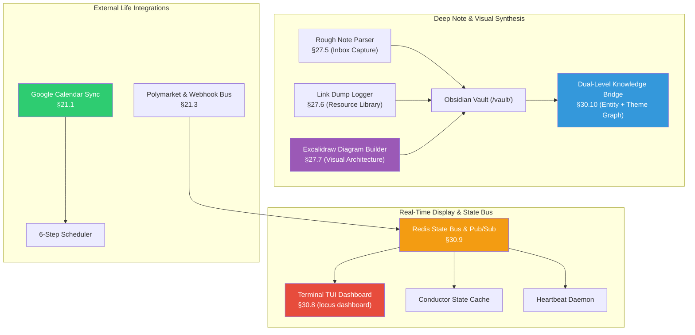

# Phase 4: Real-Time Interface, Multimodal I/O & External Life Integrations — Implementation Plan

> [!NOTE]
> Following Phase 1 (Core Foundation & Agent Loop), Phase 2 (Proactive Intelligence & Conductor), and Phase 3 (Deep Knowledge & Autonomy Engine), **Phase 4** delivers the **User Experience, Real-Time Interface, and External Integration Layer** as specified in `LOCUS_FEATURE_LOGIC_DECOMPOSITION.md`.

---

## Phase 4 Architectural Map



---

## Proposed Components for Phase 4

### Component 1: Real-Time Terminal TUI Dashboard (§30.8, §7.1–7.5)
> **Source**: `LOCUS_FEATURE_LOGIC_DECOMPOSITION.md` §30.8 & `locus_microsystems.html` Subsystem 16.  
> **Purpose**: A responsive, 4-panel terminal user interface providing live telemetry, DCS gauge, faction progress bars, and interactive keyboard task dispatching.

#### [NEW] [`core/display/dashboard.py`](file:///c:/Users/soni8/Desktop/everything/University%202.0/Project(s)/5_Locus/locus-os/core/display/dashboard.py)
- 4-Quadrant Responsive Layout:
  1. **Top Left (DCS Gauge)**: Colored ASCII / Unicode gauge reflecting DCS (0.0–10.0), Operating Mode (`SURVIVAL` $\to$ `PEAK`), and Energy/Mood/Sleep/Stress breakdown.
  2. **Top Right (Faction Balances)**: Progress bars for Craft (40%), Health (25%), Leverage (20%), Expression (15%) with $\pm 5\%$ tolerance color coding.
  3. **Bottom Left (Interactive Task Queue)**: Tasks sorted by TWS descending with lag badges, difficulty ratings, and keybindings:
     - `[Space]` Toggle task completion
     - `[D]` Defer task (increments deferral count & updates lag bonus)
     - `[N]` Quick task entry modal
     - `[C]` Trigger on-demand check-in
  4. **Bottom Right (Live Event Log & Heartbeat Stream)**: Real-time telemetry, recent subconscious insights, and conductor activity logs.
- Hot-reload and resize handler on `SIGWINCH` with fallback to text mode on minimal terminals.

#### [MODIFY] [`locus_cli/main.py`](file:///c:/Users/soni8/Desktop/everything/University%202.0/Project(s)/5_Locus/locus-os/locus_cli/main.py)
- Wire `locus dashboard` CLI entrypoint.

---

### Component 2: Redis High-Performance State Bus & Pub/Sub (§30.9)
> **Source**: `LOCUS_FEATURE_LOGIC_DECOMPOSITION.md` §30.9 & `locus_microsystems.html` Subsystem 18.  
> **Purpose**: High-speed, ephemeral state synchronization, rate limit tracking, and cross-subsystem event publishing.

#### [NEW] [`core/redis_state.py`](file:///c:/Users/soni8/Desktop/everything/University%202.0/Project(s)/5_Locus/locus-os/core/redis_state.py)
- Redis client with memory-backed fallback if Redis service is offline:
  - **Keys**: `CURRENT_STATE` (JSON, TTL 6h), `DCS_LIVE`, `RATE_LIMIT:{user_id}`, `RECENT_THOUGHTS`.
  - **Pub/Sub Channels**: `state_shift`, `emergency_alert`, `ingest_event`, `task_completed`.
  - **Atomic Transactions**: `update_state_atomic(state_dict)` updating live state and publishing to event channels.

---

### Component 3: Dual-Level Knowledge Bridge & 3-Level Tag Taxonomy (§30.10, §27.4)
> **Source**: `LOCUS_FEATURE_LOGIC_DECOMPOSITION.md` §30.10 & §27.4.  
> **Purpose**: Bridges Obsidian wikilink syntax with low-level entity extraction and macroscopic thematic clustering.

#### [NEW] [`core/search/dual_knowledge_bridge.py`](file:///c:/Users/soni8/Desktop/everything/University%202.0/Project(s)/5_Locus/locus-os/core/search/dual_knowledge_bridge.py)
- **Wikilink & AST Extractor**: Parses `[[Target]]`, `[[Target|Alias]]`, `![[Embed]]`, and Dataview inline fields (`key:: value`).
- **3-Level Tag Hierarchy**: Enforces `#domain/#category/#instance` structure (e.g. `#domain/craft/#category/coding/#instance/locus-os`).
- **Dual-Tier Graph Search**:
  - `search_entity_graph(query)`: Low-level atomic facts with line-number precision.
  - `search_theme_graph(query)`: High-level cluster synthesis for overarching strategic queries.

---

### Component 4: Rough Note Parser & Link Resource Logger (§27.5, §27.6)
> **Source**: `LOCUS_FEATURE_LOGIC_DECOMPOSITION.md` §27.5 & §27.6.  
> **Purpose**: Converts unformatted mobile brain dumps and shared URLs into structured, searchable Obsidian notes.

#### [NEW] [`core/ingestion/rough_note_parser.py`](file:///c:/Users/soni8/Desktop/everything/University%202.0/Project(s)/5_Locus/locus-os/core/ingestion/rough_note_parser.py)
- Ingests raw text streams from Telegram, Voice STT, or mobile quick notes.
- Extracts Canonical Title, Primary Faction Tag, Core Proposition, Actionable Checkboxes, and Named Entities.
- Saves atomic notes directly to `/vault/04-Captures/Inbox/{slug}.md`.

#### [NEW] [`core/ingestion/link_logger.py`](file:///c:/Users/soni8/Desktop/everything/University%202.0/Project(s)/5_Locus/locus-os/core/ingestion/link_logger.py)
- Intercepts shared URLs, scrapes readable article text, generates 3-bullet executive takeaways and goal relevance connections.
- Archives formatted markdown note to `/vault/06-Resources/{domain}/{slug}.md` and auto-indexes into PageIndex.

---

### Component 5: Excalidraw Visual Architecture Generator (§27.7)
> **Source**: `LOCUS_FEATURE_LOGIC_DECOMPOSITION.md` §27.7 & Excalidraw Schema Spec.  
> **Purpose**: Synthesizes clean visual architecture diagrams from natural language system specifications.

#### [NEW] [`core/display/excalidraw_builder.py`](file:///c:/Users/soni8/Desktop/everything/University%202.0/Project(s)/5_Locus/locus-os/core/display/excalidraw_builder.py)
- Layout engine generating valid `.excalidraw` and `.excalidraw.md` vector diagram JSON.
- Computes node bounding rectangles, text labels, color palettes, and directional connector arrow vectors.
- Writes diagram files to `/vault/07-Diagrams/{title}.excalidraw.md`.

#### [MODIFY] [`core/locus_tools.py`](file:///c:/Users/soni8/Desktop/everything/University%202.0/Project(s)/5_Locus/locus-os/core/locus_tools.py)
- Register `locus_diagram` tool for on-demand diagram creation.

---

### Component 6: External Life Integrations & Webhook Ingress (§21.1–21.3)
> **Source**: `LOCUS_FEATURE_LOGIC_DECOMPOSITION.md` §21.1–21.3.  
> **Purpose**: Connects Locus to Google Calendar time-blocking, Polymarket prediction feeds, and external webhook triggers.

#### [NEW] [`core/integrations/calendar_sync.py`](file:///c:/Users/soni8/Desktop/everything/University%202.0/Project(s)/5_Locus/locus-os/core/integrations/calendar_sync.py)
- Bi-directional Google Calendar sync: fetches today's schedule, detects meeting load, protects deep work blocks based on current Operating Mode, and logs calendar meetings into the 48-hour event window for Cause Chain analysis.

---

## Execution Order

| Phase | Component | Key Dependencies | Estimated Effort |
|-------|-----------|------------------|------------------|
| **4A** | **Redis State Bus & Pub/Sub** | In-memory fallback | 1.0 day |
| **4A** | **Real-Time Terminal TUI Dashboard** | Redis / Curses | 1.5 days |
| **4B** | **Dual-Level Knowledge Bridge & Tag Hierarchy** | Vault / PageIndex | 1.5 days |
| **4B** | **Rough Note Parser & Link Logger** | Ingestion / Vault | 1.0 day |
| **4C** | **Excalidraw Visual Diagram Builder** | Locus Tools / Vault | 1.0 day |
| **4C** | **Calendar Sync & Life Integrations** | Scheduler / Heartbeat | 1.0 day |

---

## User Review Required

> [!IMPORTANT]
> **Redis Requirement**: Redis integration includes a built-in in-memory event bus fallback so Locus functions 100% locally out-of-the-box even without a running Redis server.
> 
> **Dashboard Command**: The terminal dashboard can be launched via `locus dashboard` or embedded directly in active CLI sessions.

---

## Verification Plan

### Automated Tests
- Test Redis pub/sub state publishing and atomic state updates (with memory fallback).
- Test TUI dashboard state rendering (DCS gauge, faction bars, task queue formatting).
- Test Dual-Level Knowledge Bridge entity and theme extraction across sample markdown notes.
- Test Rough Note Parser extraction (titles, tags, checkboxes) and note generation.
- Test Link Logger URL extraction and 3-bullet summary generation.
- Test Excalidraw JSON generation (rectangles, arrows, labels, valid schema).
- Test Calendar sync time-blocking and meeting load extraction.

```bash
cd c:\Users\soni8\Desktop\everything\University 2.0\Project(s)\5_Locus\locus-os
python -m pytest core/test_phase4.py -v
```
