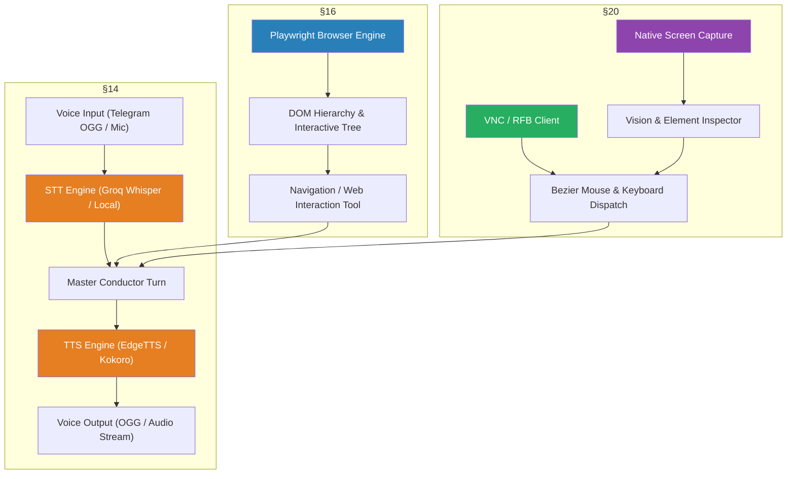

# Phase 5: Multimodal Voice, Browser Automation & Computer Use — Implementation Plan

> [!NOTE]
> Following Phase 1 (Foundation), Phase 2 (Proactive Conductor), Phase 3 (Deep Knowledge Engine), and Phase 4 (Real-Time TUI & Integrations), **Phase 5** builds the **Multimodal I/O, Browser Automation, and Native Desktop Computer Use** capabilities specified in `LOCUS_FEATURE_LOGIC_DECOMPOSITION.md` §14, §16, and §20.

---

## Phase 5 Architectural Map



---

## Proposed Components for Phase 5

### Component 1: Multimodal Voice Pipeline (§14.1–14.4)
> **Source**: `LOCUS_FEATURE_LOGIC_DECOMPOSITION.md` §14.1–14.4 & `locus_microsystems.html` Subsystem 14.  
> **Purpose**: End-to-end speech-to-text (Groq Whisper / local Whisper) and text-to-speech (EdgeTTS / Kokoro / ElevenLabs) processing with audio normalization.

#### [NEW] [`core/voice/stt.py`](file:///c:/Users/soni8/Desktop/everything/University%202.0/Project(s)/5_Locus/locus-os/core/voice/stt.py)
- Transcribes audio buffers (OGG, MP3, WAV).
- Fallback chain: Groq Whisper API $\to$ Local Whisper $\to$ Mock transcription stub for test/offline environments.

#### [NEW] [`core/voice/tts.py`](file:///c:/Users/soni8/Desktop/everything/University%202.0/Project(s)/5_Locus/locus-os/core/voice/tts.py)
- Speech synthesis with voice selection (`en-US-GuyNeural`, `en-US-JennyNeural`, Kokoro).
- Generates streaming audio bytes and persists `.ogg` / `.wav` files.

#### [NEW] [`core/voice/voice_pipeline.py`](file:///c:/Users/soni8/Desktop/everything/University%202.0/Project(s)/5_Locus/locus-os/core/voice/voice_pipeline.py)
- Full bidirectional loop: Audio intake $\to$ STT $\to$ Conductor Turn $\to$ TTS $\to$ Voice output + transcript logging to `/vault/04-Captures/Voice/`.

---

### Component 2: Multi-Platform Browser Automation (§16.1–16.2)
> **Source**: `LOCUS_FEATURE_LOGIC_DECOMPOSITION.md` §16.1–16.2.  
> **Purpose**: Headless/headful browser automation for deep web research, form submission, and interactive page extraction.

#### [NEW] [`core/browser/playwright_engine.py`](file:///c:/Users/soni8/Desktop/everything/University%202.0/Project(s)/5_Locus/locus-os/core/browser/playwright_engine.py)
- Launches and manages Chromium browser instances with connection pooling.
- Methods: `navigate(url)`, `screenshot()`, `click(selector)`, `type(selector, text)`, `extract_text()`, and `get_interactive_elements()`.
- Built-in fallback to HTTP reader if Playwright browser binaries are not installed.

---

### Component 3: Screen Intelligence & Native Computer Use (§20.1–20.3)
> **Source**: `LOCUS_FEATURE_LOGIC_DECOMPOSITION.md` §20.1–20.3 & OpenHuman `screen_intelligence/`.  
> **Purpose**: Cross-platform desktop screen capture, coordinate bounding box security enforcement, and human-like input dispatch.

#### [NEW] [`core/desktop/screen_capture.py`](file:///c:/Users/soni8/Desktop/everything/University%202.0/Project(s)/5_Locus/locus-os/core/desktop/screen_capture.py)
- Multi-monitor screenshot grabber and coordinate scaler.
- Parses UI bounding boxes and identifies interactive buttons, input fields, and icons.

#### [NEW] [`core/desktop/vnc_client.py`](file:///c:/Users/soni8/Desktop/everything/University%202.0/Project(s)/5_Locus/locus-os/core/desktop/vnc_client.py)
- RFB 3.8 protocol client for headless remote desktop control.
- Smooth Bezier curve mouse trajectory generation with safe bounding box constraint checks.

---

### Component 4: Locus Tools Registration & Gateway Wiring
#### [MODIFY] [`core/locus_tools.py`](file:///c:/Users/soni8/Desktop/everything/University%202.0/Project(s)/5_Locus/locus-os/core/locus_tools.py)
- Register `locus_browser` tool (URL navigation, text extraction, screenshots).
- Register `locus_voice_synth` tool (on-demand voice generation).
- Register `locus_desktop_action` tool (screen capture, click, type with safety gates).

---

## Verification Plan

### Automated Tests
- Test STT transcription and TTS audio synthesis with fallback.
- Test full bidirectional voice pipeline and transcript persistence.
- Test Browser engine navigation and text/element extraction (with HTTP fallback).
- Test Screen capture and Bezier mouse path calculation.
- Test VNC bounding box safety constraints (ensuring out-of-bounds clicks are blocked).

```bash
cd c:\Users\soni8\Desktop\everything\University 2.0\Project(s)\5_Locus\locus-os
python -m pytest core/test_phase5.py -v
```
