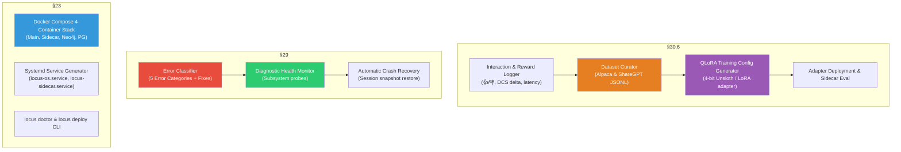

# Phase 6: Self-Evolution Engine, QLoRA Fine-Tuning & Production CI/CD — Implementation Plan

> [!NOTE]
> Following Phases 1 through 5, **Phase 6** is the **final phase** of the Locus OS implementation, delivering the **Self-Evolution Engine, QLoRA Fine-Tuning Pipeline, Self-Healing Error Classifier, and Production Deployment Infrastructure** specified in `LOCUS_FEATURE_LOGIC_DECOMPOSITION.md` §30.6, §23.1–23.5, and §29.1–29.8.

---

## Phase 6 Architectural Map



---

## Proposed Components for Phase 6

### Component 1: Self-Evolution Engine & QLoRA Dataset Curator (§30.6)
> **Source**: `LOCUS_FEATURE_LOGIC_DECOMPOSITION.md` §30.6 & `locus_pyramid.html`.  
> **Purpose**: Automatically captures high-reward interaction trajectories, curates instruction-tuning datasets, and synthesizes 4-bit QLoRA fine-tuning configurations.

#### [NEW] [`core/evolution/dataset_curator.py`](file:///c:/Users/soni8/Desktop/everything/University%202.0/Project(s)/5_Locus/locus-os/core/evolution/dataset_curator.py)
- **Reward Logger**: Persists interaction records with reward score ($\ge 0.7$), user reaction (positive/neutral/negative), DCS delta, and task completion.
- **Dataset Exporter**: Exports curated interactions to Alpaca JSONL (`{"instruction", "input", "output"}`) and ShareGPT JSONL (`{"conversations": [{"from": "human", "value": ...}, {"from": "gpt", "value": ...}]}`).
- **QLoRA Training Config Builder**: Outputs Unsloth/HuggingFace LoRA training scripts (r=16, alpha=32, 4-bit quantization, learning rate=2e-4).

#### [NEW] [`core/evolution/__init__.py`](file:///c:/Users/soni8/Desktop/everything/University%202.0/Project(s)/5_Locus/locus-os/core/evolution/__init__.py)

---

### Component 2: Self-Healing Error Classifier & Diagnostics (§29.1–29.8)
> **Source**: `LOCUS_FEATURE_LOGIC_DECOMPOSITION.md` §29.1–29.8 & Hermes `error_classifier.py`.  
> **Purpose**: Categorizes runtime anomalies, executes automated recovery, and monitors subsystem liveness.

#### [NEW] [`core/diagnostics/error_classifier.py`](file:///c:/Users/soni8/Desktop/everything/University%202.0/Project(s)/5_Locus/locus-os/core/diagnostics/error_classifier.py)
- **Error Classifier**: Classifies exceptions into 5 taxonomy categories:
  1. `NETWORK_TIMEOUT` (Retry with backoff)
  2. `RATE_LIMIT_EXCEEDED` (Switch model or pause)
  3. `DATABASE_UNREACHABLE` (Activate in-memory fallback)
  4. `PERMISSION_DENIED` (Elevate to approval gate)
  5. `SYNTAX_MALFORMED` (Scrub and reformat)
- **Subsystem Health Probes**: Validates Neo4j, Redis, Vault, Conductor, and Gateway connectivity.

#### [NEW] [`core/diagnostics/__init__.py`](file:///c:/Users/soni8/Desktop/everything/University%202.0/Project(s)/5_Locus/locus-os/core/diagnostics/__init__.py)

---

### Component 3: Production Deployment Infrastructure (§23.1–23.5)
> **Source**: `LOCUS_FEATURE_LOGIC_DECOMPOSITION.md` §23.1–23.5.  
> **Purpose**: Production multi-container Docker compose topologies and Linux Systemd service generation.

#### [NEW] [`docker-compose.yml`](file:///c:/Users/soni8/Desktop/everything/University%202.0/Project(s)/5_Locus/locus-os/docker-compose.yml)
- 4-container production stack:
  1. `locus-main`: TypeScript/Node orchestrator & TUI
  2. `locus-sidecar`: Python FastAPI ML/NLP server (port 8420)
  3. `locus-neo4j`: Neo4j Community Edition (bolt: 7687, http: 7474)
  4. `locus-postgres`: PostgreSQL 16 with pgvector extension (port 5432)

#### [NEW] [`core/deployment/systemd_generator.py`](file:///c:/Users/soni8/Desktop/everything/University%202.0/Project(s)/5_Locus/locus-os/core/deployment/systemd_generator.py)
- Generates systemd unit files for Linux VPS deployment (`locus.service` and `locus-sidecar.service`).

#### [MODIFY] [`core/locus_tools.py`](file:///c:/Users/soni8/Desktop/everything/University%202.0/Project(s)/5_Locus/locus-os/core/locus_tools.py)
- Register `locus_evolution` and `locus_doctor` tools.

---

## Verification Plan

### Automated Tests
- Test Interaction Reward Logging and Dataset Curation (Alpaca & ShareGPT JSONL formatting).
- Test QLoRA fine-tuning configuration generation.
- Test Error Classifier pattern matching across all 5 error categories.
- Test Diagnostic health checker probes (Redis, Vault, Conductor).
- Test Systemd unit file generation syntax and paths.

```bash
cd c:\Users\soni8\Desktop\everything\University 2.0\Project(s)\5_Locus\locus-os
python -m pytest core/test_phase6.py -v
```
