# Master Walkthrough: Locus OS Full 6-Phase Implementation

## Executive Summary

The entirety of **Locus OS** has been systematically implemented across **6 comprehensive phases** adhering strictly to [`LOCUS_FEATURE_LOGIC_DECOMPOSITION.md`](file:///c:/Users/soni8/Desktop/everything/University%202.0/Project(s)/5_Locus/locus-os/.keysndocs/Documentation/Implementation%20Plans/LOCUS_FEATURE_LOGIC_DECOMPOSITION.md) and all cloned dependencies (`deps/agent-memory`, `deps/headroom`, `deps/PageIndex`, `deps/autoresearch`).

---

## 🏛️ Full 6-Phase Architecture Matrix

```mermaid
graph TD
    subgraph P1["Phase 1: Foundation"]
        A1["Agent Engine Loop"]
        A2["SQLite State Store"]
        A3["8 Built-in Tools"]
        A4["Context Forge 6-Layer Engine"]
    end

    subgraph P2["Phase 2: Proactive Conductor"]
        B1["Master Conductor 11-Step"]
        B2["Heartbeat Daemon"]
        B3["Cause Chain Engine"]
        B4["SOUL.md Wants Engine"]
        B5["Holographic HRR Memory"]
    end

    subgraph P3["Phase 3: Deep Knowledge"]
        C1["Headroom CCR Compression"]
        C2["PageIndex Tree-Search"]
        C3["Daily AI Chat Archiver"]
        C4["4 Faction Subagents & AutoResearch"]
        C5["Autonomous Content Engine"]
    end

    subgraph P4["Phase 4: Real-Time TUI & Integrations"]
        D1["Terminal TUI Dashboard"]
        D2["Redis State Bus & Pub/Sub"]
        D3["Dual Knowledge Bridge"]
        D4["Rough Notes & Link Logger"]
        D5["Excalidraw Diagram Builder"]
        D6["Google Calendar Sync"]
    end

    subgraph P5["Phase 5: Multimodal & Computer Use"]
        E1["Groq / Whisper STT"]
        E2["EdgeTTS / Kokoro TTS"]
        E3["Playwright Headless Browser"]
        E4["Screen Intelligence & VNC Bezier Controller"]
    end

    subgraph P6["Phase 6: Self-Evolution & Production CI/CD"]
        F1["QLoRA Dataset Curator (Alpaca / ShareGPT)"]
        F2["Unsloth 4-Bit LoRA Training Config"]
        F3["Self-Healing Error Classifier (5 Taxonomies)"]
        F4["Docker Compose 4-Container Stack"]
        F5["Linux Systemd Unit Generator"]
    end

    P1 --> P2 --> P3 --> P4 --> P5 --> P6

    style P1 fill:#1abc9c,color:#fff
    style P2 fill:#2ecc71,color:#fff
    style P3 fill:#3498db,color:#fff
    style P4 fill:#9b59b6,color:#fff
    style P5 fill:#e67e22,color:#fff
    style P6 fill:#e74c3c,color:#fff
```



---

## 🛠️ Summary of Built Subsystems

### Phase 1: Core Foundation & Conversational Loop
- **Agent Loop**: Dynamic tool execution loop with error handling and parameter coercion.
- **Context Forge**: 6-layer context window budgeting (800 tokens max).
- **Security Guardrails**: Prompt injection sanitization, secret regex redaction, and surrogate code point cleaning.

### Phase 2: Proactive Intelligence & Conductor Integration
- **Master Conductor**: 11-step pipeline from ingress normalization to egress delivery.
- **Heartbeat Daemon**: Subconscious background reasoning running every 90 minutes.
- **Cause Chain Engine**: Pinpoints trigger vectors on severe DCS drops ($\Delta \ge 2.0$).
- **SOUL.md Wants Engine**: Identity preservation and autonomous curiosities.
- **Holographic HRR + Neo4j Memory**: Hybrid holographic vector-symbolic associative binding with graph entities.

### Phase 3: Deep Knowledge & Autonomy Engine
- **Headroom CCR Context Compression**: SmartCrusher JSON deduplication, AST structural code outlining, log truncation, and reversible local cache retrieval (`headroom_retrieve`).
- **PageIndex Vectorless Tree-Search**: Hierarchical markdown header tree builder, token count roll-up, and tree thinning (`locus_pageindex`).
- **Daily AI Chat Archiver**: Ingests Claude, ChatGPT, Cursor, and Telegram dumps into Obsidian `/vault/04-Captures/AI Chats/`.
- **Faction Subagents & AutoResearch**: Karpathy-style iterative hypothesis formulation and empirical research briefs.
- **Autonomous Content Engine**: Anti-cringe voice matcher and multi-platform draft generation.

### Phase 4: Real-Time Interface & External Life Integrations
- **Terminal TUI Dashboard**: Responsive 4-quadrant layout with live DCS gauge, faction progress bars, and interactive task queue (`locus dashboard`).
- **Redis State Bus & Pub/Sub**: Ephemeral `CURRENT_STATE` syncing and real-time event broadcasting with memory fallback.
- **Dual Knowledge Bridge**: AST wikilinks and 3-level `#domain/#category/#instance` tag hierarchy.
- **Rough Notes & Link Logger**: Raw brain dump structuring and web resource archiving with 3-bullet takeaways.
- **Excalidraw Visual Architecture Generator**: Synthesizes `.excalidraw.md` vector diagrams in `/vault/07-Diagrams/`.
- **Google Calendar Sync**: Daily meeting load and dynamic deep work time-blocking.

### Phase 5: Multimodal Voice, Browser Automation & Computer Use
- **Multimodal Voice Pipeline**: End-to-end Whisper STT $\to$ Conductor $\to$ EdgeTTS speech synthesis with transcript logging.
- **Playwright Browser Automation**: Headless Chromium DOM hierarchy extraction, interactive element selectors, and resilient HTTP fallback.
- **Screen Intelligence & Native Computer Use**: Screen capture resolution scaling, cubic Bezier mouse path calculation, and VNC controller with security boundary gates.

### Phase 6: Self-Evolution Engine, QLoRA Fine-Tuning & Production CI/CD
- **QLoRA Dataset Curator**: Interaction reward logging, Alpaca & ShareGPT JSONL formatting, and 4-bit Unsloth fine-tuning configuration generation (`locus_evolution`).
- **Self-Healing Error Classifier**: 5-taxonomy classification (`NETWORK_TIMEOUT`, `RATE_LIMIT_EXCEEDED`, `DATABASE_UNREACHABLE`, `PERMISSION_DENIED`, `SYNTAX_MALFORMED`) and subsystem health monitor (`locus_doctor`).
- **Production Deployment**: 4-container production stack in [`docker-compose.yml`](file:///c:/Users/soni8/Desktop/everything/University%202.0/Project(s)/5_Locus/locus-os/docker-compose.yml) and Linux systemd unit generator.

---

## 🧪 Master Test Suite Results (35 / 35 Tests Passed)

```
============================= test session starts =============================
platform win32 -- Python 3.13.7, pytest-7.4.0, pluggy-1.6.0
plugins: anyio-4.12.0, hydra-core-1.3.2, langsmith-0.3.9, asyncio-0.22.0, typeguard-4.5.1
asyncio: mode=Mode.STRICT
collected 35 items

core/test_core.py::test_cron_matcher PASSED                              [  2%]
core/test_core.py::test_approval_store PASSED                            [  5%]
core/test_core.py::test_cost_tracker PASSED                              [  8%]
core/test_memory_backends.py::TestMemoryBackends::test_default_config_schema PASSED [ 11%]
core/test_memory_backends.py::TestMemoryBackends::test_holographic_backend PASSED [ 14%]
core/test_memory_backends.py::TestMemoryBackends::test_neo4j_backend_nams PASSED [ 17%]
core/test_memory_backends.py::TestMemoryBackends::test_sqlite_fallback PASSED [ 20%]
core/test_phase3.py::test_headroom_ccr_compression PASSED                [ 22%]
core/test_phase3.py::test_headroom_code_and_log_compression PASSED       [ 25%]
core/test_phase3.py::test_pageindex_tree_building_and_query PASSED       [ 28%]
core/test_phase3.py::test_chat_archiver_multi_platform PASSED            [ 31%]
core/test_phase3.py::test_vault_collector_and_sanitizer PASSED           [ 34%]
core/test_phase3.py::test_subagent_archetypes_and_depth_limiting PASSED  [ 37%]
core/test_phase3.py::test_autoresearch_loop PASSED                       [ 40%]
core/test_phase3.py::test_voice_matcher_anti_cringe_evaluation PASSED    [ 42%]
core/test_phase3.py::test_content_engine_milestone_drafts PASSED         [ 45%]
core/test_phase4.py::test_redis_state_bus_memory_fallback PASSED         [ 48%]
core/test_phase4.py::test_terminal_dashboard_frame_render PASSED         [ 51%]
core/test_phase4.py::test_tag_taxonomy_and_dual_knowledge_bridge PASSED  [ 54%]
core/test_phase4.py::test_rough_note_parser PASSED                       [ 57%]
core/test_phase4.py::test_link_logger PASSED                             [ 60%]
core/test_phase4.py::test_excalidraw_builder PASSED                      [ 62%]
core/test_phase4.py::test_calendar_manager_schedule PASSED               [ 65%]
core/test_phase5.py::test_stt_transcription PASSED                       [ 68%]
core/test_phase5.py::test_tts_synthesis PASSED                           [ 71%]
core/test_phase5.py::test_voice_pipeline_full_turn PASSED                [ 74%]
core/test_phase5.py::test_browser_automation_navigation PASSED           [ 77%]
core/test_phase5.py::test_screen_capture_engine PASSED                   [ 80%]
core/test_phase5.py::test_bezier_trajectory_calculation PASSED           [ 82%]
core/test_phase5.py::test_vnc_controller_and_safety_gate PASSED          [ 85%]
core/test_phase6.py::test_dataset_curator_and_export PASSED              [ 88%]
core/test_phase6.py::test_qlora_script_generation PASSED                 [ 91%]
core/test_phase6.py::test_error_classifier PASSED                        [ 94%]
core/test_phase6.py::test_health_monitor_checks PASSED                   [ 97%]
core/test_phase6.py::test_systemd_generator PASSED                       [100%]

============================= 35 passed in 13.41s =============================
```
