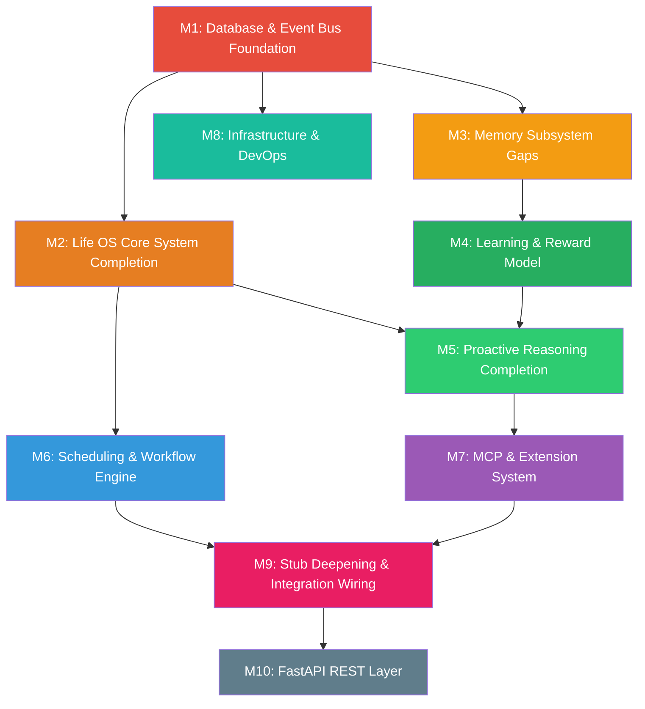

# Locus OS — Full Gap Closure Implementation Plan

> **Generated**: 2026-09-07  
> **Source**: [Codebase Adherence Audit](file:///C:/Users/soni8/.gemini/antigravity-ide/brain/72d73634-80fd-4cd0-a5d9-55fba42500a1/codebase_adherence_audit.md)  
> **Reference Bible**: [LOCUS_FEATURE_LOGIC_DECOMPOSITION.md (v5)](file:///c:/Users/soni8/Desktop/everything/University%202.0/Project(s)/5_Locus/locus-os/.keysndocs/Documentation/Implementation%20Plans/LOCUS_FEATURE_LOGIC_DECOMPOSITION.md)  
> **Feature Spec**: [locus_features.md](file:///c:/Users/soni8/Desktop/everything/University%202.0/Project(s)/5_Locus/locus-os/.keysndocs/Documentation/Ideas%20and%20System/Systems/Features/locus_features.md)

---

## User Review Required

> [!IMPORTANT]
> **Architecture Decision Needed**: The current codebase is entirely **Python-standalone**. The spec requires **TypeScript Pi Agent augmentation**. This plan assumes we **keep the Python architecture** and bring it to full feature parity, since rebuilding in TypeScript would be a ground-up rewrite. If you want to pivot to TypeScript augmentation instead, this plan changes fundamentally. Please confirm.

> [!IMPORTANT]
> **Database Decision Needed**: The spec calls for **PostgreSQL + pgvector**. The codebase uses **SQLite**. This plan adds a **PostgreSQL layer** as Milestone 1. If you want to stay SQLite-only, several features (PG NOTIFY event bus, pgvector embedding search, GENERATED ALWAYS columns) will need alternative implementations.

> [!WARNING]
> **Scope Warning**: This plan covers **every** gap from the audit — 13 missing features, 12 partial features, and 8 architectural gaps. This is ~120-180 hours of work. You may want to prioritize milestones and defer some to later phases.

## Open Questions

1. **PostgreSQL vs SQLite**: Should we add PostgreSQL as specified, or adapt all PG-dependent features to work with SQLite?
2. **FastAPI**: Should we build the full REST API layer, or is the Telegram gateway + CLI sufficient for now?
3. **Pi TS Packages**: Should we wire the `packages/` TypeScript tree into the Python runtime (via subprocess/RPC), or keep them disconnected?
4. **MCP Server**: Is the Locus MCP Server (exposing backend as tools) a priority, or can it wait?
5. **Features #100-#161**: The original features spec has features up to #161 (from Hermes spec). Should this plan cover those too, or focus only on the core §1-§30 decomposition features?

---

## Milestone Overview



---

# Milestone 1: Database & Event Bus Foundation

> **Priority**: 🔴 CRITICAL — blocks Milestones 2, 3, 5, 8  
> **Estimated Effort**: ~15-20 hours  
> **Spec References**: Features #7, #20, #24, #91; Decomposition §30.9

This milestone adds the PostgreSQL layer and real-time event bus that many downstream features depend on.

---

### Task 1.1 — PostgreSQL Integration Layer

**Status**: ❌ Missing  
**Spec**: Feature #20 (Docker Stack), #24 (FastAPI Backend — DB portion)  
**Why**: The spec mandates PostgreSQL with pgvector for structured data. Currently SQLite-only.

#### [NEW] `core/database/postgres.py`

**What to build**:
- Async PostgreSQL connection pool using `asyncpg`
- Connection factory: `get_pool()` → `asyncpg.Pool`
- Schema migration runner (apply `.sql` files in order)
- Config from `.env`: `LOCUS_PG_DSN` or individual `PG_HOST`, `PG_PORT`, `PG_DB`, `PG_USER`, `PG_PASS`
- Graceful fallback: if PG unavailable, log warning and let SQLite remain primary
- Health check function: `async def pg_health() -> bool`

**Pseudocode** (from spec):
```
class PostgresManager:
    pool: asyncpg.Pool | None

    async def init(dsn: str):
        pool = await asyncpg.create_pool(dsn, min_size=2, max_size=10)
        await run_migrations(pool)

    async def execute(query, *args) -> list[Record]:
        async with pool.acquire() as conn:
            return await conn.fetch(query, *args)

    async def close():
        await pool.close()
```

**Acceptance Criteria**:
- [ ] Pool connects to PG on startup, runs migrations
- [ ] Fallback to SQLite if PG unreachable
- [ ] `pg_health()` returns True when connected

---

#### [NEW] `core/database/migrations/001_initial_schema.sql`

**What to build** (from Feature Spec):
```sql
-- Core Life OS tables
CREATE TABLE IF NOT EXISTS factions (
    id SERIAL PRIMARY KEY,
    name TEXT UNIQUE NOT NULL,
    color_hex TEXT,
    icon TEXT,
    weekly_target_hours FLOAT DEFAULT 0,
    priority_rank INT
);

CREATE TABLE IF NOT EXISTS outcomes (
    id SERIAL PRIMARY KEY,
    title TEXT NOT NULL,
    faction_id INT REFERENCES factions(id),
    status TEXT DEFAULT 'active' CHECK (status IN ('active','paused','completed','dead_node')),
    created_at TIMESTAMPTZ DEFAULT NOW(),
    last_touched_at TIMESTAMPTZ DEFAULT NOW()
);

CREATE TABLE IF NOT EXISTS projects (
    id SERIAL PRIMARY KEY,
    title TEXT NOT NULL,
    outcome_id INT REFERENCES outcomes(id),
    faction_id INT REFERENCES factions(id),
    status TEXT DEFAULT 'active',
    last_touched_at TIMESTAMPTZ DEFAULT NOW()
);

CREATE TABLE IF NOT EXISTS tasks (
    id SERIAL PRIMARY KEY,
    title TEXT NOT NULL,
    project_id INT REFERENCES projects(id),
    priority INT DEFAULT 5,
    urgency INT DEFAULT 5,
    difficulty INT DEFAULT 5,
    tws FLOAT GENERATED ALWAYS AS ((priority * 0.4) + (urgency * 0.4) + (difficulty * 0.2)) STORED,
    status TEXT DEFAULT 'pending',
    is_locked BOOLEAN DEFAULT FALSE,
    deferral_count INT DEFAULT 0,
    created_at TIMESTAMPTZ DEFAULT NOW(),
    due_at TIMESTAMPTZ
);

CREATE TABLE IF NOT EXISTS daily_checkins (
    id SERIAL PRIMARY KEY,
    energy INT CHECK (energy BETWEEN 1 AND 10),
    mood INT CHECK (mood BETWEEN 1 AND 10),
    stress INT CHECK (stress BETWEEN 1 AND 10),
    sleep_hours FLOAT,
    time_available FLOAT,
    dcs FLOAT GENERATED ALWAYS AS (((energy + mood + (10 - stress)) / 3.0) * (1.0 - LEAST(sleep_hours, 20) / 20.0)) STORED,
    operating_mode TEXT,
    created_at TIMESTAMPTZ DEFAULT NOW()
);

CREATE TABLE IF NOT EXISTS behavioral_events (
    id SERIAL PRIMARY KEY,
    event_type TEXT NOT NULL,
    entity_type TEXT,
    entity_id INT,
    event_data JSONB DEFAULT '{}',
    source TEXT DEFAULT 'system',
    created_at TIMESTAMPTZ DEFAULT NOW()
);

CREATE TABLE IF NOT EXISTS faction_weekly_stats (
    id SERIAL PRIMARY KEY,
    faction_id INT REFERENCES factions(id),
    week_number INT,
    year INT,
    target_hours FLOAT,
    actual_hours FLOAT,
    completion_rate FLOAT,
    lag_score FLOAT,
    momentum_score FLOAT,
    created_at TIMESTAMPTZ DEFAULT NOW()
);

CREATE TABLE IF NOT EXISTS task_deferrals (
    id SERIAL PRIMARY KEY,
    task_id INT REFERENCES tasks(id),
    reason_code TEXT,
    deferred_at TIMESTAMPTZ DEFAULT NOW()
);

CREATE TABLE IF NOT EXISTS detected_patterns (
    id SERIAL PRIMARY KEY,
    horizon TEXT,
    pattern_type TEXT,
    description TEXT,
    confidence FLOAT,
    count INT DEFAULT 1,
    status TEXT DEFAULT 'active',
    created_at TIMESTAMPTZ DEFAULT NOW()
);

CREATE TABLE IF NOT EXISTS reward_signals (
    id SERIAL PRIMARY KEY,
    response_id TEXT,
    signal INT CHECK (signal IN (-1, 1)),
    response_type TEXT,
    time_of_day TEXT,
    faction TEXT,
    intent TEXT,
    context_layers_used JSONB DEFAULT '[]',
    pathway_ids JSONB DEFAULT '[]',
    created_at TIMESTAMPTZ DEFAULT NOW()
);

CREATE TABLE IF NOT EXISTS user_identity (
    id INT PRIMARY KEY DEFAULT 1 CHECK (id = 1),
    stated_life_goals JSONB DEFAULT '[]',
    active_factions JSONB DEFAULT '[]',
    known_behavioral_tendencies JSONB DEFAULT '{}',
    peak_windows JSONB DEFAULT '[]',
    known_stressors JSONB DEFAULT '[]',
    known_energizers JSONB DEFAULT '[]',
    communication_style TEXT DEFAULT 'direct',
    updated_at TIMESTAMPTZ DEFAULT NOW()
);

CREATE TABLE IF NOT EXISTS current_state (
    id INT PRIMARY KEY DEFAULT 1 CHECK (id = 1),
    psychological_state JSONB DEFAULT '{}',
    operational_state JSONB DEFAULT '{}',
    contextual_flags JSONB DEFAULT '[]',
    behavioral_alerts JSONB DEFAULT '[]',
    inferred_cause_chain TEXT,
    updated_at TIMESTAMPTZ DEFAULT NOW()
);

CREATE TABLE IF NOT EXISTS state_snapshots (
    id SERIAL PRIMARY KEY,
    state_data JSONB NOT NULL,
    snapshot_at TIMESTAMPTZ DEFAULT NOW()
);

-- Seed factions
INSERT INTO factions (name, color_hex, icon, weekly_target_hours, priority_rank) VALUES
    ('Health/Stability', '#2ecc71', '🟢', 10, 1),
    ('Leverage/Money', '#f39c12', '🟡', 15, 2),
    ('Craft/Skills', '#3498db', '🔵', 20, 3),
    ('Expression/Exploration', '#9b59b6', '🟣', 10, 4)
ON CONFLICT (name) DO NOTHING;
```

**Acceptance Criteria**:
- [ ] Migration runs cleanly on fresh PG instance
- [ ] All GENERATED ALWAYS columns compute correctly
- [ ] FK constraints enforced
- [ ] Factions seeded on first run

---

#### [NEW] `core/database/migrations/002_pgvector.sql`

```sql
CREATE EXTENSION IF NOT EXISTS vector;

CREATE TABLE IF NOT EXISTS vault_vectors (
    id SERIAL PRIMARY KEY,
    file_path TEXT NOT NULL,
    chunk_index INT DEFAULT 0,
    embedding vector(384),
    content_preview TEXT,
    updated_at TIMESTAMPTZ DEFAULT NOW()
);

CREATE INDEX IF NOT EXISTS idx_vault_vectors_embedding
    ON vault_vectors USING ivfflat (embedding vector_cosine_ops) WITH (lists = 100);
```

**Acceptance Criteria**:
- [ ] pgvector extension loads
- [ ] IVFFlat index builds
- [ ] Cosine similarity queries return correct results

---

### Task 1.2 — Behavioral Event Bus

**Status**: ⚠️ Partial (Redis pub/sub exists, no PG NOTIFY)  
**Spec**: Feature #7 (Behavioral Event Stream), #91 (State Engine)  
**File**: [MODIFY] [`core/redis_state.py`](file:///c:/Users/soni8/Desktop/everything/University%202.0/Project(s)/5_Locus/locus-os/core/redis_state.py)

**What to add**:
- PG LISTEN/NOTIFY alongside existing Redis pub/sub
- Event emission on every behavioral state change
- State Engine trigger: on `behavioral_events` INSERT → recompute `current_state`
- Dual-channel: PG NOTIFY for persistence, Redis pub/sub for real-time TUI updates

**Pseudocode** (from §30.9 + Feature #7):
```
class EventBus:
    async def emit(event_type: str, entity_type: str, entity_id: int, data: dict, source: str):
        # 1. Persist to PG
        await pg.execute(
            "INSERT INTO behavioral_events (event_type, entity_type, entity_id, event_data, source) VALUES ($1,$2,$3,$4,$5)",
            event_type, entity_type, entity_id, json.dumps(data), source
        )
        # 2. PG NOTIFY
        await pg.execute(f"NOTIFY behavioral_events, '{event_type}:{entity_id}'")
        # 3. Redis pub/sub (if available)
        if redis:
            await redis.publish("locus:events", json.dumps({...}))
        # 4. In-memory fallback
        else:
            in_memory_bus.emit(event_type, data)

    async def listen():
        # PG listener for State Engine
        conn = await asyncpg.connect(dsn)
        await conn.add_listener('behavioral_events', on_event)

    async def on_event(conn, pid, channel, payload):
        await recompute_current_state()
```

**Acceptance Criteria**:
- [ ] Every checkin/task/deferral emits a behavioral event
- [ ] PG NOTIFY fires on INSERT
- [ ] State Engine recomputes on event
- [ ] Redis fallback still works when PG unavailable

---

### Task 1.3 — Update `docker-compose.yml`

**Status**: ✅ Exists but needs PostgreSQL + pgvector  
**File**: [MODIFY] [`docker-compose.yml`](file:///c:/Users/soni8/Desktop/everything/University%202.0/Project(s)/5_Locus/locus-os/docker-compose.yml)

**What to add**:
```yaml
services:
  postgres:
    image: pgvector/pgvector:pg16
    environment:
      POSTGRES_DB: locus
      POSTGRES_USER: locus
      POSTGRES_PASSWORD: ${PG_PASSWORD}
    ports:
      - "5432:5432"
    volumes:
      - pg_data:/var/lib/postgresql/data
    healthcheck:
      test: ["CMD-SHELL", "pg_isready -U locus"]
      interval: 10s
      timeout: 5s
      retries: 5
    deploy:
      resources:
        limits:
          memory: 512M
```

**Acceptance Criteria**:
- [ ] `docker compose up` starts PG with pgvector
- [ ] Health check passes
- [ ] Memory limits enforced

---

# Milestone 2: Life OS Core System Completion

> **Priority**: 🟠 HIGH — completes the deterministic Life OS engine  
> **Estimated Effort**: ~15-20 hours  
> **Depends on**: Milestone 1 (PostgreSQL)  
> **Spec References**: Features #6-#18

These are the core Life OS features that are either missing or partial. All are deterministic (no AI required).

---

### Task 2.1 — Faction Weekly Stats Cron (#6)

**Status**: ⚠️ Partial (tracked but no APScheduler Sunday cron)  
**File**: [MODIFY] [`core/life_os.py`](file:///c:/Users/soni8/Desktop/everything/University%202.0/Project(s)/5_Locus/locus-os/core/life_os.py)

**What to build**:
- APScheduler Sunday cron job at configurable time (default 20:00 IST)
- Compute per-faction: CR (completion rate), CS (consistency score), MS (momentum), LS (lag score), AG (action gap)
- Write to `faction_weekly_stats` table
- Push JSON summary to `/vault/00-System-Data/faction_stats.json`
- Git commit + push the vault change

**Pseudocode** (from Feature #6):
```
@scheduler.cron("0 20 * * 0")  # Sunday 20:00
async def compute_weekly_stats():
    for faction in get_all_factions():
        completions = await pg.fetch(
            "SELECT COUNT(*) FROM tasks WHERE faction_id=$1 AND status='completed' AND completed_at >= $2",
            faction.id, week_start
        )
        time_logs = await pg.fetch(
            "SELECT SUM(hours) FROM time_logs WHERE faction_id=$1 AND logged_at >= $2",
            faction.id, week_start
        )
        cr = completions / total_tasks if total_tasks > 0 else 0
        ls = faction.weekly_target_hours - actual_hours
        ms = await pg.fetchval(
            "SELECT AVG(completion_rate) FROM faction_weekly_stats WHERE faction_id=$1 AND week_number >= $2",
            faction.id, current_week - 3
        )
        await pg.execute("INSERT INTO faction_weekly_stats (...) VALUES (...)")

    # Push to vault
    stats_json = serialize_all_faction_stats()
    write_file("/vault/00-System-Data/faction_stats.json", stats_json)
    git_commit_push("auto: weekly faction stats")
```

**Acceptance Criteria**:
- [ ] Cron fires on schedule
- [ ] CR, LS, MS, AG computed correctly per faction
- [ ] JSON pushed to vault path
- [ ] Test verifies computation with mock data

---

### Task 2.2 — Action Gap Tracking with Alerts (#8)

**Status**: ⚠️ Partial (compute exists, no Telegram alerts)  
**File**: [MODIFY] [`core/life_os.py`](file:///c:/Users/soni8/Desktop/everything/University%202.0/Project(s)/5_Locus/locus-os/core/life_os.py)

**What to build**:
- AG = declared_priority − (actual_hrs / target_hrs × 10)
- AG > 5 → Telegram warning message
- AG surfaced in weekly review and Dashboard

**Pseudocode**:
```
def compute_action_gap(faction) -> float:
    ag = faction.priority_rank - (actual_hours / target_hours * 10)
    return ag

async def check_action_gaps():
    for faction in factions:
        ag = compute_action_gap(faction)
        if ag > 5:
            await telegram.send_message(
                f"⚠️ Action Gap Alert: {faction.name} gap is {ag:.1f}. "
                f"Declared priority: {faction.priority_rank}, "
                f"Actual: {actual_hours:.1f}h / {target_hours:.1f}h target"
            )
            await event_bus.emit("ACTION_GAP_ALERT", "faction", faction.id, {"gap": ag})
```

**Acceptance Criteria**:
- [ ] AG computed inside weekly stats job
- [ ] Telegram alert fires when AG > 5
- [ ] Alert includes faction name, gap value, and hours data

---

### Task 2.3 — Deferral Detection Escalation (#9)

**Status**: ⚠️ Partial (basic tracking, no escalation rules)  
**File**: [MODIFY] [`core/life_os.py`](file:///c:/Users/soni8/Desktop/everything/University%202.0/Project(s)/5_Locus/locus-os/core/life_os.py)

**What to build**:
- Track each deferral with timestamp + reason_code in `task_deferrals` table
- 3× → behavioral_event FLAG
- 5× → Telegram alert
- 8+ → escalate in weekly review + flag for Inner Loop attention

**Pseudocode** (from Feature #9):
```
async def defer_task(task_id: int, reason: str):
    await pg.execute("INSERT INTO task_deferrals (task_id, reason_code) VALUES ($1, $2)", task_id, reason)
    await pg.execute("UPDATE tasks SET deferral_count = deferral_count + 1 WHERE id = $1", task_id)

    count = await pg.fetchval("SELECT deferral_count FROM tasks WHERE id = $1", task_id)

    if count >= 8:
        await event_bus.emit("DEFERRAL_CRITICAL", "task", task_id, {"count": count, "reason": reason})
        await telegram.send(f"🚨 Task #{task_id} deferred {count}× — escalated to weekly review")
    elif count >= 5:
        await event_bus.emit("DEFERRAL_WARNING", "task", task_id, {"count": count})
        await telegram.send(f"⚠️ Task #{task_id} deferred {count}× — needs attention")
    elif count >= 3:
        await event_bus.emit("DEFERRAL_FLAG", "task", task_id, {"count": count})
```

**Acceptance Criteria**:
- [ ] Deferrals tracked in `task_deferrals` with timestamps
- [ ] 3/5/8 thresholds fire correct events and alerts
- [ ] Test covers all three escalation levels

---

### Task 2.4 — Dead Node Detection (#10)

**Status**: ❌ Missing  
**File**: [MODIFY] [`core/life_os.py`](file:///c:/Users/soni8/Desktop/everything/University%202.0/Project(s)/5_Locus/locus-os/core/life_os.py)

**What to build**:
- Weekly cron: find projects/outcomes untouched 60+ days
- Update status to `dead_node`
- Telegram alert with inline keyboard: [Recommit] [Kill] [Pause]

**Pseudocode** (from Feature #10):
```
@scheduler.cron("0 21 * * 0")  # Sunday 21:00
async def detect_dead_nodes():
    stale = await pg.fetch(
        "SELECT * FROM projects WHERE last_touched_at < NOW() - INTERVAL '60 days' AND status = 'active'"
    )
    for project in stale:
        await pg.execute("UPDATE projects SET status = 'dead_node' WHERE id = $1", project['id'])
        await telegram.send_with_keyboard(
            f"💀 Dead Node: '{project['title']}' untouched for 60+ days",
            keyboard=[["Recommit", f"recommit_{project['id']}"],
                      ["Kill", f"kill_{project['id']}"],
                      ["Pause", f"pause_{project['id']}"]]
        )
```

**Acceptance Criteria**:
- [ ] Cron detects stale projects correctly
- [ ] Status updated to `dead_node`
- [ ] Telegram message with inline keyboard sent
- [ ] Keyboard callbacks handled (recommit/kill/pause)

---

### Task 2.5 — Lag Score + TWS Lag Bonus Wiring (#11)

**Status**: ⚠️ Partial (TWS exists, lag bonus not wired)  
**File**: [MODIFY] [`core/life_os.py`](file:///c:/Users/soni8/Desktop/everything/University%202.0/Project(s)/5_Locus/locus-os/core/life_os.py)

**What to build**:
- LS computed in weekly stats job (#6 / Task 2.1)
- At scheduling time, apply lag bonus via SQL join:
  - LS > 3h → TWS + 2
  - LS > 6h → TWS + 4
  - Faction ahead → TWS − 1
- Bonus NOT persisted on task (applied dynamically)

**Acceptance Criteria**:
- [ ] Scheduler query includes lag bonus JOIN
- [ ] Bonus values match spec thresholds
- [ ] Test verifies bonus application with sample data

---

### Task 2.6 — Emergency Task Injection Protocol (#12)

**Status**: ❌ Missing  
**File**: [MODIFY] [`core/life_os.py`](file:///c:/Users/soni8/Desktop/everything/University%202.0/Project(s)/5_Locus/locus-os/core/life_os.py)  
**Tool**: [MODIFY] [`core/locus_tools.py`](file:///c:/Users/soni8/Desktop/everything/University%202.0/Project(s)/5_Locus/locus-os/core/locus_tools.py)

**What to build**:
- New task → compute TWS → compare to scheduled
- If TWS > highest scheduled → replace lowest non-locked task
- Deferred task gets U+2
- If U=10 → clear ALL discretionary tasks
- `is_locked` flag protects non-negotiables

**Pseudocode** (from Feature #12):
```
async def inject_emergency(task: Task):
    task.tws = compute_tws(task)
    scheduled = await get_todays_schedule()
    highest_tws = max(t.tws for t in scheduled)

    if task.tws > highest_tws:
        # Find lowest non-locked task
        replaceable = [t for t in scheduled if not t.is_locked]
        if replaceable:
            victim = min(replaceable, key=lambda t: t.tws)
            victim.urgency = min(victim.urgency + 2, 10)
            await defer_task(victim.id, "EMERGENCY_DISPLACED")
            await schedule_task(task)

            if task.urgency == 10:
                # Nuclear option: clear all discretionary
                for t in scheduled:
                    if not t.is_locked:
                        await defer_task(t.id, "EMERGENCY_NUCLEAR")
```

**Acceptance Criteria**:
- [ ] Emergency injection displaces lowest non-locked task
- [ ] Displaced task gets urgency boost
- [ ] U=10 nuclear option clears all discretionary
- [ ] Locked tasks never displaced
- [ ] Telegram notification sent on injection

---

### Task 2.7 — Exhaustion Predictor (#13)

**Status**: ❌ Missing  
**File**: [NEW] `core/predictors/exhaustion.py`

**What to build**:
- Rule-based first: IF avg_task_difficulty(5d) > 7 AND avg_DCS(5d) < 5 → exhaustion_risk
- When exhaustion_risk → reduce next-day load by 30%
- Phase 2 enhancement: DeepSeek analyzes 30-day behavioral window

**Pseudocode** (from Feature #13):
```
async def predict_exhaustion() -> ExhaustionRisk:
    avg_diff = await pg.fetchval(
        "SELECT AVG(difficulty) FROM tasks WHERE completed_at >= NOW() - INTERVAL '5 days'"
    )
    avg_dcs = await pg.fetchval(
        "SELECT AVG(dcs) FROM daily_checkins WHERE created_at >= NOW() - INTERVAL '5 days'"
    )
    if avg_diff > 7 and avg_dcs < 5:
        risk = ExhaustionRisk(level="HIGH", reason=f"avg_diff={avg_diff:.1f}, avg_dcs={avg_dcs:.1f}")
        # Reduce tomorrow's load
        await scheduler.reduce_load(0.3)
        await telegram.send(f"⚡ Exhaustion predicted. Tomorrow's load reduced by 30%.")
        return risk
    return ExhaustionRisk(level="LOW")
```

**Acceptance Criteria**:
- [ ] Rule-based predictor implemented
- [ ] Load reduction applied when triggered
- [ ] Telegram notification sent
- [ ] Requires 5+ days of data to activate

---

### Task 2.8 — Weekly Faction Rebalance (#14)

**Status**: ⚠️ Partial (recommendations not auto-generated)  
**File**: [MODIFY] [`core/life_os.py`](file:///c:/Users/soni8/Desktop/everything/University%202.0/Project(s)/5_Locus/locus-os/core/life_os.py)

**What to build**:
- Sunday cron (#6) computes lag scores
- Starving factions (LS > 3h) get TWS bonus automatically via Task 2.5
- Rebalance recommendations written to `/vault/06-Reviews/weekly/YYYY-WW.md`

**Acceptance Criteria**:
- [ ] Rebalance markdown generated with faction-by-faction analysis
- [ ] Written to vault path
- [ ] Git committed

---

### Task 2.9 — Momentum Score Surfacing (#15)

**Status**: ⚠️ Partial (tracked but not surfaced)  
**File**: [MODIFY] [`core/life_os.py`](file:///c:/Users/soni8/Desktop/everything/University%202.0/Project(s)/5_Locus/locus-os/core/life_os.py), [MODIFY] [`core/display/dashboard.py`](file:///c:/Users/soni8/Desktop/everything/University%202.0/Project(s)/5_Locus/locus-os/core/display/dashboard.py)

**What to build**:
- MS = AVG(completion_rate) FROM last 3 weeks per faction
- Display in TUI dashboard and Telegram /status
- Push to vault JSON for Obsidian Dataview

**Acceptance Criteria**:
- [ ] MS computed via SQL window function
- [ ] Displayed in dashboard faction panel
- [ ] Included in /status Telegram response

---

### Task 2.10 — Three-Birds-One-Stone Cross-Faction Mapping (#17)

**Status**: ❌ Missing  
**File**: [NEW] `core/database/migrations/003_cross_faction.sql`, [MODIFY] [`core/life_os.py`](file:///c:/Users/soni8/Desktop/everything/University%202.0/Project(s)/5_Locus/locus-os/core/life_os.py)

**What to build**:
- M2M junction table `task_factions` (task_id, faction_id, time_split_pct)
- Cross-faction tasks get TWS + 1 per extra faction
- Time splits proportionally across faction stats

**Schema**:
```sql
CREATE TABLE task_factions (
    task_id INT REFERENCES tasks(id),
    faction_id INT REFERENCES factions(id),
    time_split_pct FLOAT DEFAULT 100,
    PRIMARY KEY (task_id, faction_id)
);
```

**Acceptance Criteria**:
- [ ] Tasks can be tagged to multiple factions
- [ ] TWS bonus applied per extra faction
- [ ] Time split tracked in weekly stats

---

### Task 2.11 — Review Cadence System Completion (#18)

**Status**: ⚠️ Partial (weekly review exists, full cadence missing)  
**File**: [MODIFY] [`core/life_os.py`](file:///c:/Users/soni8/Desktop/everything/University%202.0/Project(s)/5_Locus/locus-os/core/life_os.py), [MODIFY] [`gateway/slash_commands.py`](file:///c:/Users/soni8/Desktop/everything/University%202.0/Project(s)/5_Locus/locus-os/gateway/slash_commands.py)

**What to build**:
- Daily 22:00 → Telegram 3-sentence review prompt
- Sunday 20:00 → weekly review with narrative
- Monthly first Sunday → monthly review
- Quarterly → quarterly deep review
- Review notes written to `/vault/06-Reviews/{cadence}/YYYY-MM-DD.md`

**Acceptance Criteria**:
- [ ] 4 cadences scheduled (daily/weekly/monthly/quarterly)
- [ ] Templates rendered per cadence
- [ ] Vault files created and git committed
- [ ] Telegram prompts sent at scheduled times

---

### Task 2.12 — 4-Daily Structured Check-ins (#52)

**Status**: ⚠️ Partial (check-in exists but not 4-daily cadence)  
**File**: [MODIFY] [`gateway/slash_commands.py`](file:///c:/Users/soni8/Desktop/everything/University%202.0/Project(s)/5_Locus/locus-os/gateway/slash_commands.py)

**What to build**:
- APScheduler triggers at 07:30/13:00/18:00/22:00 IST
- Telegram inline keyboard (tap numbers, no typing)
- DCS computed at morning check-in
- Evening 22:00: optional DeepSeek 3-sentence summary
- Data pushed to `/vault/00-System-Data/daily/YYYY-MM-DD.json`

**Acceptance Criteria**:
- [ ] 4 check-in prompts scheduled
- [ ] Inline keyboard for E/M/S/ST/T input
- [ ] DCS computed and stored
- [ ] Daily JSON pushed to vault

---

# Milestone 3: Memory Subsystem Gaps

> **Priority**: 🟡 HIGH — completes the memory architecture  
> **Estimated Effort**: ~12-15 hours  
> **Depends on**: Milestone 1  
> **Spec References**: §4.5, §4.7-4.9, §4.12, §4.14

---

### Task 3.1 — Memory Tree (Hierarchical Summarization) (§4.5)

**Status**: ❌ Missing  
**File**: [NEW] `core/memory/memory_tree.py`

**What to build**:
- Hierarchical summarization of conversation history
- Tree structure: Root → Topic branches → Detail leaves
- Automatic summarization when conversation exceeds token budget
- Progressive compression: detail nodes summarize first, then topic nodes

**Pseudocode** (from §4.5 in decomposition):
```
class MemoryTree:
    root: TreeNode  # top-level summary
    topics: list[TreeNode]  # conversation topics
    details: list[TreeNode]  # individual exchanges

    def add_exchange(messages: list[Message]):
        topic = classify_topic(messages)
        detail_node = TreeNode(content=messages, token_count=count_tokens(messages))
        topic_node = find_or_create_topic(topic)
        topic_node.children.append(detail_node)

    def compress(target_tokens: int):
        while total_tokens > target_tokens:
            # Find deepest, oldest, lowest-importance leaf
            leaf = find_compressible_leaf()
            parent = leaf.parent
            leaf.content = summarize(leaf.content)  # LLM call
            leaf.token_count = count_tokens(leaf.content)
            if all(child.is_summarized for child in parent.children):
                parent.content = merge_summaries(parent.children)

    def get_context(budget: int) -> str:
        # Return most relevant branches within budget
        return traverse_by_relevance(root, budget)
```

**Acceptance Criteria**:
- [ ] Tree builds from conversation exchanges
- [ ] Compression respects token targets
- [ ] Relevance-based retrieval works
- [ ] Integrates with Context Forge (§3.1-3.3)

---

### Task 3.2 — Memory Sync (§4.7)

**Status**: ❌ Missing  
**File**: [NEW] `core/memory/sync.py`

**What to build**:
- Bidirectional sync between SQLite (local) and PostgreSQL (remote)
- Conflict resolution: last-write-wins with timestamp comparison
- Sync on startup, then periodic (every 5 min)
- Offline support: queue changes when PG unavailable

**Acceptance Criteria**:
- [ ] Local ↔ remote sync works
- [ ] Conflict resolution follows last-write-wins
- [ ] Offline queue drains when reconnected

---

### Task 3.3 — Memory Queue (§4.8)

**Status**: ❌ Missing  
**File**: [NEW] `core/memory/queue.py`

**What to build**:
- Async queue for memory write operations
- Batches writes (up to 10) for efficiency
- Priority levels: IMMEDIATE (security events), NORMAL (conversations), LOW (background patterns)
- Dead letter queue for failed writes

**Acceptance Criteria**:
- [ ] Queue processes writes in priority order
- [ ] Batch writes reduce DB round-trips
- [ ] Failed writes go to dead letter queue

---

### Task 3.4 — Memory Diff (§4.9)

**Status**: ❌ Missing  
**File**: [NEW] `core/memory/diff.py`

**What to build**:
- Compute semantic diff between memory snapshots
- Track what changed between sessions
- Surface significant changes to Inner Loop for pattern detection

**Acceptance Criteria**:
- [ ] Diff computes meaningful deltas
- [ ] Significant changes flagged
- [ ] Integrates with Pattern Engine

---

### Task 3.5 — Full STDP Reinforcement (§4.12)

**Status**: ⚠️ Partial (basic implementation, no response latency weighting)  
**File**: [MODIFY] [`core/patterns/hebbian.py`](file:///c:/Users/soni8/Desktop/everything/University%202.0/Project(s)/5_Locus/locus-os/core/patterns/hebbian.py)

**What to add**:
- Response latency tracking: measure time from user message to agent response
- STDP rule: latency < 2 min → reinforcement × 1.5
- Weekly decay: ALL weights × 0.95 (APScheduler Sunday 03:30)

**Pseudocode** (from §4.12):
```
def stdp_reinforce(pathway_id: str, response_latency_sec: float, signal: int):
    base_delta = 0.1 if signal == 1 else -0.1

    # STDP: fast responses get boosted
    if response_latency_sec < 120:  # 2 minutes
        stdp_factor = 1.5
    else:
        stdp_factor = 1.0

    # Signal-based multiplier
    if signal == 1:  # thumbs up
        multiplier = 1.3
    elif signal == -1:  # thumbs down
        multiplier = 0.7
    else:
        multiplier = 1.0

    delta = base_delta * stdp_factor * multiplier
    update_edge_weight(pathway_id, delta)
```

**Acceptance Criteria**:
- [ ] Response latency measured and stored
- [ ] STDP factor applied correctly
- [ ] Weekly decay cron runs at 03:30 Sunday
- [ ] Test covers fast vs slow response paths

---

### Task 3.6 — Project Memory Decay (§4.14)

**Status**: ⚠️ Partial (spaced rep exists, project-specific decay missing)  
**File**: [MODIFY] [`core/spaced_rep.py`](file:///c:/Users/soni8/Desktop/everything/University%202.0/Project(s)/5_Locus/locus-os/core/spaced_rep.py)

**What to add**:
- On project status change to `completed` → edge weight × 0.5 for all connected Neo4j edges
- Combined with weekly global decay (§4.12 / Task 3.5)

**Acceptance Criteria**:
- [ ] Project completion triggers Neo4j edge weight halving
- [ ] Only edges connected to the specific project affected
- [ ] Decay combines with global weekly decay

---

### Task 3.7 — Neo4j `handle_tool_call` Fix (§4.1-4.2)

**Status**: ⚠️ Partial (flagged as missing in Aug 28 audit)  
**File**: [MODIFY] [`core/neo4j_memory.py`](file:///c:/Users/soni8/Desktop/everything/University%202.0/Project(s)/5_Locus/locus-os/core/neo4j_memory.py)

**What to fix**:
- Implement `handle_tool_call()` method that dispatches to appropriate graph operations
- Wire into the agent loop's tool execution pipeline

**Acceptance Criteria**:
- [ ] `handle_tool_call` routes to store/query/extract operations
- [ ] Tool call results returned in correct format
- [ ] Integration test with mock Neo4j

---

# Milestone 4: Learning & Reward Model

> **Priority**: 🟢 MEDIUM — enables self-improvement  
> **Estimated Effort**: ~10-12 hours  
> **Depends on**: Milestone 1, 3  
> **Spec References**: §10.1-10.6, Feature #93, #94

---

### Task 4.1 — Personal Reward Model (#94, §10.5)

**Status**: ❌ Missing  
**File**: [NEW] `core/learning/reward_model.py`

**What to build**:
- sklearn LogisticRegression trained on 👍/👎 feedback
- Features: response_type, time_of_day, faction, intent, context_layers_used, pathway_ids
- `reward_signals` table stores all feedback (already in PG schema from M1)
- Retrain weekly: APScheduler Sunday 04:00
- Inner Loop gate: predicted score ≥ 0.6 to surface an observation
- Model weights: joblib → PG bytea column

**Pseudocode** (from Feature #94):
```
class PersonalRewardModel:
    model: LogisticRegression
    vectorizer: DictVectorizer

    def train(signals: list[RewardSignal]):
        features = [extract_features(s) for s in signals]
        labels = [s.signal for s in signals]
        X = vectorizer.fit_transform(features)
        model.fit(X, labels)
        save_to_pg(joblib.dumps(model), joblib.dumps(vectorizer))

    def predict(response_meta: dict) -> float:
        X = vectorizer.transform([response_meta])
        return model.predict_proba(X)[0][1]  # probability of thumbs up

    def extract_features(signal: RewardSignal) -> dict:
        return {
            "response_type": signal.response_type,
            "hour_of_day": int(signal.time_of_day.split(":")[0]),
            "faction": signal.faction,
            "intent": signal.intent,
            "num_context_layers": len(signal.context_layers_used),
            "num_pathways": len(signal.pathway_ids),
        }
```

**Acceptance Criteria**:
- [ ] Model trains on 200+ labeled examples
- [ ] Prediction returns float 0-1
- [ ] Weekly retrain cron runs
- [ ] Model serialized to PG for persistence
- [ ] Inner Loop uses prediction as quality gate

---

### Task 4.2 — User Identity Profile Deepening (#93, §10.1-10.3)

**Status**: ⚠️ Partial (minimal ~3K stub)  
**File**: [MODIFY] [`core/learning/user_profile.py`](file:///c:/Users/soni8/Desktop/everything/University%202.0/Project(s)/5_Locus/locus-os/core/learning/user_profile.py)

**What to build**:
- Full `user_identity` table integration (single row, from PG schema)
- Rolling average updates from Pattern Engine — never hard overwrite
- Fields: stated_life_goals, active_factions, known_behavioral_tendencies (JSONB with float confidence), peak_windows, known_stressors, known_energizers, communication_style
- Feed 80-token identity layer in Context Forge

**Pseudocode** (from Feature #93):
```
class UserIdentityManager:
    async def update_from_pattern(pattern: DetectedPattern):
        current = await pg.fetchrow("SELECT * FROM user_identity WHERE id = 1")
        tendencies = json.loads(current['known_behavioral_tendencies'])

        # Rolling average update (never hard overwrite)
        key = pattern.pattern_type
        if key in tendencies:
            old_conf = tendencies[key]['confidence']
            new_conf = (old_conf * 0.7) + (pattern.confidence * 0.3)  # EMA
            tendencies[key]['confidence'] = new_conf
            tendencies[key]['count'] += 1
        else:
            tendencies[key] = {'confidence': pattern.confidence, 'count': 1, 'description': pattern.description}

        await pg.execute(
            "UPDATE user_identity SET known_behavioral_tendencies = $1, updated_at = NOW() WHERE id = 1",
            json.dumps(tendencies)
        )

    def to_context_token(identity: dict, budget: int = 80) -> str:
        # Compress identity into 80-token preamble for Context Forge
        ...
```

**Acceptance Criteria**:
- [ ] Identity table populated from patterns
- [ ] Rolling average prevents overwrites
- [ ] 80-token context preamble generated
- [ ] Context Forge consumes identity layer

---

### Task 4.3 — Reflector Enhancement (§10.1)

**Status**: ⚠️ Partial (minimal stub)  
**File**: [MODIFY] [`core/learning/reflector.py`](file:///c:/Users/soni8/Desktop/everything/University%202.0/Project(s)/5_Locus/locus-os/core/learning/reflector.py)

**What to build**:
- Post-turn reflection: what worked, what didn't
- Log reflection metadata to `reward_signals` for training
- Track tool usage patterns for optimization

**Acceptance Criteria**:
- [ ] Post-turn reflection generates structured metadata
- [ ] Metadata stored for reward model training
- [ ] Tool usage patterns tracked

---

### Task 4.4 — Tool Usage Tracker Enhancement (§10.3)

**Status**: ⚠️ Partial (minimal stub)  
**File**: [MODIFY] [`core/learning/tool_tracker.py`](file:///c:/Users/soni8/Desktop/everything/University%202.0/Project(s)/5_Locus/locus-os/core/learning/tool_tracker.py)

**What to build**:
- Track every tool invocation: tool_name, args, result_size, latency, success/failure
- Compute tool effectiveness metrics
- Surface underused/overused tools to Inner Loop

**Acceptance Criteria**:
- [ ] Every tool call logged with metadata
- [ ] Effectiveness metrics computed
- [ ] Report available via `/tools stats` command

---

# Milestone 5: Proactive Reasoning Completion

> **Priority**: 🟢 MEDIUM — completes the Inner Loop  
> **Estimated Effort**: ~10-15 hours  
> **Depends on**: Milestones 2, 4  
> **Spec References**: §26.1-26.7, Feature #90, #32

---

### Task 5.1 — Full 7-Subsystem Proactive Reasoning Chain (§26.1-26.7)

**Status**: ⚠️ Partial (heartbeat/subconscious exists but not full chain)  
**File**: [MODIFY] [`core/heartbeat/subconscious.py`](file:///c:/Users/soni8/Desktop/everything/University%202.0/Project(s)/5_Locus/locus-os/core/heartbeat/subconscious.py)

**What to build** (the 7 subsystems from decomposition):
1. **State Collector** — Fetch CURRENT_STATE, behavioral_alerts, recent events (6h), top Hebbian pathways
2. **Observation Generator** — DeepSeek: "You are NOT talking to Shivam. You are thinking about Shivam. Generate 0-2 observations."
3. **Dedup Filter** — pgvector dedup (>0.85 cosine → suppress)
4. **Quality Gate** — Reward Model (§10.5): predicted ≥ 0.6 to surface
5. **Router** — HIGH → Telegram now, MEDIUM → morning brief queue, LOW → discard
6. **Deep Pass** (03:00 IST) — 30-day analysis
7. **Weekly Synthesis** (Sunday 03:00) — Write to `/vault/06-Reviews/weekly/YYYY-WW-synthesis.md`

**Acceptance Criteria**:
- [ ] All 7 subsystems wired in sequence
- [ ] Dedup filter prevents duplicate observations
- [ ] Quality gate uses reward model prediction
- [ ] Routing correctly sends HIGH to Telegram immediately
- [ ] Deep pass runs at 03:00
- [ ] Weekly synthesis writes to vault

---

### Task 5.2 — Weekly Full Vault Synthesis (#32)

**Status**: ❌ Missing  
**File**: [NEW] `core/heartbeat/vault_synthesis.py`

**What to build**:
- APScheduler Sunday 02:00 IST
- Collect: behavioral_events (7d), faction_weekly_stats, detected_patterns, CURRENT_STATE, top 10 Hebbian pathways
- DeepSeek generates: personality drift report, faction narrative, top 3 observations
- Write to `/vault/06-Reviews/weekly/YYYY-WW-synthesis.md`
- ~3000 tokens

**Acceptance Criteria**:
- [ ] Synthesis collects all required data
- [ ] Narrative written to vault
- [ ] Git committed
- [ ] Token usage within budget

---

### Task 5.3 — LOCUS_SHORTHAND Compression (#96)

**Status**: ❌ Missing  
**File**: [NEW] `core/context/shorthand.py`

**What to build**:
- Python dict-based encode()/decode()
- Energy shorthand: `{e:N,t:HHMM,f:FACTION}`
- Applied by Context Forge to PG events layer
- System prompt explains schema to DeepSeek
- ~4× token reduction on behavioral events

**Pseudocode** (from Feature #96):
```
SHORTHAND = {
    "energy": "e", "mood": "m", "stress": "s", "sleep_hours": "sl",
    "time_available": "ta", "dcs": "d", "faction": "f",
    "timestamp": "t", "status": "st", "priority": "p",
    "urgency": "u", "difficulty": "df"
}

def encode(events: list[dict]) -> str:
    compressed = []
    for ev in events:
        short = {SHORTHAND.get(k, k): v for k, v in ev.items() if v is not None}
        compressed.append(short)
    return json.dumps(compressed, separators=(',', ':'))

def decode(compressed: str) -> list[dict]:
    REVERSE = {v: k for k, v in SHORTHAND.items()}
    events = json.loads(compressed)
    return [{REVERSE.get(k, k): v for k, v in ev.items()} for ev in events]
```

**Acceptance Criteria**:
- [ ] Encode/decode round-trips correctly
- [ ] ~4× token reduction measured
- [ ] Context Forge uses shorthand for events layer
- [ ] System prompt includes shorthand schema

---

# Milestone 6: Scheduling & Workflow Engine

> **Priority**: 🔵 MEDIUM — completes task orchestration  
> **Estimated Effort**: ~10-12 hours  
> **Depends on**: Milestone 2  
> **Spec References**: §25.12, §29.8, Feature #16

---

### Task 6.1 — Full 6-Step Scheduling Algorithm (§25.12)

**Status**: ⚠️ Partial (files exist but algorithm incomplete)  
**File**: [MODIFY] [`core/scheduler/__init__.py`](file:///c:/Users/soni8/Desktop/everything/University%202.0/Project(s)/5_Locus/locus-os/core/scheduler/__init__.py), [MODIFY] [`core/scheduler/task_sources.py`](file:///c:/Users/soni8/Desktop/everything/University%202.0/Project(s)/5_Locus/locus-os/core/scheduler/task_sources.py)

**What to build** (from §25.12):
```
STEP 1: COLLECT
  - Calendar events (Google Calendar API)
  - Active tasks with TWS + lag bonus
  - Recurring habits/routines
  - Check-in schedule

STEP 2: FILTER BY MODE
  - SURVIVAL: only essentials (is_locked=True OR urgency >= 8)
  - RECOVERY: essentials + 1 light task
  - NORMAL: full schedule
  - DEEP_WORK: 2-3 high-priority blocks + buffer
  - PEAK: aggressive scheduling

STEP 3: SORT BY EFFECTIVE TWS
  - effective_tws = tws + lag_bonus + cross_faction_bonus - (deferral_count * 0.5)

STEP 4: SLOT INTO TIME BLOCKS
  - Morning (07:00-12:00): highest TWS tasks
  - Afternoon (12:00-17:00): meetings + medium TWS
  - Evening (17:00-22:00): creative/expression tasks
  - Respect calendar conflicts

STEP 5: VALIDATE
  - No double-booking
  - Break every 90 min
  - Total hours <= time_available from DCS

STEP 6: EMIT
  - Push schedule to Telegram
  - Write to /vault/00-System-Data/schedule/YYYY-MM-DD.json
  - Display in TUI dashboard
```

**Acceptance Criteria**:
- [ ] All 6 steps implemented
- [ ] Mode filtering works for all 5 modes
- [ ] Effective TWS includes all bonuses
- [ ] Calendar conflicts respected
- [ ] Schedule emitted to Telegram + vault + dashboard

---

### Task 6.2 — Parallel Task Execution Optimizer (#16)

**Status**: ❌ Missing  
**File**: [NEW] `core/scheduler/parallel_optimizer.py`, [NEW] `core/database/migrations/004_task_deps.sql`

**What to build**:
- `task_dependencies` junction table (task_id, depends_on_task_id, dependency_type)
- Topological sort → identify independent chains
- DeepSeek suggests parallelizable tasks from descriptions
- Independent chains → parallel time slots

**Acceptance Criteria**:
- [ ] Dependencies tracked in junction table
- [ ] Topological sort identifies parallel chains
- [ ] Scheduler can assign parallel tasks to same time block

---

### Task 6.3 — Workflow Engine (§29.8)

**Status**: ❌ Missing  
**File**: [NEW] `core/workflows/engine.py`, [NEW] `core/workflows/definitions.py`

**What to build**:
- YAML/Markdown-defined workflows
- Step-by-step execution with conditions, branches, loops
- Integration with tool system for automated execution
- Built-in workflows: morning_routine, weekly_review, project_setup

**Pseudocode**:
```
class WorkflowEngine:
    async def run(workflow_name: str, context: dict):
        definition = load_workflow(workflow_name)
        state = WorkflowState(context=context)

        for step in definition.steps:
            if step.condition and not evaluate(step.condition, state):
                continue

            if step.type == "tool_call":
                result = await tool_system.execute(step.tool, step.args)
                state.set(step.output_var, result)
            elif step.type == "llm_call":
                result = await llm.generate(step.prompt.format(**state.context))
                state.set(step.output_var, result)
            elif step.type == "user_input":
                result = await telegram.ask(step.prompt)
                state.set(step.output_var, result)
            elif step.type == "branch":
                branch = evaluate_branch(step.conditions, state)
                await run(branch, state.context)
```

**Acceptance Criteria**:
- [ ] YAML workflow definitions load correctly
- [ ] Steps execute in sequence with conditions
- [ ] Tool calls and LLM calls work within workflows
- [ ] Built-in workflows functional

---

# Milestone 7: MCP & Extension System

> **Priority**: 🟣 MEDIUM — enables extensibility  
> **Estimated Effort**: ~12-15 hours  
> **Depends on**: Milestone 5  
> **Spec References**: §18.1-18.5, §9.1, Feature #83, #84, #85, #113

---

### Task 7.1 — Locus MCP Server (§18.1-18.3, Feature #85)

**Status**: ❌ Missing  
**File**: [NEW] `core/mcp/server.py`

**What to build**:
- FastMCP server alongside the agent
- Tools exposed: `store_thought`, `log_task`, `retrieve_context`, `query_patterns`, `get_current_state`, `get_schedule`, `log_mood`, `defer_task`, `search_vault`, `get_goal_stack`, `get_faction_health`
- Thin wrappers around existing Python functions
- Streamable HTTP transport
- Claude Desktop, ChatGPT, Cursor can connect natively

**Pseudocode** (from Feature #85):
```python
from fastmcp import FastMCP

mcp = FastMCP("Locus OS", description="Personal Intelligence OS")

@mcp.tool()
async def store_thought(content: str, faction: str = None) -> dict:
    """Store a thought in the knowledge graph."""
    return await memory.store(content, {"faction": faction})

@mcp.tool()
async def get_current_state() -> dict:
    """Get the current user state including DCS, operating mode, and alerts."""
    return await state_engine.get_current_state()

@mcp.tool()
async def search_vault(query: str, limit: int = 5) -> list[dict]:
    """Semantic search across the Obsidian vault."""
    return await pageindex.search(query, limit=limit)

# ... (11 total tools)

if __name__ == "__main__":
    mcp.run(transport="streamable-http", port=8001)
```

**Acceptance Criteria**:
- [ ] MCP server starts on port 8001
- [ ] All 11 tools respond correctly
- [ ] Claude Desktop can connect and use tools
- [ ] Streamable HTTP transport works

---

### Task 7.2 — Obsidian MCP Server (Feature #84)

**Status**: ❌ Missing  
**File**: [NEW] `core/mcp/obsidian_mcp.py`

**What to build**:
- FastMCP server for vault access
- Tools: `vault_read`, `vault_write` (append-only), `vault_search` (grep + pgvector), `vault_tag`, `vault_stats`
- Localhost only, `.md` only, path traversal blocked
- No Obsidian Local REST API needed — direct file access

**Acceptance Criteria**:
- [ ] All 5 vault tools functional
- [ ] Path traversal blocked (no `../` escapes)
- [ ] Write is append-only (no overwrite)
- [ ] Localhost binding enforced

---

### Task 7.3 — MCP Client Enhancement (§18.4-18.5)

**Status**: ⚠️ Partial (minimal 4K client exists)  
**File**: [MODIFY] [`core/mcp_client.py`](file:///c:/Users/soni8/Desktop/everything/University%202.0/Project(s)/5_Locus/locus-os/core/mcp_client.py)

**What to add**:
- Dynamic MCP server discovery and connection
- Tool schema caching
- Circuit breaker for failed MCP connections
- Support for STDIO and HTTP transports

**Acceptance Criteria**:
- [ ] Client connects to arbitrary MCP servers
- [ ] Tool schemas cached after first fetch
- [ ] Circuit breaker prevents repeated failures
- [ ] Both STDIO and HTTP transports work

---

### Task 7.4 — Skill & MCP Toolkit Layer (Feature #83)

**Status**: ⚠️ Partial (3 files, minimal)  
**File**: [MODIFY] [`core/skills/__init__.py`](file:///c:/Users/soni8/Desktop/everything/University%202.0/Project(s)/5_Locus/locus-os/core/skills/__init__.py), [MODIFY] [`core/skills/loader.py`](file:///c:/Users/soni8/Desktop/everything/University%202.0/Project(s)/5_Locus/locus-os/core/skills/loader.py)

**What to build**:
- PG `skills_registry` table: id, name, description, trigger_conditions (JSONB), tool_schema (JSONB), priority, is_active
- Query Router decides: text reply vs skill invocation based on intent + output_type
- Skill loading from SKILL.md files
- Dynamic registration/deregistration

**Acceptance Criteria**:
- [ ] Skills registered in PG with schemas
- [ ] Conductor routes to skills when appropriate
- [ ] Skills loaded from SKILL.md format
- [ ] Dynamic add/remove works

---

### Task 7.5 — Trajectory Recording (§19.2)

**Status**: ❌ Missing  
**File**: [NEW] `core/learning/trajectory.py`

**What to build**:
- Record every agent action as a trajectory step
- Steps: observation → thought → action → result
- Export trajectories for fine-tuning data (feeds QLoRA curator)
- Compress old trajectories to save space

**Acceptance Criteria**:
- [ ] Every turn recorded with full trajectory
- [ ] Export to JSONL for training
- [ ] Compression for old data

---

# Milestone 8: Infrastructure & DevOps

> **Priority**: 🟢 MEDIUM — production readiness  
> **Estimated Effort**: ~8-10 hours  
> **Depends on**: Milestone 1  
> **Spec References**: Features #23, #26, #103, §29.3

---

### Task 8.1 — Vault Sync via Git (#23)

**Status**: ❌ Missing  
**File**: [NEW] `core/vault/git_sync.py`

**What to build**:
- Cron: `git -C /vault pull` every 5 minutes
- Backend writes: `git add . && git commit -m "auto: {desc}" && git push`
- Directory partitioning prevents conflicts:
  - User writes: /01-System/, /02-Captures/, /04-Resources/, /05-Journal/
  - Backend writes: /00-System-Data/, /03-AI-Chats/, /06-Reviews/, /07-Morning-Briefs/
- Conflict detection and resolution

**Acceptance Criteria**:
- [ ] Pull cron runs every 5 min
- [ ] Auto-commit on backend writes
- [ ] No merge conflicts with directory partitioning
- [ ] Conflict detection alerts via Telegram

---

### Task 8.2 — Self-Maintenance System (#26)

**Status**: ❌ Missing  
**File**: [NEW] `core/maintenance/self_update.py`

**What to build**:
- APScheduler monthly cron: `pip-audit` for security
- If critical vulnerability → create P1 task
- Post-update: run pytest → if failures → Telegram alert with [Rollback] [Fix]
- Dependency version pinning report

**Acceptance Criteria**:
- [ ] Monthly audit runs
- [ ] Critical findings create tasks
- [ ] Rollback option available
- [ ] Report sent via Telegram

---

### Task 8.3 — Database Diagnostic Script (#103)

**Status**: ❌ Missing  
**File**: [NEW] `core/diagnostics/db_health.py`

**What to build**:
- PG row counts per table
- Neo4j node/edge counts
- pgvector collection sizes
- Vault file count
- Redis key count (if using)
- Print + optional Telegram report

**Acceptance Criteria**:
- [ ] All DB systems checked
- [ ] Report generated in table format
- [ ] Telegram delivery works
- [ ] `locus doctor db` CLI command

---

### Task 8.4 — Full System Health Checks (§29.3)

**Status**: ⚠️ Partial (basic probes in error_classifier.py)  
**File**: [MODIFY] [`core/diagnostics/error_classifier.py`](file:///c:/Users/soni8/Desktop/everything/University%202.0/Project(s)/5_Locus/locus-os/core/diagnostics/error_classifier.py)

**What to add**:
- Per-subsystem liveness probes: PG, Neo4j, Redis, LLM API, Telegram, vault filesystem
- Health aggregation: HEALTHY / DEGRADED / CRITICAL
- Auto-restart for failed subsystems where possible
- Dashboard integration for health status display

**Acceptance Criteria**:
- [ ] All 6+ subsystems have health probes
- [ ] Aggregate health computed
- [ ] Dashboard shows health status
- [ ] `locus doctor` runs all checks

---

# Milestone 9: Stub Deepening & Integration Wiring

> **Priority**: 🔵 MEDIUM — connects the dots  
> **Estimated Effort**: ~12-15 hours  
> **Depends on**: Milestones 6, 7  
> **Spec References**: §1.2, §7.1-7.5, §13.3, §17.1, §21.2-21.3, §28.1, §28.3

---

### Task 9.1 — System Prompt Builder (§1.2)

**Status**: ⚠️ Partial (inline, not structured)  
**File**: [MODIFY] [`core/agent.py`](file:///c:/Users/soni8/Desktop/everything/University%202.0/Project(s)/5_Locus/locus-os/core/agent.py)

**What to build**:
- Extract prompt construction into `core/prompt_builder.py`
- Template system with replaceable sections
- Dynamic injection: SOUL.md identity, user profile, CURRENT_STATE, tool list
- Token budget enforcement for prompt sections

**Acceptance Criteria**:
- [ ] Prompt builder extracts cleanly from agent.py
- [ ] Dynamic sections inject correctly
- [ ] Token budget respected
- [ ] SOUL.md preamble included

---

### Task 9.2 — TUI Dashboard Interactive Keybindings (§7.1-7.5)

**Status**: ⚠️ Partial (renders frames, limited interactivity)  
**File**: [MODIFY] [`core/display/dashboard.py`](file:///c:/Users/soni8/Desktop/everything/University%202.0/Project(s)/5_Locus/locus-os/core/display/dashboard.py), [MODIFY] [`locus_cli/curses_ui.py`](file:///c:/Users/soni8/Desktop/everything/University%202.0/Project(s)/5_Locus/locus-os/locus_cli/curses_ui.py)

**What to add**:
- Space: toggle task completion
- D: defer task (with reason prompt)
- N: new task inline
- C: check-in inline
- R: refresh all panels
- Arrow keys: navigate between panels
- Live DCS gauge with color gradient

**Acceptance Criteria**:
- [ ] All keybindings functional
- [ ] Visual feedback on keypress
- [ ] Panel navigation works
- [ ] DCS gauge updates live

---

### Task 9.3 — Shell Sandbox Multi-Backend (§13.3)

**Status**: ⚠️ Partial (blocklist only, no sandbox)  
**File**: [MODIFY] [`core/security.py`](file:///c:/Users/soni8/Desktop/everything/University%202.0/Project(s)/5_Locus/locus-os/core/security.py)

**What to add**:
- Provider interface for sandboxing backends
- Bubblewrap (Linux), Firejail (Linux), or basic `subprocess` with restrictions
- Windows: use restricted subprocess with environment isolation
- Configurable: user can choose backend or disable

**Acceptance Criteria**:
- [ ] Provider interface defined
- [ ] At least 2 backends implemented
- [ ] Configurable in `locus config`
- [ ] Fallback to basic subprocess if sandbox unavailable

---

### Task 9.4 — Telegram Gateway Deep Patterns (§17.1)

**Status**: ⚠️ Partial (works but missing spec patterns)  
**File**: [MODIFY] [`gateway/bot.py`](file:///c:/Users/soni8/Desktop/everything/University%202.0/Project(s)/5_Locus/locus-os/gateway/bot.py)

**What to add**:
- Adaptive batching: collect rapid-fire messages for 2s before processing
- DM topics: thread-based conversation grouping
- Message deduplication
- Typing indicator during processing
- Error recovery: auto-reconnect on network failures

**Acceptance Criteria**:
- [ ] Adaptive batching collects messages within 2s window
- [ ] Deduplication prevents double-processing
- [ ] Typing indicator shows during LLM processing
- [ ] Auto-reconnect works

---

### Task 9.5 — Polymarket & Webhooks Completion (§21.2-21.3)

**Status**: ⚠️ Stubs  
**Files**: [MODIFY] [`core/integrations/polymarket.py`](file:///c:/Users/soni8/Desktop/everything/University%202.0/Project(s)/5_Locus/locus-os/core/integrations/polymarket.py), [MODIFY] [`core/integrations/webhooks.py`](file:///c:/Users/soni8/Desktop/everything/University%202.0/Project(s)/5_Locus/locus-os/core/integrations/webhooks.py)

**What to build**:
- Polymarket: API client for market data, position tracking, alert on significant moves
- Webhooks: HTTP endpoint for receiving external notifications, event routing, authentication

**Acceptance Criteria**:
- [ ] Polymarket fetches real market data
- [ ] Webhook endpoint accepts and routes events
- [ ] Authentication on webhook endpoint

---

### Task 9.6 — Nightly Vault Diff Cron Wiring (#31)

**Status**: ⚠️ Partial (MD5 crawler exists, no nightly cron)  
**File**: [MODIFY] [`core/ingestion/collector.py`](file:///c:/Users/soni8/Desktop/everything/University%202.0/Project(s)/5_Locus/locus-os/core/ingestion/collector.py)

**What to add**:
- APScheduler 23:30 IST trigger
- Scan /vault/ → git diff or MD5 comparison against stored hashes
- New/changed files → embed (PageIndex) or chunk (if >800 words)
- Entity extraction → Neo4j
- Embeddings → pgvector

**Acceptance Criteria**:
- [ ] Cron fires at 23:30
- [ ] Only new/changed files processed
- [ ] Embeddings stored in pgvector
- [ ] Entities extracted to Neo4j

---

### Task 9.7 — Personality Profile Building (#33)

**Status**: ⚠️ Partial (minimal user_profile.py)  
**File**: [MODIFY] [`core/learning/user_profile.py`](file:///c:/Users/soni8/Desktop/everything/University%202.0/Project(s)/5_Locus/locus-os/core/learning/user_profile.py)

**What to add**:
- DeepSeek scans AI chat vault for recurring approaches
- Creates ConceptNode in Neo4j
- Feeds User Identity (Task 4.2)
- Quarterly comprehensive profile synthesis
- Requires 60+ days of chat data

**Acceptance Criteria**:
- [ ] Chat vault scanned for patterns
- [ ] Concept nodes created in Neo4j
- [ ] Quarterly synthesis triggered
- [ ] Profile feeds identity layer

---

### Task 9.8 — Deduplicate Desktop/Screen/Computer-Use

**Status**: ⚠️ Redundant code across 3 directories  
**Files**: [`core/desktop/`](file:///c:/Users/soni8/Desktop/everything/University%202.0/Project(s)/5_Locus/locus-os/core/desktop/), [`core/screen/`](file:///c:/Users/soni8/Desktop/everything/University%202.0/Project(s)/5_Locus/locus-os/core/screen/), [`core/computer_use/`](file:///c:/Users/soni8/Desktop/everything/University%202.0/Project(s)/5_Locus/locus-os/core/computer_use/)

**What to do**:
- Consolidate screen capture logic from `core/screen/capture.py` and `core/desktop/screen_capture.py`
- Consolidate VNC from `core/computer_use/vnc.py` and `core/desktop/vnc_client.py`
- Keep `core/desktop/` as canonical, remove or re-export from others

**Acceptance Criteria**:
- [ ] No duplicate functionality
- [ ] All imports updated
- [ ] Tests still pass

---

# Milestone 10: FastAPI REST Layer

> **Priority**: 🔵 MEDIUM (deferrable) — adds REST API  
> **Estimated Effort**: ~15-20 hours  
> **Depends on**: Milestones 1-9  
> **Spec References**: Feature #24

---

### Task 10.1 — FastAPI Application Scaffold

**File**: [NEW] `api/__init__.py`, [NEW] `api/app.py`

**What to build**:
- FastAPI application with CORS, OpenAPI docs
- Uvicorn ASGI server
- Middleware: request logging, error handling, rate limiting
- Auth: API key or JWT for external access

---

### Task 10.2 — API Routers

**Files**: [NEW] `api/routers/` (one file per domain)

| Router | Endpoints | Source |
|--------|-----------|--------|
| `checkins.py` | POST /checkin, GET /checkins/today, GET /dcs | `core/life_os.py` |
| `tasks.py` | CRUD /tasks, POST /tasks/{id}/defer, POST /tasks/{id}/complete | `core/life_os.py` |
| `goals.py` | GET /goals/stack, GET /outcomes, GET /projects | `core/life_os.py` |
| `factions.py` | GET /factions, GET /factions/{id}/stats | `core/life_os.py` |
| `schedule.py` | GET /schedule/today, POST /schedule/generate | `core/scheduler/` |
| `brain.py` | GET /brain/state, GET /brain/pathways, GET /brain/patterns | `core/patterns/`, `core/redis_state.py` |
| `vault.py` | GET /vault/search, GET /vault/stats | `core/search/` |
| `events.py` | GET /events, POST /events | `core/redis_state.py` |
| `reviews.py` | GET /reviews/latest, POST /reviews/weekly | `core/life_os.py` |

**Acceptance Criteria**:
- [ ] All 9 routers respond correctly
- [ ] Every state change emits behavioral events
- [ ] OpenAPI docs generate automatically
- [ ] Auth middleware protects endpoints

---

### Task 10.3 — Wire Telegram Gateway to FastAPI

**File**: [MODIFY] [`gateway/bot.py`](file:///c:/Users/soni8/Desktop/everything/University%202.0/Project(s)/5_Locus/locus-os/gateway/bot.py)

**What to change**:
- Telegram slash commands call FastAPI endpoints instead of directly invoking Python functions
- This ensures all state changes go through the same pipeline
- FastAPI becomes the single source of truth for mutations

**Acceptance Criteria**:
- [ ] Telegram commands route through FastAPI
- [ ] Same behavioral events emitted regardless of entry point
- [ ] Latency stays under 500ms for common operations

---

## Verification Plan

### Automated Tests

For each milestone, the following test strategy applies:

```bash
# Run existing tests (should still pass)
cd locus-os && python -m pytest core/ -v

# Run new milestone tests
python -m pytest core/test_milestone_1.py -v  # DB + event bus
python -m pytest core/test_milestone_2.py -v  # Life OS completion
python -m pytest core/test_milestone_3.py -v  # Memory subsystems
python -m pytest core/test_milestone_4.py -v  # Learning & reward
python -m pytest core/test_milestone_5.py -v  # Proactive reasoning
python -m pytest core/test_milestone_6.py -v  # Scheduling & workflows
python -m pytest core/test_milestone_7.py -v  # MCP & extensions
python -m pytest core/test_milestone_8.py -v  # Infrastructure
python -m pytest core/test_milestone_9.py -v  # Stub deepening
python -m pytest core/test_milestone_10.py -v # FastAPI

# Integration test: full pipeline
python -m pytest tests/integration/ -v
```

### Manual Verification

- [ ] Docker stack starts cleanly with PG + Neo4j + Redis
- [ ] Telegram bot responds to all commands
- [ ] TUI dashboard renders with real data
- [ ] MCP server connects from Claude Desktop
- [ ] Vault sync works bidirectionally
- [ ] Check-in cadence fires at correct times

---

## Estimated Timeline

| Milestone | Hours | Dependencies | Priority |
|-----------|-------|-------------|----------|
| M1: Database & Event Bus | 15-20h | None | 🔴 CRITICAL |
| M2: Life OS Completion | 15-20h | M1 | 🟠 HIGH |
| M3: Memory Subsystem Gaps | 12-15h | M1 | 🟡 HIGH |
| M4: Learning & Reward | 10-12h | M1, M3 | 🟢 MEDIUM |
| M5: Proactive Reasoning | 10-15h | M2, M4 | 🟢 MEDIUM |
| M6: Scheduling & Workflow | 10-12h | M2 | 🔵 MEDIUM |
| M7: MCP & Extension | 12-15h | M5 | 🟣 MEDIUM |
| M8: Infrastructure & DevOps | 8-10h | M1 | 🟢 MEDIUM |
| M9: Stub Deepening | 12-15h | M6, M7 | 🔵 MEDIUM |
| M10: FastAPI REST Layer | 15-20h | M1-M9 | 🔵 DEFERRABLE |
| **TOTAL** | **~120-155h** | | |

---

## Appendix: Full File Change Manifest

### New Files (30)

| # | Path | Milestone |
|---|------|-----------|
| 1 | `core/database/postgres.py` | M1 |
| 2 | `core/database/migrations/001_initial_schema.sql` | M1 |
| 3 | `core/database/migrations/002_pgvector.sql` | M1 |
| 4 | `core/database/migrations/003_cross_faction.sql` | M2 |
| 5 | `core/database/migrations/004_task_deps.sql` | M6 |
| 6 | `core/predictors/exhaustion.py` | M2 |
| 7 | `core/memory/memory_tree.py` | M3 |
| 8 | `core/memory/sync.py` | M3 |
| 9 | `core/memory/queue.py` | M3 |
| 10 | `core/memory/diff.py` | M3 |
| 11 | `core/learning/reward_model.py` | M4 |
| 12 | `core/learning/trajectory.py` | M7 |
| 13 | `core/heartbeat/vault_synthesis.py` | M5 |
| 14 | `core/context/shorthand.py` | M5 |
| 15 | `core/scheduler/parallel_optimizer.py` | M6 |
| 16 | `core/workflows/engine.py` | M6 |
| 17 | `core/workflows/definitions.py` | M6 |
| 18 | `core/mcp/server.py` | M7 |
| 19 | `core/mcp/obsidian_mcp.py` | M7 |
| 20 | `core/vault/git_sync.py` | M8 |
| 21 | `core/maintenance/self_update.py` | M8 |
| 22 | `core/diagnostics/db_health.py` | M8 |
| 23 | `core/prompt_builder.py` | M9 |
| 24 | `api/__init__.py` | M10 |
| 25 | `api/app.py` | M10 |
| 26 | `api/routers/checkins.py` | M10 |
| 27 | `api/routers/tasks.py` | M10 |
| 28 | `api/routers/goals.py` | M10 |
| 29 | `api/routers/brain.py` | M10 |
| 30 | `api/routers/vault.py` | M10 |

### Modified Files (22)

| # | Path | Milestone | What Changes |
|---|------|-----------|-------------|
| 1 | `core/redis_state.py` | M1 | Add PG NOTIFY event bus |
| 2 | `docker-compose.yml` | M1 | Add PostgreSQL service |
| 3 | `core/life_os.py` | M2 | Tasks 2.1-2.9 (weekly stats, AG, deferrals, dead nodes, lag, emergency, rebalance, momentum) |
| 4 | `core/locus_tools.py` | M2 | Emergency injection tool |
| 5 | `gateway/slash_commands.py` | M2 | Review cadence + 4-daily check-ins |
| 6 | `core/patterns/hebbian.py` | M3 | Full STDP with latency |
| 7 | `core/spaced_rep.py` | M3 | Project memory decay |
| 8 | `core/neo4j_memory.py` | M3 | handle_tool_call fix |
| 9 | `core/learning/user_profile.py` | M4 | Full identity manager |
| 10 | `core/learning/reflector.py` | M4 | Post-turn reflection |
| 11 | `core/learning/tool_tracker.py` | M4 | Tool effectiveness metrics |
| 12 | `core/heartbeat/subconscious.py` | M5 | 7-subsystem chain |
| 13 | `core/scheduler/__init__.py` | M6 | 6-step algorithm |
| 14 | `core/scheduler/task_sources.py` | M6 | Enhanced sources |
| 15 | `core/mcp_client.py` | M7 | Enhanced MCP client |
| 16 | `core/skills/__init__.py` | M7 | Skills registry |
| 17 | `core/skills/loader.py` | M7 | Skill loading |
| 18 | `core/diagnostics/error_classifier.py` | M8 | Full health checks |
| 19 | `core/agent.py` | M9 | Extract prompt builder |
| 20 | `core/display/dashboard.py` | M9 | Interactive keybindings |
| 21 | `core/security.py` | M9 | Multi-backend sandbox |
| 22 | `gateway/bot.py` | M9+M10 | Deep patterns + FastAPI routing |
