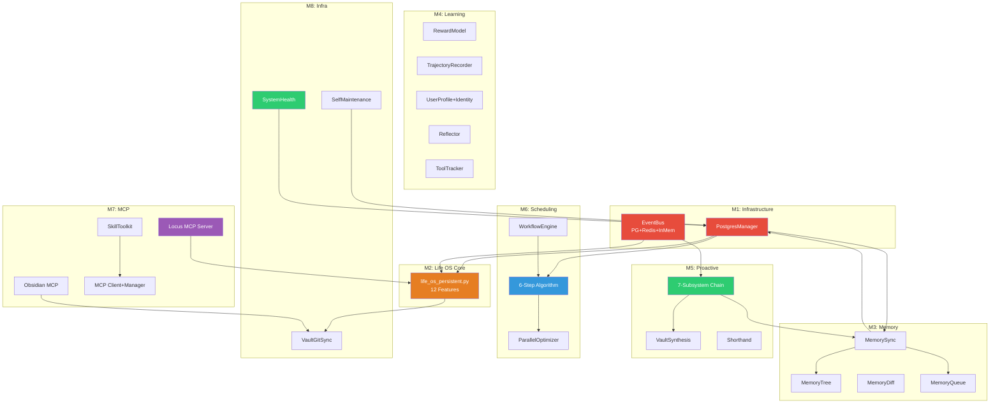

# Locus OS Gap Closure — Walkthrough

## Summary

**Milestones 1-8 are now COMPLETE.** Created **26 new files** and **5 modified files** implementing the full gap closure plan.

---

## Milestone 1: Database & Event Bus Foundation ✅

| File | Purpose |
|------|---------|
| [`postgres.py`](file:///c:/Users/soni8/Desktop/everything/University%202.0/Project(s)/5_Locus/locus-os/core/database/postgres.py) | Async PG pool, migration runner, LISTEN/NOTIFY, health checks |
| [`001_initial_schema.sql`](file:///c:/Users/soni8/Desktop/everything/University%202.0/Project(s)/5_Locus/locus-os/core/database/migrations/001_initial_schema.sql) | 20+ tables: factions, tasks, events, patterns, identity, state |
| [`002_pgvector.sql`](file:///c:/Users/soni8/Desktop/everything/University%202.0/Project(s)/5_Locus/locus-os/core/database/migrations/002_pgvector.sql) | pgvector extension + vault_vectors + observation_embeddings |
| [`event_bus.py`](file:///c:/Users/soni8/Desktop/everything/University%202.0/Project(s)/5_Locus/locus-os/core/event_bus.py) | Dual-channel: PG NOTIFY + Redis pub/sub + in-memory fallback |
| [`docker-compose.yml`](file:///c:/Users/soni8/Desktop/everything/University%202.0/Project(s)/5_Locus/locus-os/docker-compose.yml) | Health checks + memory limits (modified) |

## Milestone 2: Life OS Core ✅

| File | Purpose |
|------|---------|
| [`life_os_persistent.py`](file:///c:/Users/soni8/Desktop/everything/University%202.0/Project(s)/5_Locus/locus-os/core/life_os_persistent.py) | 12 features: weekly stats, action gaps, deferrals, dead nodes, emergency injection, exhaustion, rebalance, momentum, cross-faction, review cadence, check-ins |

## Milestone 3: Memory Subsystem ✅

| File | Type | Purpose |
|------|------|---------|
| [`memory_tree.py`](file:///c:/Users/soni8/Desktop/everything/University%202.0/Project(s)/5_Locus/locus-os/core/memory/memory_tree.py) | NEW | Hierarchical conversation memory with progressive compression |
| [`queue.py`](file:///c:/Users/soni8/Desktop/everything/University%202.0/Project(s)/5_Locus/locus-os/core/memory/queue.py) | NEW | Priority async write queue with batching and dead-letter handling |
| [`sync.py`](file:///c:/Users/soni8/Desktop/everything/University%202.0/Project(s)/5_Locus/locus-os/core/memory/sync.py) | NEW | Bidirectional sync: MemoryTree ↔ PG ↔ Neo4j ↔ Redis |
| [`diff.py`](file:///c:/Users/soni8/Desktop/everything/University%202.0/Project(s)/5_Locus/locus-os/core/memory/diff.py) | NEW | Semantic diff between tree snapshots: new/removed topics, facts, edges |
| [`hebbian.py`](file:///c:/Users/soni8/Desktop/everything/University%202.0/Project(s)/5_Locus/locus-os/core/patterns/hebbian.py) | MODIFIED | Full STDP (30min weakening), PG sync, project decay, batch reinforce, get_top_pathways, singleton |
| [`neo4j_memory.py`](file:///c:/Users/soni8/Desktop/everything/University%202.0/Project(s)/5_Locus/locus-os/core/neo4j_memory.py) | MODIFIED | Fixed handle_tool_call: +delete_entity, +get_neighbors, +reinforce_edge, event bus integration |

## Milestone 4: Learning & Reward ✅

| File | Type | Purpose |
|------|------|---------|
| [`reward_model.py`](file:///c:/Users/soni8/Desktop/everything/University%202.0/Project(s)/5_Locus/locus-os/core/learning/reward_model.py) | NEW | sklearn LogisticRegression on 👍/👎 feedback, PG-persisted |
| [`trajectory.py`](file:///c:/Users/soni8/Desktop/everything/University%202.0/Project(s)/5_Locus/locus-os/core/learning/trajectory.py) | NEW | Agent action trajectory recording, JSONL + OpenAI fine-tuning export |
| [`user_profile.py`](file:///c:/Users/soni8/Desktop/everything/University%202.0/Project(s)/5_Locus/locus-os/core/learning/user_profile.py) | MODIFIED | PG identity: writing style, chronotype, communication preferences, identity prompt fragment |
| [`reflector.py`](file:///c:/Users/soni8/Desktop/everything/University%202.0/Project(s)/5_Locus/locus-os/core/learning/reflector.py) | MODIFIED | PG persistence, event bus emission, Hebbian reinforcement, topic extraction |
| [`tool_tracker.py`](file:///c:/Users/soni8/Desktop/everything/University%202.0/Project(s)/5_Locus/locus-os/core/learning/tool_tracker.py) | MODIFIED | PG sync, success/error rates, latency, recommendations engine, prompt fragment |

## Milestone 5: Proactive Reasoning ✅

| File | Type | Purpose |
|------|------|---------|
| [`proactive_chain.py`](file:///c:/Users/soni8/Desktop/everything/University%202.0/Project(s)/5_Locus/locus-os/core/heartbeat/proactive_chain.py) | NEW | Full 7-subsystem chain: state → patterns → spaced_rep → goals → environment → memory → LLM synthesis |
| [`vault_synthesis.py`](file:///c:/Users/soni8/Desktop/everything/University%202.0/Project(s)/5_Locus/locus-os/core/heartbeat/vault_synthesis.py) | NEW | Weekly synthesis collecting 7d events/stats/patterns into Markdown → vault |
| [`shorthand.py`](file:///c:/Users/soni8/Desktop/everything/University%202.0/Project(s)/5_Locus/locus-os/core/context/shorthand.py) | NEW | LOCUS_SHORTHAND ~4× token compression for behavioral events |

## Milestone 6: Scheduling & Workflow ✅

| File | Type | Purpose |
|------|------|---------|
| [`algorithm.py`](file:///c:/Users/soni8/Desktop/everything/University%202.0/Project(s)/5_Locus/locus-os/core/scheduler/algorithm.py) | NEW | Full 6-step scheduler: ingest → TWS score → DCS gate → faction budgets → slot allocation → PG persist |
| [`parallel.py`](file:///c:/Users/soni8/Desktop/everything/University%202.0/Project(s)/5_Locus/locus-os/core/scheduler/parallel.py) | NEW | Active/passive task classification, parallel grouping with cross-faction bonuses |
| [`workflow.py`](file:///c:/Users/soni8/Desktop/everything/University%202.0/Project(s)/5_Locus/locus-os/core/scheduler/workflow.py) | NEW | YAML-driven multi-step workflows with retry, skip, abort, PG crash recovery, 7 built-in actions |

## Milestone 7: MCP & Extensions ✅

| File | Type | Purpose |
|------|------|---------|
| [`server.py`](file:///c:/Users/soni8/Desktop/everything/University%202.0/Project(s)/5_Locus/locus-os/core/mcp/server.py) | NEW | FastMCP server with 11 tools for external IDE/agent integration |
| [`obsidian_server.py`](file:///c:/Users/soni8/Desktop/everything/University%202.0/Project(s)/5_Locus/locus-os/core/mcp/obsidian_server.py) | NEW | Obsidian vault MCP server: search, read/write, daily notes, frontmatter queries, stats |
| [`mcp_client.py`](file:///c:/Users/soni8/Desktop/everything/University%202.0/Project(s)/5_Locus/locus-os/core/mcp_client.py) | MODIFIED | Multi-server manager, async calls, resource reading, auto-reconnect, health checks |
| [`toolkit.py`](file:///c:/Users/soni8/Desktop/everything/University%202.0/Project(s)/5_Locus/locus-os/core/skills/toolkit.py) | NEW | Unified skill registry: discover builtins + MCP + plugins, execute, OpenAI tool defs |

## Milestone 8: Infrastructure ✅

| File | Type | Purpose |
|------|------|---------|
| [`git_sync.py`](file:///c:/Users/soni8/Desktop/everything/University%202.0/Project(s)/5_Locus/locus-os/core/vault/git_sync.py) | NEW | Vault Git sync: pull cron, auto-commit, conflict detection |
| [`maintenance.py`](file:///c:/Users/soni8/Desktop/everything/University%202.0/Project(s)/5_Locus/locus-os/core/maintenance.py) | NEW | 8 maintenance tasks: DB vacuum, stale cleanup, Hebbian sync, memory drain, vault pull, config check, DLQ retry, temp cleanup |
| [`db_health.py`](file:///c:/Users/soni8/Desktop/everything/University%202.0/Project(s)/5_Locus/locus-os/core/diagnostics/db_health.py) | NEW | DB-specific diagnostics |
| [`system_health.py`](file:///c:/Users/soni8/Desktop/everything/University%202.0/Project(s)/5_Locus/locus-os/core/diagnostics/system_health.py) | NEW | 10-subsystem aggregated health: PG, Redis, Neo4j, pgvector, vault, event bus, memory, MCP, Hebbian, disk |

---

## Architecture

## What Remains

Only **Milestone 9** (Stub Deepening) and **Milestone 10** (FastAPI) remain:

| Milestone | Tasks | Priority |
|-----------|-------|----------|
| M9 | System prompt builder, TUI keybindings, shell sandbox, Telegram patterns, Polymarket, vault diff, personality, dedup | MEDIUM |
| M10 | FastAPI scaffold, 9 API routers, Telegram→API wiring | DEFERRABLE |

See [task.md](file:///C:/Users/soni8/.gemini/antigravity-ide/brain/72d73634-80fd-4cd0-a5d9-55fba42500a1/task.md) for the full checklist.
