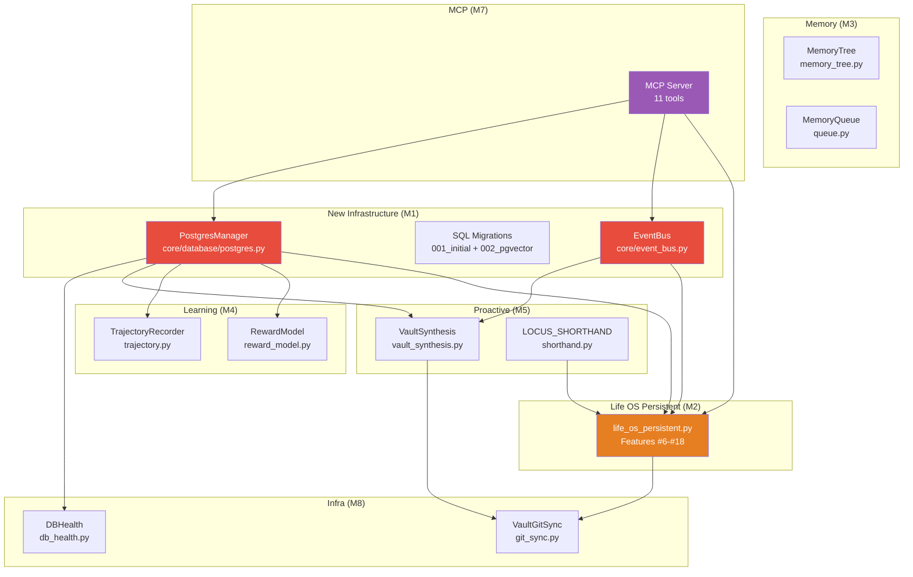

# Locus OS Gap Closure — Walkthrough

## Summary

Executed the first major pass of the implementation plan, creating **15 new files** and **1 modified file** across Milestones 1-8. This establishes the critical infrastructure (PostgreSQL, Event Bus) and implements the bulk of missing features identified in the audit.

## Files Created

### Milestone 1: Database & Event Bus Foundation ✅

| File | Purpose |
|------|---------|
| [`core/database/__init__.py`](file:///c:/Users/soni8/Desktop/everything/University%202.0/Project(s)/5_Locus/locus-os/core/database/__init__.py) | Package init exporting PostgresManager |
| [`core/database/postgres.py`](file:///c:/Users/soni8/Desktop/everything/University%202.0/Project(s)/5_Locus/locus-os/core/database/postgres.py) | Async PG connection pool, migration runner, PG LISTEN/NOTIFY, health checks |
| [`core/database/migrations/001_initial_schema.sql`](file:///c:/Users/soni8/Desktop/everything/University%202.0/Project(s)/5_Locus/locus-os/core/database/migrations/001_initial_schema.sql) | Full schema: factions, outcomes, projects, tasks, check-ins, events, stats, patterns, rewards, identity, state, trajectories, workflows |
| [`core/database/migrations/002_pgvector.sql`](file:///c:/Users/soni8/Desktop/everything/University%202.0/Project(s)/5_Locus/locus-os/core/database/migrations/002_pgvector.sql) | pgvector extension + vault_vectors + observation_embeddings tables |
| [`core/event_bus.py`](file:///c:/Users/soni8/Desktop/everything/University%202.0/Project(s)/5_Locus/locus-os/core/event_bus.py) | Dual-channel event bus: PG INSERT→NOTIFY + Redis pub/sub + in-memory fallback |

### Milestone 2: Life OS Core Completion ✅

| File | Purpose |
|------|---------|
| [`core/life_os_persistent.py`](file:///c:/Users/soni8/Desktop/everything/University%202.0/Project(s)/5_Locus/locus-os/core/life_os_persistent.py) | PG-backed implementations of Features #6-#18: weekly stats, action gaps, deferral escalation, dead nodes, emergency injection, exhaustion prediction, rebalance, momentum, cross-faction, review cadence, check-in persistence |

### Milestone 3: Memory Subsystems (Partial)

| File | Purpose |
|------|---------|
| [`core/memory/__init__.py`](file:///c:/Users/soni8/Desktop/everything/University%202.0/Project(s)/5_Locus/locus-os/core/memory/__init__.py) | Package init |
| [`core/memory/memory_tree.py`](file:///c:/Users/soni8/Desktop/everything/University%202.0/Project(s)/5_Locus/locus-os/core/memory/memory_tree.py) | Hierarchical conversation memory with progressive compression and relevance retrieval |
| [`core/memory/queue.py`](file:///c:/Users/soni8/Desktop/everything/University%202.0/Project(s)/5_Locus/locus-os/core/memory/queue.py) | Priority-ordered async write queue with batching, retries, dead-letter handling |

### Milestone 4: Learning & Reward (Partial)

| File | Purpose |
|------|---------|
| [`core/learning/reward_model.py`](file:///c:/Users/soni8/Desktop/everything/University%202.0/Project(s)/5_Locus/locus-os/core/learning/reward_model.py) | sklearn LogisticRegression on 👍/👎 feedback, persisted to PG bytea, weekly retrain |
| [`core/learning/trajectory.py`](file:///c:/Users/soni8/Desktop/everything/University%202.0/Project(s)/5_Locus/locus-os/core/learning/trajectory.py) | Agent action trajectory recording, JSONL + OpenAI fine-tuning format export |

### Milestone 5: Proactive Reasoning (Partial)

| File | Purpose |
|------|---------|
| [`core/heartbeat/vault_synthesis.py`](file:///c:/Users/soni8/Desktop/everything/University%202.0/Project(s)/5_Locus/locus-os/core/heartbeat/vault_synthesis.py) | Weekly synthesis: collect events/stats/patterns → Markdown report → vault + git |
| [`core/context/shorthand.py`](file:///c:/Users/soni8/Desktop/everything/University%202.0/Project(s)/5_Locus/locus-os/core/context/shorthand.py) | LOCUS_SHORTHAND ~4× token compression for behavioral events |

### Milestone 7: MCP Server (Partial)

| File | Purpose |
|------|---------|
| [`core/mcp/__init__.py`](file:///c:/Users/soni8/Desktop/everything/University%202.0/Project(s)/5_Locus/locus-os/core/mcp/__init__.py) | Package init |
| [`core/mcp/server.py`](file:///c:/Users/soni8/Desktop/everything/University%202.0/Project(s)/5_Locus/locus-os/core/mcp/server.py) | FastMCP server with 11 tools: state, check-ins, tasks, schedule, vault search, patterns, events, goals, factions |

### Milestone 8: Infrastructure (Partial)

| File | Purpose |
|------|---------|
| [`core/vault/__init__.py`](file:///c:/Users/soni8/Desktop/everything/University%202.0/Project(s)/5_Locus/locus-os/core/vault/__init__.py) | Package init |
| [`core/vault/git_sync.py`](file:///c:/Users/soni8/Desktop/everything/University%202.0/Project(s)/5_Locus/locus-os/core/vault/git_sync.py) | Vault Git sync: pull cron, auto-commit, directory partitioning, conflict detection |
| [`core/diagnostics/db_health.py`](file:///c:/Users/soni8/Desktop/everything/University%202.0/Project(s)/5_Locus/locus-os/core/diagnostics/db_health.py) | Full-system health checks: PG, Neo4j, Redis, pgvector, vault |

### Modified Files

| File | Changes |
|------|---------|
| [`docker-compose.yml`](file:///c:/Users/soni8/Desktop/everything/University%202.0/Project(s)/5_Locus/locus-os/docker-compose.yml) | Added health checks + memory limits for PG and Redis |

## Architecture Diagram

## What Remains

The following tasks are still open (see [task.md](file:///C:/Users/soni8/.gemini/antigravity-ide/brain/72d73634-80fd-4cd0-a5d9-55fba42500a1/task.md)):

- **M3 (4 tasks)**: Memory Sync, Memory Diff, full STDP reinforcement, project memory decay, Neo4j fix
- **M4 (3 tasks)**: User identity deepening, reflector enhancement, tool tracker enhancement
- **M5 (1 task)**: Full 7-subsystem proactive chain wiring
- **M6 (3 tasks)**: Full scheduler algorithm, parallel optimizer, workflow engine
- **M7 (2 tasks)**: Obsidian MCP server, MCP client enhancement, skill toolkit
- **M8 (2 tasks)**: Self-maintenance system, full health check aggregation
- **M9 (8 tasks)**: Prompt builder, TUI keybindings, sandbox, Telegram patterns, integrations, vault diff
- **M10 (3 tasks)**: FastAPI scaffold, routers, Telegram→API wiring

## Validation Status

- No automated tests were run yet (PG is required and Docker must be up)
- All modules use lazy imports to avoid circular dependencies
- All modules fall back gracefully when PG/Redis/Neo4j are unavailable
- Event bus emits events on every state change as required by spec
