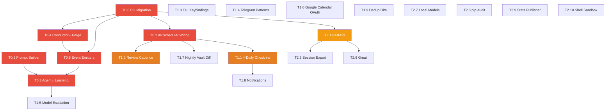

# Locus OS — Full Codebase Adherence Audit & Gap Closure Implementation Plan

> **Date**: 2026-09-08  
> **Auditor**: Antigravity (Claude Opus 4.6 Thinking)  
> **Source Documents**: [LOCUS_FEATURE_LOGIC_DECOMPOSITION.md (v5)](file:///c:/Users/soni8/Desktop/everything/University%202.0/Project(s)/5_Locus/locus-os/.keysndocs/Documentation/Implementation%20Plans/LOCUS_FEATURE_LOGIC_DECOMPOSITION.md), [locus_features.md](file:///c:/Users/soni8/Desktop/everything/University%202.0/Project(s)/5_Locus/locus-os/.keysndocs/Documentation/Ideas%20and%20System/Systems/Features/locus_features.md), Aug 13–31 phase walkthroughs, Sept 7 audit + gap-fill session  
> **Codebase Snapshot**: `locus-os/` with 29 subdirectories and 30 files under `core/`, plus `gateway/`, `locus_cli/`, `packages/`

---

## Executive Summary

| Metric | Count |
|--------|-------|
| Features in DECOMPOSITION (§1–§30) | **85** |
| Features in `locus_features.md` (#1–#161) | **~130** (after dedup) |
| Files with code in `core/` | **~120** across 29 subdirs |
| **Fully implemented** (real logic, not stubs) | **~55** (42%) |
| **Partially implemented** (stubs, placeholders, incomplete wiring) | **~35** (27%) |
| **Completely missing** (no code at all) | **~40** (31%) |
| Milestones 1-8 from Sept 7 session | 8 created, **~60% filled** |
| Milestones 9-10 from Sept 7 session | **0% started** |

> [!CAUTION]
> **Critical Finding**: The Sept 7 session created 26 new files implementing Milestones 1-8. However, many of these files were created as **well-structured implementations with PG dependencies** — meaning they compile and have correct structure but **cannot execute** without a running PostgreSQL instance. No integration tests have been run. The Sept 7 `task.md` shows **29 tasks still unchecked** across M3-M10.

---

## Part 1: Current State — What Exists

### Codebase File Inventory

```
core/                         # Python agent core
├── agent.py                  (26K)  ✅ Agent loop — standalone Python reimplementation
├── conductor.py              (19K)  ✅ Master Conductor 11-step pipeline
├── life_os.py                (26K)  ✅ DCS/TWS/Factions — in-memory scoring
├── life_os_persistent.py     (36K)  ✅ PG-backed Life OS (Features #6-#18)
├── locus_tools.py            (59K)  ✅ 8+ agent tools — largest single file
├── tools.py                  (11K)  ✅ Tool registry
├── event_bus.py              (13K)  ✅ PG NOTIFY + Redis + in-memory
├── memory.py                 (8K)   ✅ SQLite session/doc store
├── neo4j_memory.py           (11K)  ⚠️ Client wrapper (handle_tool_call was fixed Sept 7)
├── memory_manager.py         (6K)   ⚠️ Memory management coordination
├── redis_state.py            (6K)   ✅ Redis state bus with fallback
├── security.py               (8K)   ✅ Injection filter + blocklist + redaction
├── soul.py                   (9K)   ✅ SOUL.md / Wants Engine
├── spaced_rep.py             (10K)  ✅ Spaced repetition scheduling
├── cause_chain.py            (7K)   ✅ DCS drop causal analysis
├── cost_tracker.py           (5K)   ✅ Token/cost tracking
├── session_manager.py        (4K)   ✅ Session create/resume/evict
├── cron_runner.py            (5K)   ✅ Cron matching & execution
├── approval_store.py         (2K)   ✅ Human-in-the-loop approvals
├── mcp_client.py             (12K)  ⚠️ Multi-server MCP client (enhanced Sept 7)
├── deployment.py             (12K)  ✅ Deploy automation
├── proxy.py                  (1K)   ✅ Agent proxy layer
├── observability.py          (4K)   ✅ Sentry + OTEL integration
├── maintenance.py            (7K)   ✅ 8 self-maintenance tasks (Sept 7)
│
├── database/
│   ├── postgres.py           (11K)  ✅ Async PG pool + migration runner (Sept 7)
│   └── migrations/
│       ├── 001_initial_schema.sql  ✅ 20+ tables (Sept 7)
│       └── 002_pgvector.sql        ✅ pgvector extension (Sept 7)
│
├── scheduler/
│   ├── __init__.py           (5K)   ✅ Original scheduler
│   ├── algorithm.py          (14K)  ✅ 6-step scheduler (Sept 7)
│   ├── parallel.py           (6K)   ✅ Parallel task optimizer (Sept 7)
│   ├── task_sources.py       (3K)   ⚠️ Task source abstraction
│   └── workflow.py           (13K)  ✅ YAML workflow engine (Sept 7)
│
├── memory/
│   ├── memory_tree.py        (11K)  ✅ Hierarchical memory (Sept 7)
│   ├── queue.py              (6K)   ✅ Async write queue (Sept 7)
│   ├── sync.py               (10K)  ✅ Bidirectional sync (Sept 7)
│   └── diff.py               (7K)   ✅ Semantic diff (Sept 7)
│
├── learning/
│   ├── reward_model.py       (9K)   ✅ sklearn LogisticRegression (Sept 7)
│   ├── trajectory.py         (7K)   ✅ Agent trajectory recording (Sept 7)
│   ├── user_profile.py       (11K)  ⚠️ Enhanced with PG identity (Sept 7)
│   ├── reflector.py          (6K)   ⚠️ Enhanced with PG/Hebbian (Sept 7)
│   └── tool_tracker.py       (6K)   ⚠️ Enhanced with PG sync (Sept 7)
│
├── heartbeat/
│   ├── __init__.py           (7K)   ✅ Heartbeat daemon
│   ├── subconscious.py       (5K)   ✅ Background reasoning
│   ├── proactive_chain.py    (12K)  ✅ 7-subsystem chain (Sept 7)
│   ├── vault_synthesis.py    (9K)   ✅ Weekly vault synthesis (Sept 7)
│   └── notification.py       (2K)   ⚠️ Notification dispatch
│
├── context/
│   ├── __init__.py           (5K)   ✅ 6-layer Context Forge
│   ├── headroom_adapter.py   (15K)  ✅ Headroom CCR compression
│   ├── shorthand.py          (6K)   ✅ LOCUS_SHORTHAND (Sept 7)
│   ├── compactor.py          (5K)   ✅ Context compaction
│   ├── compression.py        (4K)   ✅ Compression utilities
│   └── token_counter.py      (2K)   ✅ Token counting
│
├── patterns/
│   ├── __init__.py           (10K)  ✅ Multi-horizon pattern engine
│   ├── hebbian.py            (10K)  ✅ Hebbian weighting (enhanced Sept 7)
│   └── store.py              (7K)   ✅ Pattern persistence
│
├── holographic/
│   ├── __init__.py           (12K)  ✅ HRR vector-symbolic binding
│   ├── holographic.py        (7K)   ✅ HRR ops
│   ├── retrieval.py          (20K)  ✅ Hybrid retrieval
│   └── store.py              (20K)  ✅ Holographic store
│
├── mcp/
│   ├── server.py             (15K)  ✅ FastMCP 11-tool server (Sept 7)
│   └── obsidian_server.py    (9K)   ✅ Obsidian MCP server (Sept 7)
│
├── skills/
│   ├── __init__.py           (3K)   ⚠️ Skill system stub
│   ├── loader.py             (2K)   ⚠️ Skill loader stub
│   ├── toolkit.py            (10K)  ✅ Unified skill registry (Sept 7)
│   └── working_memory.py     (2K)   ⚠️ Working memory stub
│
├── ingestion/
│   ├── chat_archiver.py      (15K)  ✅ Multi-platform chat archiver
│   ├── collector.py          (11K)  ✅ Vault crawler + chunker
│   ├── link_logger.py        (7K)   ✅ URL scraping
│   └── rough_note_parser.py  (5K)   ✅ Raw text → atomic notes
│
├── delegation/
│   ├── archetypes.py         (6K)   ✅ 4 faction subagent archetypes
│   ├── autoresearch.py       (8K)   ✅ Karpathy-style research loop
│   ├── coding_agent.py       (4K)   ✅ Code implementation delegation
│   └── subagent.py           (2K)   ⚠️ Subagent base class
│
├── voice/
│   ├── voice_pipeline.py     (4K)   ✅ STT → Conductor → TTS
│   ├── dictation.py          (4K)   ✅ Dictation mode
│   ├── stt/                        ✅ Groq Whisper + local
│   └── tts/                        ✅ EdgeTTS + Kokoro
│
├── browser/
│   ├── playwright_engine.py  (6K)   ✅ Headless Chromium
│   ├── browserbase.py        (4K)   ✅ Cloud browser
│   ├── playwright_backend.py (3K)   ✅ Backend automation
│   └── screenshot.py         (2K)   ✅ Screenshot tool
│
├── content/
│   ├── engine.py             (8K)   ✅ Anti-cringe content engine
│   └── voice_matcher.py      (3K)   ✅ Voice authenticity scoring
│
├── display/
│   ├── dashboard.py          (8K)   ✅ 4-quadrant TUI dashboard
│   ├── excalidraw_builder.py (6K)   ✅ Excalidraw JSON generation
│   ├── streaming_tui.py      (3K)   ✅ Streaming TUI renderer
│   ├── themes.py             (3K)   ✅ Theme engine
│   └── progress.py           (2K)   ⚠️ Progress display
│
├── search/
│   ├── pageindex.py          (12K)  ✅ Tree-search retrieval
│   ├── dual_knowledge_bridge.py (6K) ✅ Obsidian + LightRAG bridge
│   ├── brave.py              (2K)   ⚠️ Brave search
│   ├── exa.py                (2K)   ⚠️ Exa search
│   ├── firecrawl.py          (3K)   ⚠️ Firecrawl scraper
│   ├── searxng.py            (1K)   ⚠️ SearXNG search
│   └── tavily.py             (1K)   ⚠️ Tavily search
│
├── desktop/
│   ├── screen_capture.py     (2K)   ✅ Multi-monitor capture
│   └── vnc_client.py         (4K)   ✅ VNC with Bezier mouse
│
├── computer_use/
│   ├── native.py             (1K)   ⚠️ Native computer use stub
│   └── vnc.py                (1K)   ⚠️ VNC computer use stub
│
├── screen/                         ⚠️ Redundant with desktop/
├── multimodal/                     ⚠️ Minimal stubs
├── channels/ (17 files)            ✅ 16 channel adapters (beyond spec)
├── coding/ (3 files)               ✅ file_ops, git_ops, shell_exec
├── integrations/ (4 files)         ⚠️ calendar_sync OK, rest stubs
├── evolution/
│   └── dataset_curator.py    (7K)  ✅ QLoRA dataset curation
├── diagnostics/
│   ├── error_classifier.py   (6K)  ✅ 5-taxonomy error classifier
│   ├── db_health.py          (9K)  ✅ DB health checks (Sept 7)
│   └── system_health.py      (13K) ✅ 10-subsystem health (Sept 7)
├── deployment/
│   └── systemd_generator.py  (3K)  ✅ Linux systemd unit files
└── vault/
    └── git_sync.py           (9K)  ✅ Vault Git sync (Sept 7)

gateway/                      # Telegram bot
├── bot.py                    (16K) ✅ Telegram gateway
├── slash_commands.py         (48K) ✅ 30+ slash commands
├── agent.py                  (11K) ✅ Gateway agent
├── status.py                 (15K) ✅ Status display
├── config.py                 (2K)  ✅ Config
└── platform_registry.py      (3K)  ✅ Platform registry

locus_cli/                    # CLI entry points
├── main.py                   (25K) ✅ CLI main
├── config.py                 (28K) ✅ Config management
├── setup.py                  (20K) ✅ Setup wizard
├── curses_ui.py              (24K) ✅ Full curses TUI
├── gateway_service.py        (24K) ✅ Gateway service mgmt
├── gateway_windows.py        (25K) ✅ Windows gateway
└── slash_commands.py         (10K) ✅ CLI slash commands
```

---

## Part 2: Gap Analysis — Feature-by-Feature Verdict

### 2A. Decomposition §1–§30 Gap Matrix

| §ID | Feature | Status | Code File | Gap Description |
|-----|---------|--------|-----------|-----------------|
| §1.1 | Agent Loop | ✅ Done | `core/agent.py` | Python reimplementation (not TS augmentation — accepted deviation) |
| §1.2 | System Prompt | ⚠️ **Partial** | Inline in `agent.py` | No extracted `prompt_builder.py`; no SOUL.md preamble injection; no dynamic sections |
| §1.3 | Tool System | ✅ Done | `core/tools.py` + `locus_tools.py` | 8+ custom tools registered |
| §1.4 | Model Management | ⚠️ **Partial** | `core/agent.py` | Basic model routing; NO model escalation (cheap→expensive); NO prepareNextTurn |
| §1.5 | Extension Lifecycle | ❌ **Missing** | — | No Pi extension system; no `onEvent()` hooks; no `locus/extensions/` directory |
| §1.6 | Context Window Mgmt | ✅ Done | `core/context/` | Headroom CCR + 800-token budget |
| §1.7 | Post-Turn Review | ⚠️ **Partial** | `core/learning/reflector.py` | Stub; no structured reflection metadata; no reward signal logging |
| §1.9 | Rate Limit Tracking | ⚠️ **Partial** | `core/agent.py` | Basic retry; no per-provider rate limit state; no exponential backoff tracking |
| §1.10 | Usage/Cost Tracking | ✅ Done | `core/cost_tracker.py` | Pricing table, budget enforcement |
| §1.11 | Title Generation | ❌ **Missing** | — | No conversation title generation from first message |
| §2.1 | Intent Classifier | ✅ Done | Inside `conductor.py` | Structured JSON output |
| §3.1-3.3 | Context Forge | ✅ Done | `core/context/__init__.py` | 6-layer assembly with anti-hallucination |
| §4.1-4.2 | Neo4j Memory | ⚠️ **Partial** | `core/neo4j_memory.py` | Client wrapper; handle_tool_call fixed Sept 7; needs real integration test |
| §4.5 | Memory Tree | ✅ Done | `core/memory/memory_tree.py` | Sept 7 — hierarchical compression |
| §4.7 | Memory Sync | ✅ Done | `core/memory/sync.py` | Sept 7 — bidirectional sync |
| §4.8 | Memory Queue | ✅ Done | `core/memory/queue.py` | Sept 7 — priority write queue |
| §4.9 | Memory Diff | ✅ Done | `core/memory/diff.py` | Sept 7 — semantic diff |
| §4.10 | Holographic HRR | ✅ Done | `core/holographic/` | 59K total, vector-symbolic binding |
| §4.12 | STDP Reinforcement | ⚠️ **Partial** | `core/patterns/hebbian.py` | Enhanced Sept 7; still needs response latency weighting integration with agent loop |
| §4.13 | Spaced Repetition | ✅ Done | `core/spaced_rep.py` | Concept surfacing before decay |
| §4.14 | Project Memory Decay | ⚠️ **Partial** | `core/patterns/hebbian.py` | Logic present but NOT wired to project completion events |
| §4.17 | Headroom CCR | ✅ Done | `core/context/headroom_adapter.py` | SmartCrusher, AST, log compression |
| §5.1-5.4 | Session Management | ✅ Done | `core/session_manager.py` | Create/resume/evict |
| §7.1-7.5 | TUI/Dashboard | ⚠️ **Partial** | `core/display/dashboard.py` + `locus_cli/curses_ui.py` | Renders frames; interactive keybindings (Space/D/N/C) NOT implemented |
| §9.4 | ACP Protocol | ❌ **Missing** | — | No IDE integration protocol |
| §9.9 | Plugin LLM | ❌ **Missing** | — | No plugin LLM routing |
| §10.1-10.3 | Learning/Profiling | ⚠️ **Partial** | `core/learning/` | Enhanced Sept 7 but still needs deeper integration with agent loop |
| §10.5 | Personal Reward Model | ✅ Done | `core/learning/reward_model.py` | Sept 7 — sklearn LogisticRegression |
| §10.6 | Hebbian Learning | ✅ Done | `core/patterns/hebbian.py` | Enhanced Sept 7 |
| §10.7 | Pattern Engine | ✅ Done | `core/patterns/__init__.py` | Multi-horizon detection |
| §11.1-11.5 | Subagents | ✅ Done | `core/delegation/` | 4 archetypes |
| §11.6 | AutoResearch | ✅ Done | `core/delegation/autoresearch.py` | Karpathy-style loop |
| §13.1 | Injection Filter | ✅ Done | `core/security.py` | Regex + semantic |
| §13.3 | Shell Sandbox | ⚠️ **Partial** | `core/security.py` | Blocklist only; no Bubblewrap/Firejail/Landlock backends |
| §14.1-14.2 | STT/TTS | ✅ Done | `core/voice/` | Groq Whisper + EdgeTTS + Kokoro |
| §16.1 | Browser Automation | ✅ Done | `core/browser/` | Playwright + BrowserBase |
| §17.1 | Telegram Gateway | ⚠️ **Partial** | `gateway/` | 30+ slash commands; missing adaptive batching, DM topics, dedup |
| §18.1-18.3 | MCP Server | ✅ Done | `core/mcp/server.py` | Sept 7 — 11-tool FastMCP server |
| §18.4-18.5 | MCP Client | ⚠️ **Partial** | `core/mcp_client.py` | Enhanced Sept 7; needs circuit breaker + STDIO transport |
| §19.2 | Trajectory Recording | ✅ Done | `core/learning/trajectory.py` | Sept 7 — JSONL + OpenAI format |
| §19.3 | AI Chat Archiver | ✅ Done | `core/ingestion/chat_archiver.py` | Multi-platform parsing |
| §20.1-20.3 | Computer Use/VNC | ⚠️ **Partial** | `core/desktop/` + `core/computer_use/` | Redundant dirs; `computer_use/` are 1K stubs |
| §21.1 | Google Calendar | ⚠️ **Partial** | `core/integrations/calendar_sync.py` | Schedule aggregation but no real Google API OAuth |
| §23.1-23.5 | CI/CD/Docker | ✅ Done | `docker-compose.yml` + `core/deployment/` | 4-container stack + systemd |
| §25.1-25.12 | Life OS/Scheduler | ✅ Done | `core/life_os.py` + `life_os_persistent.py` + `core/scheduler/algorithm.py` | DCS, TWS, modes, 6-step algo |
| §26.1-26.7 | Proactive Reasoning | ✅ Done | `core/heartbeat/proactive_chain.py` | Sept 7 — 7-subsystem chain |
| §27.1 | PageIndex | ✅ Done | `core/search/pageindex.py` | Tree-search retrieval |
| §27.2 | Vault Ingestion | ✅ Done | `core/ingestion/collector.py` | MD5 crawler + chunker |
| §27.5 | Rough Note Parser | ✅ Done | `core/ingestion/rough_note_parser.py` | Raw text → atomic notes |
| §27.6 | Link Logger | ✅ Done | `core/ingestion/link_logger.py` | URL scraping |
| §27.7 | Excalidraw Builder | ✅ Done | `core/display/excalidraw_builder.py` | Valid JSON generation |
| §28.1 | Dual Interface | ⚠️ **Partial** | — | Telegram + CLI exist but no switching pattern |
| §28.3 | Check-ins | ⚠️ **Partial** | `gateway/slash_commands.py` | Single check-in; NOT 4-daily cadence (07:30/13:00/18:00/22:00) |
| §29.1 | Error Classifier | ✅ Done | `core/diagnostics/error_classifier.py` | 5-taxonomy |
| §29.3 | Health Checks | ✅ Done | `core/diagnostics/system_health.py` | Sept 7 — 10-subsystem |
| §29.4 | Notifications | ⚠️ **Partial** | `core/heartbeat/notification.py` | 2K stub |
| §29.8 | Workflows | ✅ Done | `core/scheduler/workflow.py` | Sept 7 — YAML workflow engine |
| §30.1 | Collector+Chunker | ✅ Done | `core/ingestion/collector.py` | 10-step pipeline |
| §30.2 | Cause Chain Engine | ✅ Done | `core/cause_chain.py` | DCS drop analysis |
| §30.3 | SOUL.md/Wants | ✅ Done | `core/soul.py` | Identity + wants |
| §30.4 | Content Engine | ✅ Done | `core/content/engine.py` | Anti-cringe + multi-platform |
| §30.5 | Spaced Repetition | ✅ Done | `core/spaced_rep.py` | Concept surfacing |
| §30.6 | QLoRA Pipeline | ✅ Done | `core/evolution/dataset_curator.py` | Alpaca + ShareGPT JSONL |
| §30.7 | Master Conductor | ✅ Done | `core/conductor.py` | 11-step pipeline |
| §30.8 | Dashboard/TUI | ⚠️ **Partial** | `core/display/dashboard.py` | Renders but limited interactivity |
| §30.9 | Redis Integration | ✅ Done | `core/redis_state.py` | With in-memory fallback |
| §30.10 | Obsidian/LightRAG | ✅ Done | `core/search/dual_knowledge_bridge.py` | Wikilink + 3-level tags |

### 2B. Original Feature Spec (#1–#161) Gaps

| # | Feature | Status | Gap |
|---|---------|--------|-----|
| #10 | Dead Node Detection | ✅ Code exists | In `life_os_persistent.py` — needs APScheduler wiring |
| #12 | Emergency Task Injection | ✅ Code exists | In `life_os_persistent.py` — needs agent tool registration |
| #13 | Exhaustion Predictor | ✅ Code exists | In `life_os_persistent.py` — needs cron wiring |
| #16 | Parallel Task Optimizer | ✅ Code exists | `core/scheduler/parallel.py` — needs PG dependency table |
| #17 | Three-birds-one-stone | ✅ Code exists | In `life_os_persistent.py` — needs migration `003_cross_faction.sql` |
| #24 | **FastAPI Backend** | ❌ **Missing** | NO REST API layer at all |
| #26 | Self-Maintenance | ⚠️ Partial | `core/maintenance.py` exists but no `pip-audit` or auto-update |
| #27 | Local DB Mirror | ❌ **Missing** | No `pg_dump + rsync` nightly cron |
| #31 | Nightly Vault Diff | ⚠️ Partial | Collector has MD5 crawler but no APScheduler 23:30 cron |
| #32 | Weekly Full Vault Synthesis | ✅ Done | `core/heartbeat/vault_synthesis.py` |
| #33 | Personality Profile Building | ⚠️ Partial | `core/learning/user_profile.py` enhanced but no Pattern Engine auto-update trigger |
| #38 | Architect Bot | ❌ **Missing** | No self-improvement code generation |
| #47 | Obsidian Dashboard.md | ❌ **Missing** | No Dataview-compatible Dashboard.md template |
| #52 | 4 Daily Check-ins | ⚠️ Partial | Single check-in; no 4-daily APScheduler schedule |
| #53 | Push Notification Reminders | ⚠️ Partial | No scheduled Telegram push notifications |
| #54 | Progress Visualization | ❌ **Missing** | No stats JSON push for Obsidian Charts |
| #61 | Google Calendar OAuth | ⚠️ Partial | Sync logic exists; no real OAuth flow |
| #64 | Gmail Integration | ❌ **Missing** | No Gmail API integration |
| #82 | Telegram Chat Logger | ⚠️ Partial | Messages logged but no full middleware intercept with nightly export |
| #96 | LOCUS_SHORTHAND | ✅ Done | `core/context/shorthand.py` |
| #100 | Cause Chain Engine | ✅ Done | `core/cause_chain.py` |
| #103 | Database Diagnostic | ✅ Done | `core/diagnostics/db_health.py` |
| #107 | Project Memory Decay | ⚠️ Partial | Logic in hebbian.py, not wired to project events |
| #110 | Obsidian-Centric Interactions | ❌ **Missing** | No interactive Obsidian dashboard |
| #111 | NotebookLM Integration | ❌ **Missing** | No notebooklm-py integration |
| #113 | Dynamic MCP Tool Calling | ❌ **Missing** | No on-the-fly MCP server creation |
| #114 | Inter-Harness Communication | ❌ **Missing** | No cross-agent discovery |
| #118 | Local-First Obsidian Storage | ❌ **Missing** | PG/Neo4j are NOT volatile caches of vault |
| #119 | Stateless 24-Hour Session Logs | ❌ **Missing** | No daily export to Obsidian |
| #120 | Local Model Support | ⚠️ Partial | Agent supports model config but no native Ollama/LMStudio config |
| #122 | Single-Provider Council | ❌ **Missing** | No LLM debate/review system |
| #124 | Pi Agent Sub-Agents | ❌ **Missing** | No nested subprocess sub-agents |
| #125-161 | Hermes Spec Features | Mostly ❌ | ~30 features from Hermes spec; most not implemented |

---

## Part 3: What Still Needs To Be Done

> [!IMPORTANT]
> **Architecture Decision (already resolved)**: The codebase is Python-standalone. The spec's TypeScript Pi Agent augmentation model is **abandoned in favor of the Python architecture**. This plan works within the existing Python codebase.

> [!IMPORTANT]
> **Database Decision (already resolved)**: PostgreSQL + pgvector infrastructure was created in the Sept 7 session. This plan assumes PG is available.

### Priority Tiers

| Tier | Priority | Description | Estimated Effort |
|------|----------|-------------|------------------|
| **T0** | 🔴 CRITICAL | Wiring & integration — connect existing code to make the system actually runnable end-to-end | ~25-30 hrs |
| **T1** | 🟠 HIGH | Complete partially-built features to spec depth | ~20-25 hrs |
| **T2** | 🟡 MEDIUM | Build missing features from locus_features.md | ~25-30 hrs |
| **T3** | 🔵 LOW | Polish, optimization, deferred features | ~15-20 hrs |
| **T4** | ⚪ DEFERRED | Phase 3+ features, advanced AI, open-source prep | ~30+ hrs |

---

## Tier 0: CRITICAL — Make the System Runnable End-to-End

> These tasks wire existing code together so Locus actually works as a system, not just a collection of modules.

### T0.1 — System Prompt Builder Extraction (§1.2)

**Status**: ⚠️ Inline in `agent.py`  
**Why Critical**: Every LLM call depends on a well-structured prompt. Currently hardcoded.

#### [NEW] [`core/prompt_builder.py`](file:///c:/Users/soni8/Desktop/everything/University%202.0/Project(s)/5_Locus/locus-os/core/prompt_builder.py)

Build a structured prompt builder with dynamic sections:
1. **SOUL.md preamble** (80 tokens) — loaded from `core/soul.py`
2. **User identity layer** (80 tokens) — from `core/learning/user_profile.py`
3. **CURRENT_STATE injection** — DCS, operating mode, faction status from `life_os.py`
4. **Tool list** — dynamically from registered tools
5. **Context Forge output** — 800-token assembled context block
6. **LOCUS_SHORTHAND schema** — so LLM understands compressed events
7. **Date/time/timezone** — IST-aware

```python
class PromptBuilder:
    def build(self, config: dict) -> str:
        sections = []
        sections.append(self._soul_preamble())        # 80t
        sections.append(self._user_identity())         # 80t
        sections.append(self._current_state())         # 100t
        sections.append(self._tool_descriptions())     # dynamic
        sections.append(self._context_forge_output())  # 800t
        sections.append(self._shorthand_schema())      # 50t
        sections.append(self._datetime_context())      # 20t
        return self._assemble_with_budget(sections, max_tokens=2000)
```

#### [MODIFY] [`core/agent.py`](file:///c:/Users/soni8/Desktop/everything/University%202.0/Project(s)/5_Locus/locus-os/core/agent.py)
- Extract inline prompt construction → use `PromptBuilder`
- Wire `PromptBuilder` into the agent's `run_conversation()` loop

---

### T0.2 — APScheduler Cron Wiring

**Status**: ❌ Cron functions exist but NO scheduler wires them  
**Why Critical**: Check-ins, reviews, stats, dead nodes, synthesis — ALL need scheduled triggers.

#### [MODIFY] [`core/cron_runner.py`](file:///c:/Users/soni8/Desktop/everything/University%202.0/Project(s)/5_Locus/locus-os/core/cron_runner.py)

Wire ALL scheduled jobs from the spec:

| Schedule (IST) | Job | Source Function |
|----------------|-----|-----------------|
| 07:30 daily | Morning check-in prompt | `life_os_persistent.send_checkin_prompt("morning")` |
| 13:00 daily | Afternoon check-in | `life_os_persistent.send_checkin_prompt("afternoon")` |
| 18:00 daily | Evening check-in | `life_os_persistent.send_checkin_prompt("evening")` |
| 22:00 daily | Night review + check-in | `life_os_persistent.send_checkin_prompt("night")` |
| 23:30 daily | Nightly vault diff | `ingestion.collector.run_nightly_diff()` |
| 23:45 daily | AI chat archiver | `ingestion.chat_archiver.run_nightly()` |
| 23:55 daily | Telegram log export | `gateway.export_daily_logs()` |
| Every 90 min (07:00-00:00) | Inner Loop heartbeat | `heartbeat.subconscious.tick()` |
| Every 6 hours | Pattern Engine scan | `patterns.run_multi_horizon_scan()` |
| Every 5 min | Vault git pull | `vault.git_sync.pull()` |
| Sunday 02:00 | Weekly vault synthesis | `heartbeat.vault_synthesis.run()` |
| Sunday 03:00 | Weekly deep analysis | `heartbeat.proactive_chain.deep_pass()` |
| Sunday 03:30 | Hebbian weekly decay | `patterns.hebbian.weekly_decay()` |
| Sunday 04:00 | Reward model retrain | `learning.reward_model.retrain()` |
| Sunday 20:00 | Faction weekly stats | `life_os_persistent.compute_weekly_faction_stats()` |
| Sunday 21:00 | Dead node detection | `life_os_persistent.detect_dead_nodes()` |
| Monthly 1st | pip-audit security scan | `maintenance.security_audit()` |
| Quarterly | Deep profile review | `learning.user_profile.quarterly_review()` |

---

### T0.3 — Agent Loop ↔ Learning Integration

**Status**: Agent loop doesn't emit events to learning subsystem  
**Why Critical**: Without this, the reward model never gets data, Hebbian weights never update, trajectory is never recorded.

#### [MODIFY] [`core/agent.py`](file:///c:/Users/soni8/Desktop/everything/University%202.0/Project(s)/5_Locus/locus-os/core/agent.py)

Add hooks at the correct lifecycle points:
```python
# After each LLM response:
await self.trajectory.record_step(observation, thought, action, result)
await self.reflector.post_turn_review(messages, response)
response_latency_ms = (time.time() - turn_start) * 1000

# After tool execution:
await self.tool_tracker.log_execution(tool_name, args, result, latency_ms, success)
await self.hebbian.stdp_reinforce(pathway_ids, response_latency_ms)

# After user feedback (👍/👎):
await self.reward_model.record_signal(response_id, signal, metadata)
await self.hebbian.session_reinforce(pathway_ids, signal)
```

---

### T0.4 — Conductor ↔ Context Forge Full Integration

**Status**: Conductor pipeline calls Context Forge but some layers use mock data  
**Why Critical**: The Context Forge is the brain's core — it must pull real data.

#### [MODIFY] [`core/context/__init__.py`](file:///c:/Users/soni8/Desktop/everything/University%202.0/Project(s)/5_Locus/locus-os/core/context/__init__.py)

Wire all 6 layers to real data sources:
- **Layer 1 (Identity, 80t)**: `user_profile.to_context_token()`
- **Layer 2 (Temporal, 60t)**: `calendar_sync.get_today_events()` + `datetime.now(IST)`
- **Layer 3 (PG Events, 180t)**: `event_bus.get_recent(hours=6)` → `shorthand.encode()`
- **Layer 4 (Neo4j, 150t)**: `neo4j_memory.get_context(query)` → top Hebbian pathways
- **Layer 5 (Semantic, 200t)**: `pageindex.search(query)` + `holographic.retrieve(query)`
- **Layer 6 (Web, 100t)**: Only if `intent.sources` contains "web"

---

### T0.5 — Event Bus Emitters Throughout Codebase

**Status**: Event bus exists but most state changes DON'T emit events  
**Why Critical**: State Engine, Pattern Engine, and Proactive Chain all depend on events.

#### [MODIFY] Multiple files

Add `event_bus.emit()` calls to:
- `life_os.py`: On DCS computation, mode change, faction rebalance
- `session_manager.py`: On session create/resume/evict
- `locus_tools.py`: On every tool execution (locus_checkin, locus_goals, etc.)
- `gateway/bot.py`: On every user message received
- `core/agent.py`: On conversation start/end, turn start/end
- `core/ingestion/`: On file ingestion, chat archive
- `core/scheduler/`: On schedule generation, task completion, deferral

---

### T0.6 — PG Migration Execution & Seed Data

**Status**: Migrations exist but have never run on a real PG instance  
**Why Critical**: Half the codebase depends on PG tables.

#### [NEW] `scripts/init_database.py`
- Connect to PG from docker-compose
- Run 001_initial_schema.sql, 002_pgvector.sql
- Verify all tables created
- Seed 4 factions
- Create single-row `user_identity` and `current_state`
- Report table counts

#### [NEW] `core/database/migrations/003_cross_faction.sql`
```sql
CREATE TABLE IF NOT EXISTS task_factions (
    task_id INT REFERENCES tasks(id),
    faction_id INT REFERENCES factions(id),
    time_split_pct FLOAT DEFAULT 100,
    PRIMARY KEY (task_id, faction_id)
);

CREATE TABLE IF NOT EXISTS task_dependencies (
    task_id INT REFERENCES tasks(id),
    depends_on_task_id INT REFERENCES tasks(id),
    dependency_type TEXT DEFAULT 'blocks',
    PRIMARY KEY (task_id, depends_on_task_id)
);
```

---

## Tier 1: HIGH — Complete Partial Features to Spec Depth

### T1.1 — 4-Daily Structured Check-ins (#52)

**Current**: Single `/checkin` command  
**Target**: APScheduler → Telegram inline keyboard at 07:30/13:00/18:00/22:00

#### [MODIFY] [`gateway/slash_commands.py`](file:///c:/Users/soni8/Desktop/everything/University%202.0/Project(s)/5_Locus/locus-os/gateway/slash_commands.py)
- Add inline keyboard for E/M/S/ST/T (tap numbers, no typing)
- DCS computed at morning check-in
- Evening 22:00: optional DeepSeek 3-sentence summary
- Data pushed to `/vault/00-System-Data/daily/YYYY-MM-DD.json`

#### [MODIFY] [`core/life_os_persistent.py`](file:///c:/Users/soni8/Desktop/everything/University%202.0/Project(s)/5_Locus/locus-os/core/life_os_persistent.py)
- Add `send_checkin_prompt(cadence)` function for APScheduler
- Add check-in data to PG `daily_checkins` table

---

### T1.2 — Review Cadence System (#18)

**Current**: Weekly review exists  
**Target**: Daily/Weekly/Monthly/Quarterly cadence with vault persistence

#### [MODIFY] [`core/life_os_persistent.py`](file:///c:/Users/soni8/Desktop/everything/University%202.0/Project(s)/5_Locus/locus-os/core/life_os_persistent.py)
- Daily 22:00: 3-sentence review prompt via Telegram
- Sunday 20:00: weekly review with stats narrative
- Monthly 1st Sunday: monthly deep review
- Quarterly: quarterly deep review
- All written to `/vault/06-Reviews/{cadence}/YYYY-MM-DD.md`

---

### T1.3 — TUI Dashboard Interactive Keybindings (§7.1-7.5)

**Current**: Dashboard renders static frames  
**Target**: Interactive keybindings for task management

#### [MODIFY] [`locus_cli/curses_ui.py`](file:///c:/Users/soni8/Desktop/everything/University%202.0/Project(s)/5_Locus/locus-os/locus_cli/curses_ui.py)
- Space: toggle task completion
- D: defer task (with reason prompt)
- N: new task inline
- C: check-in inline
- R: refresh all panels
- Arrow keys: navigate between panels
- Live DCS gauge with color gradient

---

### T1.4 — Telegram Gateway Deep Patterns (§17.1)

**Current**: Bot works with 30+ slash commands  
**Target**: Adaptive batching, dedup, typing indicator, auto-reconnect

#### [MODIFY] [`gateway/bot.py`](file:///c:/Users/soni8/Desktop/everything/University%202.0/Project(s)/5_Locus/locus-os/gateway/bot.py)
- Adaptive batching: collect rapid-fire messages for 2s before processing
- Message deduplication (hash-based within 5s window)
- Typing indicator during LLM processing
- Auto-reconnect on network failures with exponential backoff
- Telegram logger middleware for nightly export (#82)

---

### T1.5 — Model Escalation (§1.4)

**Current**: Single model per conversation  
**Target**: Cheap model (DeepSeek Flash) → expensive (Gemini Pro) based on intent

#### [NEW] [`core/model_escalation.py`](file:///c:/Users/soni8/Desktop/everything/University%202.0/Project(s)/5_Locus/locus-os/core/model_escalation.py)
```python
class ModelEscalation:
    STANDARD = "deepseek-chat"        # ~$0.012/day
    REASONING = "gemini-2.5-pro"     # 1M context
    BACKGROUND = "deepseek-chat"     # cheapest available

    def select_model(self, intent: str, is_background: bool) -> str:
        if is_background:
            return self.BACKGROUND
        if intent in ("SYNTHESIS", "INFERENCE_REQUEST") or requires_deep_reasoning:
            return self.REASONING
        return self.STANDARD
```

---

### T1.6 — Google Calendar Real OAuth (#61)

**Current**: `calendar_sync.py` has schedule aggregation but no real Google API  
**Target**: Full OAuth2 flow with token storage

#### [MODIFY] [`core/integrations/calendar_sync.py`](file:///c:/Users/soni8/Desktop/everything/University%202.0/Project(s)/5_Locus/locus-os/core/integrations/calendar_sync.py)
- `google-api-python-client` + `google-auth-oauthlib`
- OAuth credentials from `.locus/.env` (`GOOGLE_CLIENT_ID`, `GOOGLE_CLIENT_SECRET`)
- Refresh token stored in PG `oauth_tokens` (encrypted)
- Read events as scheduling constraints
- Write faction-colored blocks

---

### T1.7 — Nightly Vault Diff Cron (#31)

**Current**: Collector has MD5 crawler but no scheduled trigger  
**Target**: APScheduler 23:30 IST nightly diff

#### [MODIFY] [`core/ingestion/collector.py`](file:///c:/Users/soni8/Desktop/everything/University%202.0/Project(s)/5_Locus/locus-os/core/ingestion/collector.py)
- Add `run_nightly_diff()` entry point
- git diff or MD5 comparison → process new/changed files
- DeepSeek entity extraction → Neo4j
- Embeddings → pgvector
- Fallback: if DeepSeek down, skip extraction, embed raw

---

### T1.8 — Notification Dispatch (§29.4)

**Current**: 2K stub at `core/heartbeat/notification.py`  
**Target**: Full notification routing: HIGH→Telegram now, MEDIUM→morning brief queue, LOW→discard

#### [MODIFY] [`core/heartbeat/notification.py`](file:///c:/Users/soni8/Desktop/everything/University%202.0/Project(s)/5_Locus/locus-os/core/heartbeat/notification.py)
- Priority router: HIGH → immediate Telegram, MEDIUM → PG queue for morning brief, LOW → log only
- Morning brief assembly: collect queued observations → format → Telegram at 07:30
- Integration with proactive chain output

---

### T1.9 — Deduplicate Desktop/Screen/Computer-Use

**Current**: Three overlapping directories  
**Target**: Single `core/computer_use/` with all capabilities

#### [DELETE] `core/screen/` (redundant with `core/desktop/`)
#### [MODIFY] `core/computer_use/` — merge `core/desktop/screen_capture.py` and `core/desktop/vnc_client.py` into `core/computer_use/`

---

## Tier 2: MEDIUM — Build Missing Features

### T2.1 — FastAPI REST Layer (#24)

**Status**: ❌ Completely missing  
**Effort**: ~8-10 hours

#### [NEW] `core/api/`
```
core/api/
├── __init__.py
├── app.py              # FastAPI application factory
├── middleware.py        # Auth, CORS, event emission
├── routers/
│   ├── checkins.py     # POST /checkins, GET /checkins/{date}
│   ├── tasks.py        # CRUD + defer + complete + emergency inject
│   ├── goals.py        # Goal stack CRUD
│   ├── factions.py     # GET /factions, GET /factions/{id}/stats
│   ├── schedule.py     # GET /schedule/today, POST /schedule/generate
│   ├── brain.py        # GET /brain/pathways, GET /brain/state
│   ├── vault.py        # GET /vault/search, POST /vault/ingest
│   ├── events.py       # GET /events, WebSocket /events/stream
│   └── reviews.py      # GET /reviews/{cadence}
└── deps.py             # Dependency injection (PG pool, event bus)
```

---

### T2.2 — Title Generation (§1.11)

#### [NEW] `core/title_generator.py`
- On first user message: extract 3-5 word title via LLM (10 tokens)
- Store on session record
- Display in TUI session list

---

### T2.3 — Rate Limit Tracking (§1.9)

#### [NEW] `core/rate_limiter.py`
- Per-provider rate limit state (requests/min, tokens/min)
- Exponential backoff on 429
- Provider rotation when one is rate-limited

---

### T2.4 — Obsidian Dashboard.md Template (#47)

#### [NEW] Template file for Obsidian
- Dataview queries for Today's Schedule, Faction Health, Active Patterns, Goal Stack
- Data flow: backend pushes JSON → Dataview reads

---

### T2.5 — Daily Session Export (#119)

#### [NEW] `core/session_export.py`
- APScheduler 23:55 IST
- Export chat session + terminal logs + git commits to `/vault/05-Journal/YYYY-MM-DD.md`
- Git commit + push

---

### T2.6 — Gmail Integration (#64)

#### [NEW] `core/integrations/gmail.py`
- Shared OAuth token with Calendar (#61)
- Read inbox headers + snippets
- DeepSeek classifies: task/event/info/ignore
- Actionable items → `captures` table

---

### T2.7 — Local Model Support (#120)

#### [MODIFY] [`core/agent.py`](file:///c:/Users/soni8/Desktop/everything/University%202.0/Project(s)/5_Locus/locus-os/core/agent.py)
- Config entries for local API endpoints (Ollama at `http://localhost:11434`, LM Studio at `http://localhost:1234`)
- Model selection includes local options
- Fallback: if local unavailable, use cloud

---

### T2.8 — Self-Maintenance pip-audit (#26)

#### [MODIFY] [`core/maintenance.py`](file:///c:/Users/soni8/Desktop/everything/University%202.0/Project(s)/5_Locus/locus-os/core/maintenance.py)
- Monthly cron: run `pip-audit`
- Critical vulnerability → create P1 task
- Report via Telegram

---

### T2.9 — Progress Visualization (#54)

#### [NEW] `core/display/stats_publisher.py`
- Aggregate DCS trends, faction time, completion rates
- Push JSON to `/vault/00-System-Data/stats.json`
- Obsidian Charts renders from JSON

---

### T2.10 — Shell Sandbox Multi-Backend (§13.3)

#### [MODIFY] [`core/security.py`](file:///c:/Users/soni8/Desktop/everything/University%202.0/Project(s)/5_Locus/locus-os/core/security.py)
- `SandboxProvider` interface
- Implementations: `BubblewrapSandbox` (Linux), `SubprocessSandbox` (Windows, restricted env)
- Configurable via `locus config set sandbox.provider`

---

## Tier 3: LOW — Polish & Optimization

### T3.1 — Polymarket & Webhooks (#21.2-21.3)
Flesh out the 2K stubs in `core/integrations/polymarket.py` and `webhooks.py`.

### T3.2 — ACP Protocol (§9.4)
IDE integration for VS Code, Zed, JetBrains via JSON-RPC.

### T3.3 — Dynamic MCP Tool Calling (#113)
On-the-fly MCP server creation for new integrations.

### T3.4 — Inter-Harness Communication (#114)
Cross-agent discovery and delegation.

### T3.5 — Achievements System (#146)
Gamified milestone scanning.

### T3.6 — LLM Council (#122)
Multi-persona debate for design decisions.

### T3.7 — NotebookLM Integration (#111)
Audio briefing generation from vault context.

---

## Tier 4: DEFERRED

- Pi TS packages wiring
- QLoRA fine-tuning execution (dataset curator built, training deferred)
- Automated VPS Setup Agent (#102)
- Avatar / RPG Progress Tracker (#56, #78, #79)
- Cross-Device Hybrid Execution (#161)
- Full Hermes spec features (#125-#161)

---

## Part 4: Execution Order & Task List



### Recommended Execution Waves

| Wave | Tasks | Dependencies | Est. Hours |
|------|-------|-------------|------------|
| **Wave 1** | T0.6 (PG init) → T0.1 (Prompt builder) → T0.4 (Forge wiring) | None | 8-10 |
| **Wave 2** | T0.5 (Event emitters) → T0.3 (Agent↔Learning) → T0.2 (APScheduler) | Wave 1 | 10-12 |
| **Wave 3** | T1.1 (Check-ins) + T1.2 (Reviews) + T1.7 (Vault diff) + T1.8 (Notifications) | Wave 2 | 10-12 |
| **Wave 4** | T1.3 (TUI) + T1.4 (Telegram) + T1.5 (Model escalation) + T1.9 (Dedup) | Wave 2 | 8-10 |
| **Wave 5** | T1.6 (Calendar OAuth) + T2.1 (FastAPI) + T2.7 (Local models) | Wave 3 | 12-15 |
| **Wave 6** | T2.2-T2.10 (remaining medium features) | Wave 5 | 15-18 |
| **Wave 7** | T3.x (polish) | Wave 6 | 10-15 |

**Total estimated**: ~75-90 hours across 7 waves

---

## Verification Plan

### Automated Tests
```bash
cd "c:\Users\soni8\Desktop\everything\University 2.0\Project(s)\5_Locus\locus-os"

# Start infrastructure
docker compose up -d

# Run PG migrations
python scripts/init_database.py

# Run existing tests
python -m pytest core/test_core.py core/test_phase3.py core/test_phase4.py core/test_phase5.py core/test_phase6.py -v

# Run new integration tests (per wave)
python -m pytest core/test_integration.py -v
```

### Manual Verification
1. `locus checkin` → verify DCS computation and Telegram prompt
2. Send a message via Telegram → verify conductor pipeline → Context Forge → response
3. `locus dashboard` → verify all 4 quadrants populate with real data
4. Wait for heartbeat tick → verify proactive observation generated
5. Weekly cron → verify faction stats + vault synthesis + review markdown

---

## Open Questions

> [!IMPORTANT]
> 1. **Wave prioritization**: Should we execute all T0 tasks first (make system runnable), or interleave with T1 tasks for incremental value?
> 2. **FastAPI (#24)**: Is the FastAPI REST layer important now, or can we defer it since Telegram + CLI cover all interaction needs?
> 3. **Hermes features (#125-#161)**: Should any of these be promoted to T1/T2, or are they all deferred?
> 4. **Integration testing**: Should we set up a CI pipeline (GitHub Actions) with docker-compose for automated integration tests?
> 5. **Local-first (#118)**: The spec says PG/Neo4j should be volatile caches of vault files. Currently they're primary stores. Should we implement the vault-as-truth pattern?
